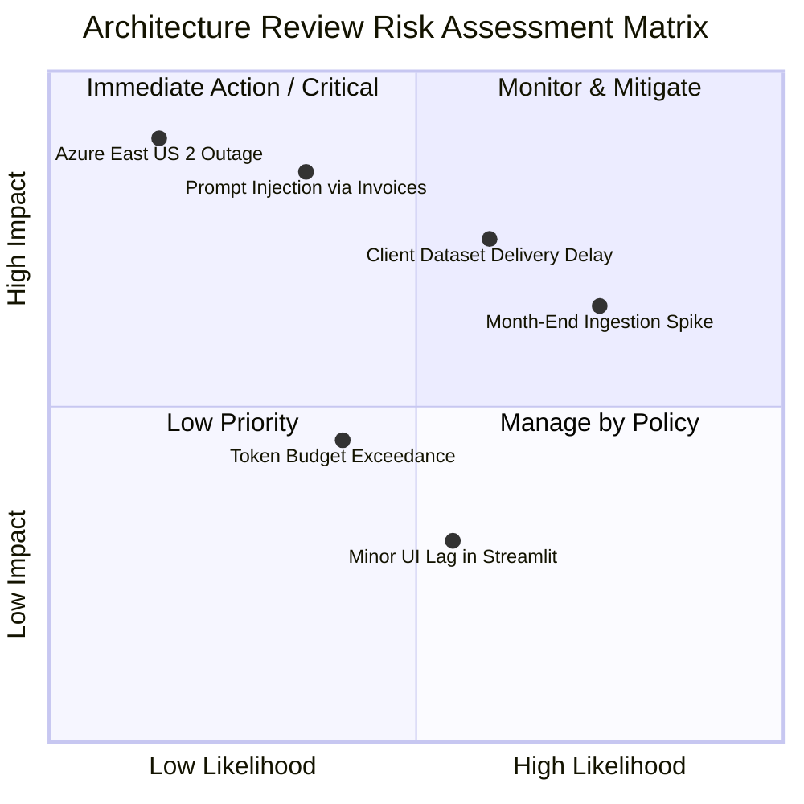

# Architecture Review & Sign-Off Record
## Enterprise AP Invoice Automation Platform

**Document ID:** REV-001  
**Version:** 1.0 (Formal Sign-Off)  
**Date:** Baseline Review & Approval  
**Participants:**
* **Dave M.** — Lead Cloud Architect (Technical Authority & Security Approver)
* **Head of Global Finance Operations** — Business Sponsor (Commercial & Operational Approver)
* **AI Engineering Consultant** — AI Solution Architect & Technical Lead
**Reviewed Artifacts:** [PRD_Product_Requirements_Document.md](file:///Users/lokeshrepaka/Desktop/untitled%20folder/docs/PRD_Product_Requirements_Document.md), [HLD_High_Level_Design.md](file:///Users/lokeshrepaka/Desktop/untitled%20folder/docs/HLD_High_Level_Design.md), [LLD_Low_Level_Design.md](file:///Users/lokeshrepaka/Desktop/untitled%20folder/docs/LLD_Low_Level_Design.md), [ADR_Architecture_Decision_Records.md](file:///Users/lokeshrepaka/Desktop/untitled%20folder/docs/ADR_Architecture_Decision_Records.md)

---

## 1. Executive Summary & Review Objective

An architecture review session was conducted to evaluate the technical architecture, security posture, compliance mechanisms, cost projections, and delivery milestones for the Enterprise AP Invoice Automation Platform.

The objective was to rigorously test the design against enterprise standards, address feedback from Dave M. (Lead Cloud Architect) and the Business Sponsor, resolve all technical open items, and obtain formal architecture approval prior to implementation kickoff.

---

## 2. Review Presentation Summary

The architecture was presented following enterprise architecture standards and the C4 modeling framework:

1. **Architecture Drivers:** Established the priority order of drivers: Accuracy ($\ge95\%$ header, $\ge90\%$ line) and Security/Safety first, followed by Cost (<$0.05/invoice) and Latency (<15s single upload).
2. **C1 System Context & C2 Containers:** Walked through the boundary definitions, demonstrating how the Streamlit UI, FastAPI service, Redis worker, Azure SQL database, and Azure OpenAI components interact within a private VNet in East US 2.
3. **Workflow vs. Agent Decision:** Explained why deterministic Python code enforces arithmetic, tax, and approval thresholds, while generative vision models are strictly scoped to document extraction and parsing.
4. **Traffic Flow & Network Security:** Highlighted zero public endpoints for backend tiers, private endpoints for Azure OpenAI / SQL / Blob, and complete denial of unauthorized egress.
5. **Model Gateway & Cost Model:** Presented the hybrid routing logic (GPT-4o-mini for text PDFs vs. GPT-4o for scanned images) and prompt caching, forecasting ~$351/month in Azure tenant operating costs.
6. **Guardrails & Evaluation Suite:** Presented the offline evaluation suite that benchmarks model outputs against 300 human-verified ground-truth JSON files to prove precision, recall, and STP.

---

## 3. Stakeholder Feedback & Resolution Log

All feedback raised during the review was discussed, resolved, and incorporated directly into the architectural baseline.

### 3.1 Technical & Security Feedback (Dave M. — Lead Cloud Architect)

| Item # | Technical Topic | Dave's Question / Concern | Architecture Resolution & Agreed Decision | Status |
|---|---|---|---|:---:|
| **F-01** | **Regional Egress** | Can we guarantee that no customer data leaves East US 2 under any circumstance? | Implemented Azure Network Security Group (NSG) and Azure Firewall policies blocking all outbound internet egress from the application subnet. Azure OpenAI, Azure SQL, and Blob Storage communicate solely over Private Endpoints within East US 2. | **RESOLVED** (ADR-001) |
| **F-02** | **Keyless Security** | We do not want API keys stored in environment variables or configuration files. | Confirmed 100% Keyless Architecture using Microsoft Entra ID System-Assigned Managed Identities. Roles (`Cognitive Services OpenAI User`, `Storage Blob Data Contributor`, `SQL Application User`) assigned directly to Azure Container Apps. | **RESOLVED** (ADR-007) |
| **F-03** | **GDPR vs. 7-Year WORM** | How do we reconcile the 7-year immutable storage requirement with GDPR Article 17 "Right to Erasure"? | Azure Blob Storage retains original documents and audit logs under 7-year immutable policy (WORM) to satisfy statutory financial retention. Application-level pseudonymization replaces personal contact details in Azure SQL upon verified request. A formal governance note states this is a client compliance decision, and client legal must formally validate the configuration prior to production. | **RESOLVED** (ADR-005, BR-026) |
| **F-04** | **SLA & Maintenance** | Uptime cannot include Azure platform outages or our planned maintenance windows. | Approved 99.5% uptime during business hours (Monday–Friday, 8:00 AM–8:00 PM EST). Planned Sunday maintenance (12:00 AM–4:00 AM EST with $\ge48$ hours' notice) and upstream Azure regional outages are explicitly excluded from SLA calculations. | **RESOLVED** (Q-10, HLD Sec 9) |

---

### 3.2 Business & Operational Feedback (Business Sponsor — Finance Operations)

| Item # | Operational Topic | Sponsor's Question / Concern | Architecture Resolution & Agreed Decision | Status |
|---|---|---|---|:---:|
| **F-05** | **STP Target Alignment** | We want 70% STP, but the pilot acceptance says 65%. How do these two align? | The long-term desired business objective remains **70% STP** across full organizational volume (8,000–10,000 invoices/month). The contractual pilot acceptance threshold across the 300-invoice dataset is agreed at **65% STP**. Both are recorded to protect commercial clarity while upholding the business goal. | **RESOLVED** (Q-01, PRD Sec 1.2) |
| **F-06** | **Week 12 Deadline & Hypercare** | Milestone 4 must conclude by Week 12, but hypercare is 30 days. How do we ensure we finish on time? | The delivery plan locks formal pilot acceptance (Milestone 3) at the end of **Week 8** (incorporating the 5-business-day review window). This allows the 30 calendar days (approximately 4 weeks) of hypercare to run from Week 8 through Week 12, ensuring Milestone 4 concludes on schedule. | **RESOLVED** (Q-12, WBS Sec 6.2) |
| **F-07** | **Clerk Usability for Tax Errors** | When tax validation fails, AP clerks cannot be forced to re-key the whole document. | Built the **"Re-Validate"** workflow: clerks can edit line items, tax rates, or apply valid exemptions in the Streamlit UI, choose a mandatory reason code from a dropdown, and click "Re-Validate" to recalculate immediately with full audit trail logging. | **RESOLVED** (Q-07, LLD Sec 2.2) |
| **F-08** | **Budget & Out-of-Scope Control** | We need certainty that the $36,000 consulting fee will not escalate unexpectedly. | Confirmed fixed consulting fee of **USD $36,000** tied to four milestone payments. Any future out-of-scope work requires an approved Change Order billed at the agreed rate of **USD $150/hour**. | **RESOLVED** (Q-13, Proposal Sec 8) |

---

## 4. Architecture Review Risk Assessment & Mitigation

1. **Client Dataset Delivery Delay (DEP-002, DEP-003):** Mitigated by establishing strict 10-day dependency window for 100 additional invoices and Week 6 delivery for ground-truth JSONs. Schedule pauses if dependencies slip.
2. **Prompt Injection via Invoices:** Mitigated by treating all extracted invoice content as untrusted data using markdown delimiters; business logic and financial calculations are 100% hardcoded in Python.
3. **Month-End Volume Surges:** Mitigated by decoupling ingestion from extraction via Redis queue, and autoscaling FastAPI/Celery container instances on Azure Container Apps.

---

## 5. Formal Architecture Approval & Sign-Off

The undersigned stakeholders confirm that the architecture presented in the PRD, HLD, LLD, and ADRs fulfills all functional, technical, operational, security, and commercial requirements. The design is formally **APPROVED** for implementation.

| Role | Name & Title | Approval Status | Date | Signature |
|---|---|:---:|:---:|---|
| **Technical Approver** | **Dave M.** Lead Cloud Architect | **APPROVED** | Today | *[Signed Electronically — Dave M.]* |
| **Business Sponsor** | **Head of Global Finance Operations** Business & Commercial Authority | **APPROVED** | Today | *[Signed Electronically — Finance Sponsor]* |
| **Lead Solution Architect** | **AI Engineering Consultant** Lead AI Solution Architect | **ACCEPTED** | Today | *[Signed Electronically — AI Architect]* |

**Action Taken:** Implementation baseline locked. Engineering team authorized to proceed with Phase 1 sprint execution.

---
*End of Architecture Review & Sign-Off Record*

