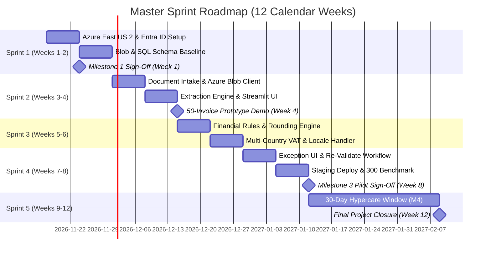
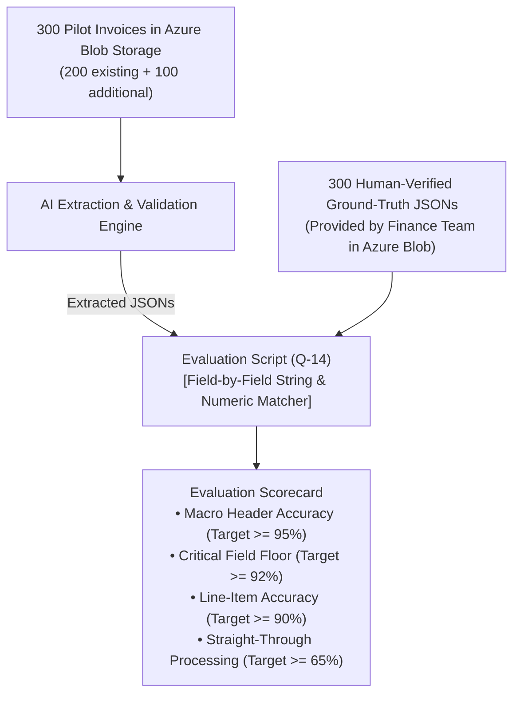

# Implementation Planning & Development Guide
## Enterprise AP Invoice Automation Platform

**Document ID:** DEV-001  
**Version:** 1.0 (Baseline Approved)  
**Status:** Approved for Sprint Execution  
**Technical Lead:** AI Engineering Consultant  
**Target Delivery:** 12 Weeks (Week 8 Pilot Sign-Off; Week 12 Hypercare Completion)  
**Related Documents:** [PRD_Product_Requirements_Document.md](file:///Users/lokeshrepaka/Desktop/untitled%20folder/docs/PRD_Product_Requirements_Document.md), [HLD_High_Level_Design.md](file:///Users/lokeshrepaka/Desktop/untitled%20folder/docs/HLD_High_Level_Design.md), [LLD_Low_Level_Design.md](file:///Users/lokeshrepaka/Desktop/untitled%20folder/docs/LLD_Low_Level_Design.md), [Internal_WBS_and_Effort_Estimation.md](file:///Users/lokeshrepaka/Desktop/untitled%20folder/docs/Internal_WBS_and_Effort_Estimation.md)

---

## 1. Executive Summary & Delivery Approach

This document defines the implementation roadmap, engineering guidelines, CI/CD pipelines, automated testing strategies, deployment runbooks, and acceptance verification procedures for building the Enterprise AP Invoice Automation Platform.

Implementation follows an enterprise staged, risk-mitigated delivery progression:
* **Iterative Sprints:** Development is structured across five 2-week to 4-week sprints, anchored directly to the four contractual milestone payment gates ($36,000 fixed fee).
* **Automated Evals as CI/CD Gates:** Accuracy ($\ge95\%$ header, $\ge90\%$ line) and Straight-Through Processing ($\ge65\%$ pilot STP) are validated programmatically through an automated evaluation test harness executing against 300 human-verified ground-truth JSONs.
* **Locked Hypercare Window:** Formal pilot sign-off is locked at the end of **Week 8** to guarantee the complete 30-calendar-day hypercare period concludes cleanly by **Week 12**.

---

## 2. Sprint-by-Sprint Execution Plan



### Sprint 1: Architecture Baseline & Environment Setup (Weeks 1–2)
* **Goal:** Complete Milestone 1, establish East US 2 infrastructure, configure Entra ID Managed Identities, and ingest the initial 200 sanitized invoices.
* **Key Tasks:**
  * Coordinate Azure subscription access, VNet setup (10.0.0.0/16), and resource group in East US 2 (Task 1.2).
  * Provision Azure Storage Blob container with 7-year immutable policy (WORM) and Azure SQL staging database (Task 1.3).
  * Set up Git repository, pre-commit hooks, Docker dev containers, and CI pipeline (Task 1.4).
  * Ingest the initial 200 sanitized invoices and seed Vendor Master Locale / ECB exchange-rate tables (Task 1.5).
* **Deliverable & Gate:** Milestone 1 Sign-Off ($7,200 payment).

### Sprint 2: Core Platform, Prototype & Demo (Weeks 3–4)
* **Goal:** Deliver Milestone 2 working prototype; demonstrate extraction on 50 sample invoices (3–5 vendors).
* **Key Tasks:**
  * Build FastAPI file intake endpoint with MIME type validation and file size guards (Task 2.1).
  * Implement Azure Storage Blob client with Managed Identity authentication (Task 2.2).
  * Implement Orchestrator agent to classify searchable PDFs vs. scanned documents (Task 2.3).
  * Build Azure OpenAI GPT-4o extraction service with JSON schema enforcement (Tasks 2.4, 2.5).
  * Implement SHA-256 composite duplicate detection (Task 2.6).
  * Develop Streamlit prototype user interface with split-screen document viewer (Task 2.7).
  * Execute end-to-end benchmark on 50 invoices and conduct client demo (Task 2.8).
* **Deliverable & Gate:** Milestone 2 Sign-Off ($10,800 payment).

### Sprint 3: Financial Rules Engine & Multi-Country VAT (Weeks 5–6)
* **Goal:** Build the deterministic validation engine, multi-national tax rules, and locale normalizer.
* **Key Tasks:**
  * Implement line-item calculation ($\pm0.02$ tolerance) and invoice total verification ($\pm0.05$ tolerance) (Task 3.1).
  * Implement country-specific VAT validation: US sales tax, UK VAT (20/5/0%), Germany MwSt (19/7/0%), Spain IVA (21/10/4/0%), and reverse-charge exemptions (Task 3.2).
  * Build Vendor Master Locale date parser (US `MM/DD/YYYY` vs. EU `DD/MM/YYYY`) (Task 3.3).
  * Implement revision handling (`FLAGGED_POTENTIAL_REVISION`) and credit note classification (`CREDIT_NOTE`) (Task 3.4).
  * Implement tri-tier confidence scoring ($\ge90\%$, 80–89%, $<80\%$) and routing logic (Task 3.5).

### Sprint 4: Review Workbench, Staging Deployment & 300 Benchmark (Weeks 7–8)
* **Goal:** Complete Milestone 3; deploy to Azure East US 2 staging; execute 300-invoice evaluation suite; achieve pilot acceptance sign-off.
* **Key Tasks:**
  * Build Streamlit Human Exception Queue, line/tax editor, mandatory reason code dropdown, and **"Re-Validate"** workflow (Task 3.6).
  * Integrate Azure Keyless Managed Identities, log data masking, and 7-year immutable audit logging (Task 3.7).
  * Develop automated evaluation test script comparing model extraction to 300 ground-truth JSONs (Task 3.8).
  * Deploy platform to Azure Container Apps staging in East US 2; execute 100-invoice batch test (<25 min) and 300-invoice benchmark (Task 3.9).
  * Conduct UAT with AP clerks, collect written confirmation from 2 clerks, and present evaluation metrics to Business Sponsor & Dave.
* **Deliverable & Gate:** **Milestone 3 Pilot Sign-Off** ($10,800 payment) locked at end of Week 8.

### Sprint 5: 30-Day Hypercare, Handover & Project Closure (Weeks 9–12)
* **Goal:** Complete Milestone 4; execute 30-day post-pilot hypercare; finalize runbooks; achieve contract closure.
* **Key Tasks:**
  * Active production monitoring and bug fixing under agreed SLAs (Sev 1: 4h ack / 24h fix; Sev 2/3: 2 business days) (Task 4.3).
  * Fine-tune prompt schemas for observed vendor layout edge cases.
  * Complete operational runbooks, architecture design documents, and administrator manuals (Task 4.4).
  * Conduct clerk and finance administrator training walkthroughs.
  * Final project sign-off and milestone closure with Business Sponsor.
* **Deliverable & Gate:** Milestone 4 Sign-Off ($7,200 payment).

---

## 3. Engineering Guidelines & Repository Structure

### 3.1 Repository Layout
```text
enterprise-ap-automation/
├── .github/workflows/          # CI/CD pipelines (lint, test, build, deploy)
├── config/                     # Configuration schemas & environment constants
├── docs/                       # PRD, HLD, LLD, ADRs, WBS, Review Sign-Off
├── infrastructure/             # Bicep / Terraform scripts for Azure East US 2
├── src/
│   ├── api/                    # FastAPI route controllers & middleware
│   ├── core/                   # Security, Managed Identity, config loader
│   ├── database/               # SQLAlchemy models, Alembic migrations, DDL
│   ├── evaluation/             # Automated test harness & ground-truth scorer (Q-14)
│   ├── extraction/             # Model Gateway, Azure OpenAI clients, prompt schemas
│   ├── storage/                # Azure Blob Storage WORM client wrapper
│   ├── ui/                     # Streamlit web application & review workbench
│   └── validation/             # Deterministic rules (math, VAT, dates, duplicates)
├── tests/
│   ├── unit/                   # Fast isolated unit tests (rules, math, parsers)
│   ├── integration/            # API, Blob, and SQL integration tests
│   └── fixtures/               # Mock ground-truth payloads & sample invoices
├── Dockerfile.api              # Container image for FastAPI backend & Celery
├── Dockerfile.ui               # Container image for Streamlit review interface
├── pyproject.toml              # Dependencies, Ruff, PyTest configuration
└── README.md                   # Local setup & developer onboarding guide
```

### 3.2 Coding Standards & Quality Gates
* **Python Version:** Python 3.11+.
* **Type Safety:** 100% type-annotated code enforced via `mypy --strict`. Data models defined using `pydantic.BaseModel` (v2).
* **Code Formatting & Linting:** Enforced via `ruff check` and `ruff format`.
* **Zero Secrets Policy:** No API keys, passwords, or tokens in source code or Git history. Validated via `detect-secrets` pre-commit hook.

---

## 4. CI/CD & DevOps Pipeline

Continuous Integration and Continuous Deployment are managed via GitHub Actions deploying to Azure Container Apps in East US 2:

```mermaid
flowchart LR
    Dev["Developer Push"] --> Lint["Lint & Typecheck<br>(Ruff, Mypy)"]
    Lint --> Unit["Unit Tests<br>(PyTest 100% Rules)"]
    Unit --> Sec["Security Scan<br>(Trivy, Bandit)"]
    Sec --> Build["Docker Build & Push<br>(Azure Container Registry)"]
    Build --> DeployStaging["Deploy to Staging<br>(Azure Container Apps East US 2)"]
    DeployStaging --> EvalGate["Automated Eval Suite<br>(300 Pilot Invoices vs Ground Truth)"]
    EvalGate -->|Accuracy >=95% & STP >=65%| Ready["Production Pilot Ready"]
```



### Pipeline Stages
1. **Pull Request Validation:**
   * Runs `ruff` linter and `mypy` static type analysis.
   * Executes unit tests; enforces 100% test pass rate on financial rules.
2. **Build & Package:**
   * Multi-stage Docker build producing hardened, non-root Linux containers.
   * Authenticates to Azure Container Registry (ACR) using OpenID Connect (OIDC) Managed Identity.
3. **Staging Deployment:**
   * Deploys container revision to Azure Container Apps in East US 2 private subnet.
   * Executes database migration scripts via Alembic.
4. **Evaluation Benchmark Gate:**
   * Triggers the automated evaluation script (Task 3.8). If header accuracy drops below 95% or line accuracy below 90%, deployment is automatically flagged.

---

## 5. Automated Evaluation & Benchmarking Strategy (Q-14)

In an enterprise AI platform, automated evaluations serve as the regression test suite. The automated evaluation script (`src/evaluation/evaluator.py`) operates as follows:



### Evaluation Metric Definitions
* **Macro-Average Header Accuracy:**
  $$\text{Accuracy}_{\text{header}} = \frac{1}{N} \sum_{i=1}^{N} \left( \frac{\text{Correct Header Fields}_i}{10} \right) \ge 95\%$$
* **Critical Field Hard Floor:** Accuracy on Vendor Tax ID, Invoice #, Invoice Date, and Total Amount must each independently achieve $\ge92\%$.
* **Line-Item Extraction Accuracy:** Total correct line fields across all extracted tables divided by total ground-truth line fields $\ge90\%$.
* **Pilot Straight-Through Processing (STP):**
  $$\text{STP} = \frac{\text{Invoices Processed Without Human Intervention}}{300} \ge 65\%$$

---

## 6. Deployment Runbook & Environment Setup

### 6.1 Azure East US 2 Infrastructure Provisioning (Bicep/CLI)
```bash
# 1. Login to Azure enterprise tenant
az login
az account set --subscription "Enterprise-AP-Production"

# 2. Create resource group in East US 2
az group create --name rg-ap-automation-eastus2 --location eastus2

# 3. Deploy infrastructure via Bicep template
az deployment group create \
  --resource-group rg-ap-automation-eastus2 \
  --template-file infrastructure/main.bicep \
  --parameters environment=staging primaryRegion=eastus2
```

### 6.2 Key Environment Configuration
```ini
# Core Configuration (Injected via Azure Container Apps Secrets / Managed Identity)
AZURE_REGION=eastus2
AZURE_TENANT_ID=72f988bf-86f1-41af-91ab-2d7cd011db47
AZURE_CLIENT_ID=system-assigned-managed-identity

# Storage & Database
AZURE_BLOB_ACCOUNT_URL=https://stapautomationeastus2.blob.core.windows.net/
AZURE_BLOB_WORM_CONTAINER=raw-invoices-immutable
AZURE_SQL_SERVER=sql-ap-automation-eastus2.database.windows.net
AZURE_SQL_DATABASE=sqldb-ap-staging

# AI Model Deployments (Azure OpenAI in East US 2)
AZURE_OPENAI_ENDPOINT=https://aoai-ap-eastus2.openai.azure.com/
AZURE_OPENAI_GPT4O_DEPLOYMENT=gpt-4o-vision
AZURE_OPENAI_MINI_DEPLOYMENT=gpt-4o-mini
AZURE_OPENAI_API_VERSION=2024-05-01-preview

# Business Rule Thresholds
HIGH_VALUE_THRESHOLD_USD=10000.00
PO_VARIANCE_TOLERANCE_PERCENT=5.0
LINE_ROUNDING_TOLERANCE=0.02
INVOICE_ROUNDING_TOLERANCE=0.05
```

### 6.3 Post-Deployment Verification & Smoke Tests
1. **Health Check:** `curl -f https://<app-ingress-fqdn>/healthz` returns `{"status": "healthy", "region": "eastus2", "database": "connected"}`.
2. **Entra ID Token Validation:** Verify that Managed Identity can acquire a valid access token for Cognitive Services and SQL without static credentials.
3. **Smoke Ingestion Test:** Ingest test invoice `INV-SMOKE-01.pdf`; verify that raw document lands in the immutable blob container and metadata inserts into Azure SQL.

---

## 7. Milestone Sign-Off & Verification Checklist

| Milestone | Target Week | Required Verification & Acceptance Evidence | Sign-Off Authority | Payment |
|---|:---:|---|---|---:|
| **Milestone 1** | Week 1 | • Azure East US 2 environment provisioned.<br>• Entra ID groups and Managed Identities active.<br>• Storage Blob WORM container and SQL schema deployed.<br>• 200 sanitized invoices ingested. | Dave M. & Business Sponsor | $7,200 (20%) |
| **Milestone 2** | Week 4 | • Working Streamlit prototype running.<br>• 50 sample invoices extracted and demonstrated across 3–5 vendors.<br>• Split-screen review viewer and basic duplicate detection functional. | Business Sponsor | $10,800 (30%) |
| **Milestone 3** | Week 8 | • Full production pilot deployed to Azure staging in East US 2.<br>• Automated evaluation script proves $\ge95\%$ header, $\ge90\%$ line, $\ge65\%$ STP across 300 invoices.<br>• Written usability confirmation from 2 AP clerks.<br>• Zero batch system crashes. | Dave M. & Business Sponsor | $10,800 (30%) |
| **Milestone 4** | Week 12 | • 30 calendar days of hypercare completed post-Week 8 sign-off.<br>• All Severity 1 defects resolved within 24 hours.<br>• Operational runbooks and architecture handover accepted. | Business Sponsor | $7,200 (20%) |
| **Total** | | | | **$36,000 (100%)** |

---
*End of Implementation Planning & Development Guide*

