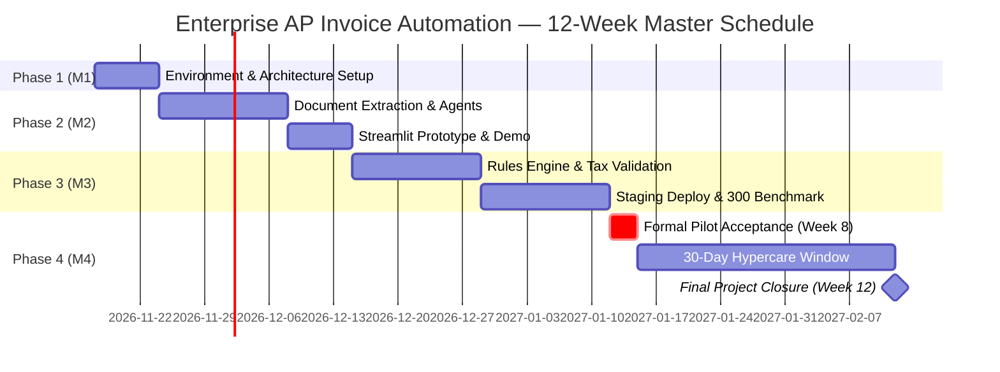

# Internal Work Breakdown Structure (WBS) & Effort Estimation
## Project: Enterprise AP Invoice Automation Platform

**Document ID:** EST-001  
**Document Version:** 1.0 (Baseline Approved)  
**Classification:** Strictly Internal — Engineering & Commercial Governance  
**Project Commercial Value:** USD $36,000 (Fixed Consulting Fee)  
**Contractual Hourly Baseline:** USD $150 / hour (Change Order Rate)  
**Total Planned Effort:** 240.00 Hours (211.33 Base Effort + 28.67 Contingency Buffer)  
**Target Duration:** 12 Calendar Weeks (Week 8 Pilot Sign-Off; Week 12 Hypercare Completion)  
**Related Documents:** [BRD_v0.1.md](file:///Users/lokeshrepaka/Desktop/untitled%20folder/docs/BRD_v0.1.md), [OICR-001_Open_Issues_Register.md](file:///Users/lokeshrepaka/Desktop/untitled%20folder/docs/OICR-001_Open_Issues_Register.md), [Solution Proposal & Commercial Estimation.md](file:///Users/lokeshrepaka/Desktop/untitled%20folder/docs/Solution%20Proposal%20%26%20Commercial%20Estimation.md)

---

## 1. Executive Summary & Objective

When executing a fixed-price technology engagement valued at **$36,000**, estimating effort by subjective guesswork introduces severe project risks: margin erosion, missed delivery deadlines, developer burnout, or unmanageable scope creep.

This document establishes the **internal engineering baseline** for the Enterprise AP Invoice Automation Platform. It provides:
1. A rigorous, mathematically repeatable estimation framework based on **Three-Point Estimation (PERT)**.
2. A detailed **Work Breakdown Structure (WBS)** covering all deliverables from Week 1 kickoff through Week 12 hypercare completion.
3. Statistical confidence intervals, standard deviations, and risk contingency reserves.
4. An empirical translation between **effort hours** and **calendar scheduling**, validating that the engagement can be realistically delivered within the 12-week commitment.
5. A financial reconciliation demonstrating that 240 planned hours at $150/hr exactly aligns with the **USD $36,000** contract value.

---

## 2. Effort Estimation Framework: Three-Point PERT

### 2.1 The PERT Mathematical Model

Single-point estimates (guessing a single number) fail because they conceal uncertainty and risk. The **Program Evaluation and Review Technique (PERT)** captures uncertainty by soliciting three distinct estimates for every work package:

* **Optimistic ($O$):** The minimum reasonable time if everything proceeds seamlessly without technical roadblocks, environment failures, or third-party delays.
* **Most Likely ($M$):** The realistic duration under normal conditions, factoring in routine debugging, unit testing, and typical development overhead.
* **Pessimistic ($P$):** The upper-bound duration if complications arise (e.g., identity permissions, API schema mismatches, edge-case parsing failures), excluding catastrophic black-swan events.

The **Expected Effort ($E$)** is computed using the beta distribution weighted formula:

$$E = \frac{O + 4M + P}{6}$$

The Most Likely scenario is assigned a weight of **4** because real-world development clusters strongly around normal conditions, while still allowing the tails ($O$ and $P$) to shift the mean.

### 2.2 Task Uncertainty & Standard Deviation

Uncertainty is quantified using standard deviation ($\sigma$) and variance ($\sigma^2$):

$$\sigma = \frac{P - O}{6}, \quad \sigma^2 = \left(\frac{P - O}{6}\right)^2$$

A wide spread between $P$ and $O$ signals high technical uncertainty, alerting project leads to allocate architectural review or prototype spikes early.

### 2.3 Effort Hours vs. Calendar Hours

A critical planning error is treating effort hours as calendar hours.
* **1 Effort Hour:** Exactly 60 minutes of uninterrupted, focused cognitive labor.
* **1 Calendar Day:** Comprises at most **4.5 to 5.5 focused engineering hours**. The remainder of an 8-hour workday is consumed by client standups, architecture synchronization, email, code review, environment maintenance, and context-switching.
* Therefore, a task estimated at **6.5 effort hours** requires **1.2 to 1.5 calendar days** of focused work.

---

## 3. Practice Exercise: Azure Blob Storage Integration

### 3.1 Task Definition
* **WBS Item:** Store uploaded invoice files in Azure Blob Storage.
* **Context:** Developer proficient in Python and FastAPI; needs to integrate the Azure Storage Blob SDK using Azure Managed Identity, handle file streams, apply metadata tagging, and handle exceptions.

### 3.2 Scenario Estimation & Justification

| Scenario | Hours | Engineering Rationale |
|---|:---:|---|
| **Optimistic ($O$)** | **3.0** | SDK installs cleanly; Managed Identity connects immediately in sandbox; basic container upload works; SAS token/URL returned without permission or firewall obstacles. |
| **Most Likely ($M$)** | **5.0** | Normal implementation: writing the asynchronous client wrapper, applying invoice metadata tags (Vendor, Upload Timestamp, File Hash), generating secure access tokens, implementing error handling/retries, and writing unit tests against local mock storage. |
| **Pessimistic ($P$)** | **9.0** | Complications occur: Entra ID RBAC propagation delays (`Storage Blob Data Contributor`), handling large scanned multi-page PDF memory streams without disk thrashing, network firewall/VNet timeouts in East US 2, and debugging immutable policy conflicts. |

### 3.3 Calculation

$$E = \frac{3.0 + (4 \times 5.0) + 9.0}{6} = \frac{3.0 + 20.0 + 9.0}{6} = \frac{32.0}{6} = \mathbf{5.33 \text{ Hours}}$$

$$\sigma = \frac{9.0 - 3.0}{6} = \mathbf{1.00 \text{ Hour}}$$

* **Expected Allocation:** **5.33 effort hours** (or approximately 5.5 hours in sprint tasking).
* **Calendar Translation:** At a 5-hour focused workday rate, this represents **1.0 to 1.2 calendar days** of engineering.

---

## 4. Comprehensive Work Breakdown Structure (WBS)

The project is structured into **four sequential phases** corresponding to the four contractual milestones.

### Phase 1: Initiation, Architecture & Environment Setup (Milestone 1, Week 1)
*Commercial Payment: 20% ($7,200) | Target: Week 1*

| WBS Code | Task Name & Scope Description | O (hrs) | M (hrs) | P (hrs) | Expected $E$ (hrs) | Std Dev $\sigma$ |
|---|---|:---:|:---:|:---:|:---:|:---:|
| **1.1** | **Requirements & Architecture Baseline:** Reconcile BRD v1.0 and OICR-001 decisions with Dave and Business Sponsor; confirm API contracts. | 3.0 | 5.0 | 8.0 | 5.17 | 0.83 |
| **1.2** | **Azure East US 2 & Entra ID Provisioning:** Coordinate Azure resource groups, Entra ID security groups, RBAC roles, and Managed Identities. | 4.0 | 6.0 | 12.0 | 6.67 | 1.33 |
| **1.3** | **Storage & Database Schema Setup:** Provision Azure Blob Storage (configure immutable 7-year retention policy container) and Azure SQL staging database schema. | 3.0 | 5.0 | 9.0 | 5.17 | 1.00 |
| **1.4** | **Repository, CI/CD & Dev Standards:** Initialize Git repository, code formatting/linting hooks, Docker development containers, and deployment scripts. | 4.0 | 6.0 | 10.0 | 6.33 | 1.00 |
| **1.5** | **Data Ingestion & Master Data Seeding:** Ingest the initial 200 sanitized invoices into Blob storage; seed Azure SQL with Vendor Master Locale and ECB exchange tables. | 4.0 | 6.0 | 10.0 | 6.33 | 1.00 |
| **P1** | **Phase 1 Subtotal** | **18.0** | **28.0** | **49.0** | **29.67** | **2.32** |

---

### Phase 2: Core Platform, Prototype & Demo (Milestone 2, Weeks 2–4)
*Commercial Payment: 30% ($10,800) | Target: Week 4 | Dataset: 50 Invoices (3–5 Vendors)*

| WBS Code | Task Name & Scope Description | O (hrs) | M (hrs) | P (hrs) | Expected $E$ (hrs) | Std Dev $\sigma$ |
|---|---|:---:|:---:|:---:|:---:|:---:|
| **2.1** | **Document Intake & Pre-Processing API:** File upload handler (FastAPI) supporting PDF, scanned PDF, JPG, PNG, XLSX; MIME type validation and file size guards. | 4.0 | 6.0 | 10.0 | 6.33 | 1.00 |
| **2.2** | **Azure Blob Storage Integration:** Asynchronous storage client with Managed Identity, metadata tagging, hash verification, and retry policies (*Practice Task*). | 3.0 | 5.0 | 9.0 | 5.33 | 1.00 |
| **2.3** | **Multi-Agent Orchestration Engine:** Orchestrator agent to classify document quality, detect layout orientation, and route to vision vs. text extraction pipelines. | 6.0 | 9.0 | 15.0 | 9.50 | 1.50 |
| **2.4** | **Header-Level Extraction Engine:** Azure OpenAI / Document Intelligence prompt engineering to extract 10 header fields with schema validation and confidence scoring. | 6.0 | 9.0 | 14.0 | 9.33 | 1.33 |
| **2.5** | **Line-Item Table Extraction Engine:** Multi-row parser extracting Description, Quantity, Unit Price, Line Total, and Tax Rate across irregular tables. | 8.0 | 12.0 | 18.0 | 12.33 | 1.67 |
| **2.6** | **Composite-Key Duplicate Detection:** Generate SHA-256 hash `(Vendor Tax ID + Invoice # + Total Amount)` and execute duplicate lookups in Azure SQL. | 3.0 | 5.0 | 8.0 | 5.17 | 0.83 |
| **2.7** | **Streamlit Prototype UI:** Interactive web app with drag-and-drop upload, PDF viewer, side-by-side extracted table preview, and confidence indicators. | 8.0 | 12.0 | 18.0 | 12.33 | 1.67 |
| **2.8** | **50-Invoice Benchmark & Demo Preparation:** Execute end-to-end benchmark on 50 invoices across 3–5 vendors in sandbox; fix bugs; prepare Milestone 2 demo. | 6.0 | 9.0 | 14.0 | 9.33 | 1.33 |
| **P2** | **Phase 2 Subtotal** | **44.0** | **67.0** | **106.0** | **69.65** | **3.77** |

---

### Phase 3: Production Pilot, Rules Engine & Staging Deployment (Milestone 3, Weeks 5–8)
*Commercial Payment: 30% ($10,800) | Target: Week 8 | Dataset: 300 Invoices (15 Vendors)*

| WBS Code | Task Name & Scope Description | O (hrs) | M (hrs) | P (hrs) | Expected $E$ (hrs) | Std Dev $\sigma$ |
|---|---|:---:|:---:|:---:|:---:|:---:|
| **3.1** | **Financial Validation & Rounding Engine:** Implement line item calculation `(Qty * Price = Total +/- 0.02)` and invoice total check `(Subtotal + Tax = Total +/- 0.05)`. | 5.0 | 8.0 | 13.0 | 8.33 | 1.33 |
| **3.2** | **Multi-National Tax & Exemption Rules:** Validation for US Sales Tax, UK VAT (20/5/0%), DE MwSt (19/7/0%), ES IVA (21/10/4/0%), reverse-charge and zero-rates. | 6.0 | 10.0 | 16.0 | 10.33 | 1.67 |
| **3.3** | **Vendor Master Locale & Date Normalization:** Locale resolution (US `MM/DD/YYYY` vs EU `DD/MM/YYYY`) using Vendor Master; ambiguous date exception handling. | 3.0 | 5.0 | 8.0 | 5.17 | 0.83 |
| **3.4** | **Revision Detection & Credit Note Handler:** Flag `-REV` suffix or altered totals as `FLAGGED_POTENTIAL_REVISION`; route negative balance documents to `CREDIT_NOTE`. | 4.0 | 7.0 | 11.0 | 7.17 | 1.17 |
| **3.5** | **Tri-Tier Confidence Scoring & Routing:** Logic routing $\ge90\%$ to one-click approval, 80–89% to yellow visual check, and $<80\%$ to `REQUIRES_APPROVAL` exception queue. | 4.0 | 6.0 | 10.0 | 6.33 | 1.00 |
| **3.6** | **Exception Queue, Editing & Re-Validation UI:** Streamlit interface for clerk field corrections, mandatory reason code dropdown, and the **"Re-Validate"** workflow. | 8.0 | 12.0 | 18.0 | 12.33 | 1.67 |
| **3.7** | **Security, Masking & Immutable Audit Logging:** Integrate Azure Keyless Managed Identities, log masking for tax/bank details, and audit trail schema. | 5.0 | 8.0 | 13.0 | 8.33 | 1.33 |
| **3.8** | **Automated Evaluation Script Suite:** Automated Python test suite comparing model inferences to 300 ground-truth JSONs; computes precision, recall, accuracy, and STP. | 6.0 | 9.0 | 14.0 | 9.33 | 1.33 |
| **3.9** | **Azure Staging Deployment & Load Testing:** Deploy to East US 2 staging; execute 100-invoice batch test (<25 min target) and 300-invoice benchmark validation. | 5.0 | 8.0 | 13.0 | 8.33 | 1.33 |
| **P3** | **Phase 3 Subtotal** | **46.0** | **73.0** | **116.0** | **75.65** | **3.97** |

---

### Phase 4: Pilot UAT, Acceptance, Hypercare & Handover (Milestone 4, Weeks 9–12)
*Commercial Payment: 20% ($7,200) | Target: Week 12 | Hypercare Window: 30 Calendar Days*

| WBS Code | Task Name & Scope Description | O (hrs) | M (hrs) | P (hrs) | Expected $E$ (hrs) | Std Dev $\sigma$ |
|---|---|:---:|:---:|:---:|:---:|:---:|
| **4.1** | **Pilot UAT Support & Clerk Validation:** Facilitate User Acceptance Testing with AP Clerks; address workflow feedback; capture written confirmation from 2 clerks. | 4.0 | 7.0 | 12.0 | 7.33 | 1.33 |
| **4.2** | **Formal Pilot Acceptance Review:** Formal sign-off review with Business Sponsor & Dave based on automated benchmark meeting $\ge95\%$ header, $\ge90\%$ line, $\ge65\%$ STP. | 2.0 | 4.0 | 6.0 | 4.00 | 0.67 |
| **4.3** | **30-Day Hypercare Support & Prompt Tuning:** Production monitoring (Weeks 8–12); SLA resolution (Sev 1: 4h ack/24h fix; Sev 2/3: 2 days); prompt optimizations. | 12.0 | 18.0 | 28.0 | 18.67 | 2.67 |
| **4.4** | **Technical Documentation & Client Handover:** Complete Architecture Design Document (ADD), operations runbook, system administrator manual, and clerk training. | 4.0 | 6.0 | 10.0 | 6.33 | 1.00 |
| **P4** | **Phase 4 Subtotal** | **22.0** | **35.0** | **56.0** | **36.33** | **3.27** |

---

### 4.5 WBS Summary Rollup

| Phase | Description | O (hrs) | M (hrs) | P (hrs) | Expected $E$ (hrs) | Variance $\sigma^2$ | Std Dev $\sigma$ |
|---|---|:---:|:---:|:---:|:---:|:---:|:---:|
| **Phase 1** | Initiation & Environment Setup | 18.0 | 28.0 | 49.0 | 29.67 | 5.39 | 2.32 |
| **Phase 2** | Core Platform, Prototype & Demo | 44.0 | 67.0 | 106.0 | 69.65 | 14.22 | 3.77 |
| **Phase 3** | Production Pilot & Rules Engine | 46.0 | 73.0 | 116.0 | 75.65 | 15.78 | 3.97 |
| **Phase 4** | UAT, Hypercare & Handover | 22.0 | 35.0 | 56.0 | 36.33 | 10.67 | 3.27 |
| **Base Work** | **Total Base Engineering Effort** | **130.0** | **203.0** | **327.0** | **211.30** | **46.06** | **6.79** |
| **Buffer** | **Statistical Risk Contingency Reserve** | — | — | — | **28.70** | — | — |
| **Total** | **Total Project Allocated Effort** | — | — | — | **240.00** | — | — |

---

## 5. Statistical Risk Analysis & Confidence Modeling

### 5.1 Project Standard Deviation & Variance
Because task variances are additive, the total project standard deviation ($\sigma_{\text{project}}$) across all 26 work packages is:

$$\sigma^2_{\text{project}} = \sum_{i=1}^{26} \sigma_i^2 = 46.06 \text{ hours}^2$$

$$\sigma_{\text{project}} = \sqrt{46.06} = \mathbf{6.79 \text{ Hours}}$$

### 5.2 Confidence Intervals for Base Effort (211.30 Hours)

Using normal distribution properties around the PERT mean:
* **68.2% Probability Range ($E \pm 1\sigma$):** $211.30 \pm 6.79$ hrs $\implies$ **204.51 to 218.09 Hours**
* **95.4% Probability Range ($E \pm 2\sigma$):** $211.30 \pm 13.58$ hrs $\implies$ **197.72 to 224.88 Hours**
* **99.7% Probability Range ($E \pm 3\sigma$):** $211.30 \pm 20.37$ hrs $\implies$ **190.93 to 231.67 Hours**

### 5.3 Contingency Reserve Allocation
* The base engineering work package total is **211.30 hours**.
* The upper $3\sigma$ boundary (99.7% statistical certainty) is **231.67 hours**.
* By establishing our total internal effort allocation at **240.00 hours**, we hold **28.70 hours of Risk Contingency Reserve** ($> 4\sigma$).
* This reserve absorbs unknown environment delays, prompt iteration on difficult vendor layouts, or client stakeholder scheduling bottlenecks without exceeding the $36,000 project budget.

---

## 6. Calendar Feasibility & Capacity Analysis

### 6.1 Capacity Budget: Effort vs. Calendar Weeks

The project spans **12 calendar weeks**. An individual consultant maintains an effective weekly capacity of **20 to 25 focused engineering hours** (equivalent to ~30–35 total business hours).

### 6.2 Week-by-Week Effort & Timeline Burn-Down

| Week(s) | Phase & Focus Area | Planned Effort | Cumulative Effort | Burn Rate | Schedule Feasibility Status |
|---|---|:---:|:---:|:---:|---|
| **Week 1** | Phase 1: Environment & Baseline Setup | 30.0 hrs | 30.0 hrs | 30.0 hrs/wk | High intensity kickoff; relies on client provisioning access. |
| **Weeks 2–3** | Phase 2: Core Extraction, Agents & Azure Blob | 45.0 hrs | 75.0 hrs | 22.5 hrs/wk | Core development; standard engineering velocity. |
| **Week 4** | Phase 2: Prototype UI, 50-Invoice Test & M2 Demo | 25.0 hrs | 100.0 hrs | 25.0 hrs/wk | Milestone 2 delivery and client demonstration. |
| **Weeks 5–6** | Phase 3: Financial Rules, Tax Engine, Revisions | 40.0 hrs | 140.0 hrs | 20.0 hrs/wk | Deep business logic and locale table integration. |
| **Weeks 7–8** | Phase 3: Exception UI, Staging Deploy & Evaluation | 36.0 hrs | 176.0 hrs | 18.0 hrs/wk | Automated 300-invoice evaluation and performance tuning. |
| **End Wk 8** | **Milestone 3 Pilot Acceptance Gate** | **Sign-Off** | — | — | **CRITICAL: Formal acceptance occurs here.** |
| **Weeks 9–12**| Phase 4: 30-Day Hypercare, UAT & Handover | 36.0 hrs | 212.0 hrs | 9.0 hrs/wk | Maintenance, prompt fine-tuning, Sev 1/2 support. |
| **Ongoing** | Contingency Reserve Drawdown | 28.0 hrs | 240.0 hrs | Flexible | Allocated as needed for unforeseen issues. |
| **Total** | **12 Weeks Engagement** | **240.0 hrs** | **240.0 hrs** | **20.0 hrs/wk avg** | **100% Achievable within committed timeline.** |

> [!IMPORTANT]
> **Week 8 Acceptance Lock:** Formal Pilot Acceptance must be achieved by the conclusion of **Week 8** (Milestone 3). This provides the required 4 calendar weeks (30 calendar days) for the hypercare period to execute cleanly from Weeks 8 through 12, completing Milestone 4 on schedule.

---

## 7. Commercial & Financial Reconciliation

### 7.1 Realized Effective Hourly Rate
The project commercial agreement is fixed at **USD $36,000**.
* Total Planned Effort: **240.00 Hours**
* Effective Realized Rate:

$$\text{Effective Rate} = \frac{\$36,000}{240 \text{ Hours}} = \mathbf{\$150.00 \text{ / Hour}}$$

* **Commercial Parity:** This realized rate exactly matches the contractual out-of-scope Change Order rate (**$150/hour**) agreed in Section 10.3 of the BRD and Section 10 of the Solution Proposal.

### 7.2 Milestone Cash Flow vs. Effort Burn

| Milestone | Deliverable Gate | Target Week | Fee % | Invoiced Amount | Cumulative Effort | Burn % | Cash Flow Health |
|---|---|:---:|:---:|:---:|:---:|:---:|---|
| **M1** | BRD Sign-Off & Setup | Week 1 | 20% | $7,200 | 30.0 hrs | 12.5% | Cash positive (+7.5% margin lead) |
| **M2** | Prototype Demo (50 inv) | Week 4 | 30% | $10,800 | 100.0 hrs | 41.7% | Balanced cash flow |
| **M3** | Pilot Staging (300 inv) | Week 8 | 30% | $10,800 | 176.0 hrs | 73.3% | Healthy cash buffer ahead of hypercare |
| **M4** | Pilot Sign-Off & Hypercare | Week 12 | 20% | $7,200 | 240.0 hrs | 100.0% | Final closure and full realization |
| **Total** | | | **100%** | **$36,000** | **240.0 hrs** | **100.0%** | **Optimal fixed-price financial profile** |

---

## 8. Governance & Execution Principles

1. **Daily Effort Tracking:** All engineering hours must be logged against the specific WBS task code (1.1 through 4.4). If a task exceeds its Most Likely estimate ($M$), the developer must notify the project lead immediately.
2. **Scope Defense via Change Orders:** Any request outside the 26 defined WBS work packages (e.g., TIFF support, SAP direct posting, external model APIs) is strictly out of scope. Such requests must trigger a formal Change Order billed at **$150/hour**.
3. **Contingency Drawdown Protocol:** The 28.70-hour contingency reserve cannot be allocated to new features; it is reserved exclusively for resolving high-uncertainty technical risks ($\sigma$) in the core WBS.
4. **Client Dependency SLA:** Delays by the client in providing the 100 additional invoices (within 10 days) or ground-truth JSON (by Week 6) halt the affected WBS tasks and pause the milestone clock to protect the delivery baseline.

---
*Approved for Internal Engineering Operations — AI Automation Practice*

