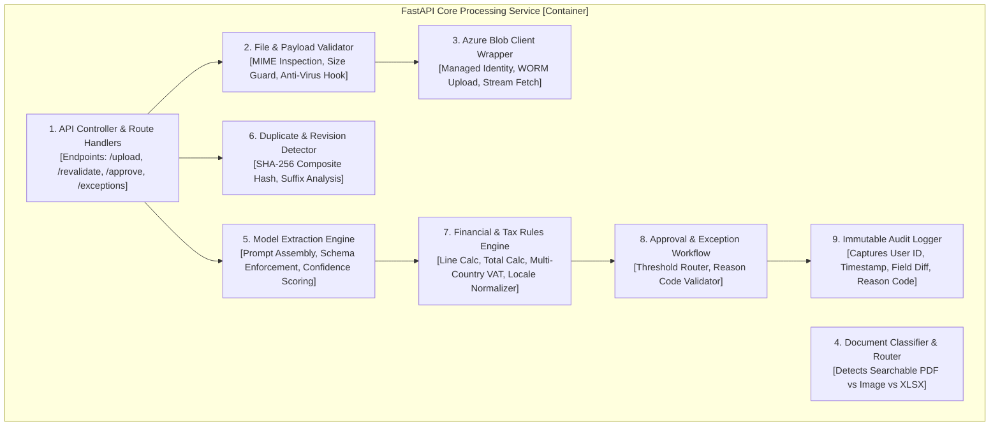
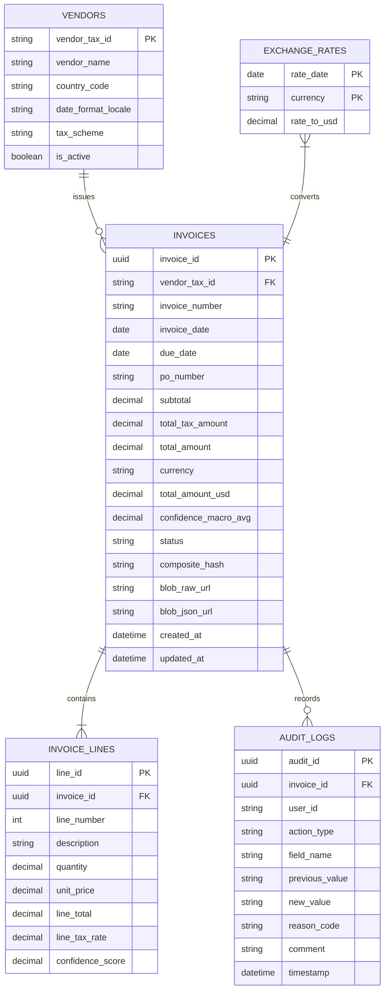
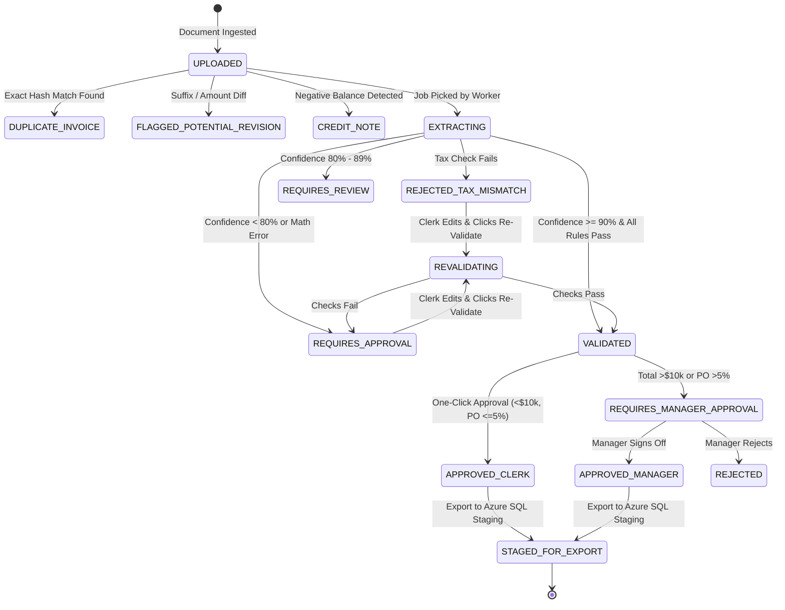
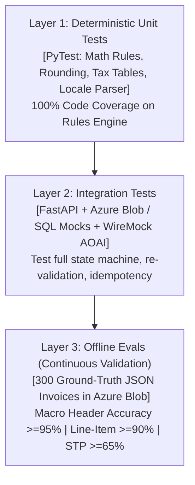

# Low-Level Architecture Design (LLD)
## Enterprise AP Invoice Automation Platform

**Document ID:** LLD-001  
**Version:** 1.0 (Baseline Approved)  
**Status:** Approved for Implementation  
**Author:** AI Engineering Consultant / Tech Lead  
**Audience:** Developers, Testers, Code Reviewers, DevOps Engineers  
**Target Environment:** Azure East US 2 (Python 3.11, FastAPI, Streamlit, Azure SQL)  
**Related Documents:** [HLD_High_Level_Design.md](file:///Users/lokeshrepaka/Desktop/untitled%20folder/docs/HLD_High_Level_Design.md), [PRD_Product_Requirements_Document.md](file:///Users/lokeshrepaka/Desktop/untitled%20folder/docs/PRD_Product_Requirements_Document.md)

---

## 1. Component Architecture (C3 Diagram)

The C3 Component diagram (based on the C4 model) details the internal components of the FastAPI Core Processing Service container:



Every component has a single, well-defined responsibility and can be unit-tested in isolation using mock fixtures.

---

## 2. API Specifications & Contracts

The platform exposes an internal OpenAPI/REST interface conforming strictly to JSON:API standards.

### 2.1 Endpoint Summary

| Method | Endpoint Path | Role / RBAC | Purpose |
|---|---|---|---|
| `POST` | `/api/v1/invoices/upload` | AP Clerk, Admin | Multipart file upload and asynchronous job creation. |
| `GET` | `/api/v1/invoices/{id}` | AP Clerk, Manager | Retrieve invoice details, extracted fields, and validation status. |
| `POST` | `/api/v1/invoices/{id}/revalidate` | AP Clerk | Submit corrected field values with mandatory reason code to trigger re-validation. |
| `POST` | `/api/v1/invoices/{id}/approve` | AP Clerk, Manager | Execute one-click clerk approval or high-value manager sign-off. |
| `GET` | `/api/v1/invoices/exceptions` | AP Clerk, Manager | Query filtered exception queue items (tax mismatches, low confidence, duplicates). |
| `GET` | `/api/v1/invoices/{id}/audit` | AP Clerk, Manager, Auditor | Retrieve full immutable change history and audit trail. |

### 2.2 Key Endpoint Schemas

#### POST `/api/v1/invoices/{id}/revalidate`
Used by AP Clerks to resubmit edited invoice data from the Streamlit review workbench.

**Request Payload:**
```json
{
  "clerk_id": "sarah.jenkins@company.com",
  "reason_code": "TAX_CODE_OVERRIDE",
  "comment": "Supplier qualified for EU reverse charge per note on page 1 footer.",
  "header_edits": {
    "total_tax_amount": 0.00,
    "total_amount": 1250.00
  },
  "line_edits": [
    {
      "line_number": 1,
      "quantity": 10.0,
      "unit_price": 125.00,
      "line_total": 1250.00,
      "line_tax_rate": 0.00
    }
  ]
}
```

**Success Response (200 OK):**
```json
{
  "invoice_id": "inv_89f412a8-0e9b-4b16",
  "status": "VALIDATED",
  "is_revalidated": true,
  "validation_summary": {
    "line_arithmetic_valid": true,
    "invoice_total_valid": true,
    "tax_valid": true,
    "currency_converted_amount_usd": 1362.50,
    "active_exceptions": []
  },
  "eligible_for_clerk_approval": true,
  "audit_event_id": "aud_7b29e011"
}
```

---

## 3. Database Schema & Indexing Strategy (Azure SQL)

The Azure SQL database stores structured invoice information, master configuration, and immutable audit trails.



### 3.1 DDL & Table Definitions

```sql
-- Core Invoices Table
CREATE TABLE dbo.Invoices (
    invoice_id UNIQUEIDENTIFIER DEFAULT NEWID() PRIMARY KEY,
    vendor_tax_id NVARCHAR(50) NOT NULL,
    invoice_number NVARCHAR(100) NOT NULL,
    invoice_date DATE NULL,
    due_date DATE NULL,
    po_number NVARCHAR(100) NULL,
    subtotal DECIMAL(18,2) NULL,
    total_tax_amount DECIMAL(18,2) NULL,
    total_amount DECIMAL(18,2) NOT NULL,
    currency CHAR(3) NOT NULL DEFAULT 'USD',
    total_amount_usd DECIMAL(18,2) NULL,
    confidence_macro_avg DECIMAL(5,2) NOT NULL,
    status NVARCHAR(50) NOT NULL,
    composite_hash CHAR(64) NOT NULL, -- SHA-256 of TaxID + Inv# + Total
    blob_raw_url NVARCHAR(500) NOT NULL,
    blob_json_url NVARCHAR(500) NULL,
    created_at DATETIME2 DEFAULT SYSUTCDATETIME() NOT NULL,
    updated_at DATETIME2 DEFAULT SYSUTCDATETIME() NOT NULL
);

-- Indexes for Fast Lookup and Duplicate Identification
CREATE UNIQUE NONCLUSTERED INDEX UX_Invoices_CompositeHash 
ON dbo.Invoices (composite_hash) 
WHERE status NOT IN ('REJECTED_DUPLICATE', 'VOID');

CREATE NONCLUSTERED INDEX IX_Invoices_Status_Date 
ON dbo.Invoices (status, invoice_date);

CREATE NONCLUSTERED INDEX IX_Invoices_VendorLookup 
ON dbo.Invoices (vendor_tax_id, invoice_number);

-- Immutable Audit Log Table
CREATE TABLE dbo.AuditLogs (
    audit_id UNIQUEIDENTIFIER DEFAULT NEWID() PRIMARY KEY,
    invoice_id UNIQUEIDENTIFIER NOT NULL REFERENCES dbo.Invoices(invoice_id),
    user_id NVARCHAR(100) NOT NULL,
    action_type NVARCHAR(50) NOT NULL, -- 'EXTRACTION', 'EDIT', 'REVALIDATE', 'APPROVE', 'REJECT'
    field_name NVARCHAR(100) NULL,
    previous_value NVARCHAR(MAX) NULL,
    new_value NVARCHAR(MAX) NULL,
    reason_code NVARCHAR(100) NULL,
    comment NVARCHAR(1000) NULL,
    timestamp DATETIME2 DEFAULT SYSUTCDATETIME() NOT NULL
);

CREATE NONCLUSTERED INDEX IX_AuditLogs_InvoiceId 
ON dbo.AuditLogs (invoice_id, timestamp);
```

---

## 4. State Machine Architecture

The invoice processing lifecycle is governed by a strict finite state machine:



---

## 5. Validation Algorithms & Business Logic

### 5.1 Line-Item Arithmetic Algorithm (BR-009, Q-05)
```python
def validate_line_items(lines: list[InvoiceLine]) -> tuple[bool, list[str]]:
    errors = []
    TOLERANCE = 0.02
    for line in lines:
        expected = round(line.quantity * line.unit_price, 2)
        diff = abs(expected - line.line_total)
        if diff > TOLERANCE:
            errors.append(
                f"Line {line.line_number}: Stated total {line.line_total} "
                f"differs from Qty ({line.quantity}) * Price ({line.unit_price}) = {expected} "
                f"by {diff:.2f} (tolerance: +/-{TOLERANCE})"
            )
    return (len(errors) == 0, errors)
```

### 5.2 Invoice Total Arithmetic Algorithm (BR-010, Q-05)
```python
def validate_invoice_total(subtotal: float, tax: float, grand_total: float) -> tuple[bool, str]:
    TOLERANCE = 0.05
    expected = round(subtotal + tax, 2)
    diff = abs(expected - grand_total)
    if diff > TOLERANCE:
        return (False, f"Subtotal ({subtotal}) + Tax ({tax}) = {expected}, "
                       f"which differs from Grand Total ({grand_total}) by {diff:.2f}")
    return (True, "")
```

### 5.3 Multi-National Tax Verification Algorithm (BR-011, Q-05)
```python
COUNTRY_TAX_RATES = {
    "GB": [0.20, 0.05, 0.00],        # UK VAT
    "DE": [0.19, 0.07, 0.00],        # Germany MwSt
    "ES": [0.21, 0.10, 0.04, 0.00],  # Spain IVA
}

def validate_tax_rate(country_code: str, subtotal: float, stated_tax: float, 
                      is_reverse_charge: bool, is_exempt: bool) -> tuple[bool, str]:
    if is_reverse_charge or is_exempt:
        if abs(stated_tax) < 0.01:
            return (True, "Valid Exemption / Reverse Charge verified.")
        return (False, "Tax amount must be zero for reverse charge or exempt transactions.")
    
    if country_code not in COUNTRY_TAX_RATES:
        # Fallback to US sales tax check against Vendor Master lookup
        return (True, "US sales tax accepted based on vendor tax jurisdiction.")

    valid_rates = COUNTRY_TAX_RATES[country_code]
    for rate in valid_rates:
        expected_tax = round(subtotal * rate, 2)
        if abs(expected_tax - stated_tax) <= 0.05:
            return (True, f"Matched approved statutory rate of {int(rate*100)}%.")

    return (False, f"Stated tax {stated_tax} does not match any statutory VAT rate for {country_code}.")
```

### 5.4 Date Locale Disambiguation (BR-012, Q-04)
```python
from datetime import datetime

def parse_invoice_date(date_str: str, locale: str) -> datetime.date:
    """
    US vendors: MM/DD/YYYY
    European vendors: DD/MM/YYYY
    """
    clean_date = date_str.strip().replace("-", "/").replace(".", "/")
    if locale == "US":
        return datetime.strptime(clean_date, "%m/%d/%Y").date()
    elif locale in ["UK", "DE", "ES", "EU"]:
        return datetime.strptime(clean_date, "%d/%m/%Y").date()
    else:
        # Ambiguous locale: Attempt standard ISO format or route to clerk
        try:
            return datetime.strptime(clean_date, "%Y/%m/%d").date()
        except ValueError:
            raise ValueError(f"Ambiguous date format '{date_str}' requires clerk verification.")
```

---

## 6. Error Handling, Retries & Idempotency

### 6.1 Idempotency Key Pattern
To prevent duplicate job execution during network disconnects or client retries:
* Every upload generates an `Idempotency-Key` calculated from:
  $$\text{SHA256}(\text{File Bytes} + \text{Clerk ID})$$
* If an identical request arrives while the job is `PROCESSING` or `VALIDATED`, the existing `InvoiceID` and status are returned immediately (HTTP 200) without re-invoking the model.

### 6.2 Transient Failure Retries
* **Azure OpenAI HTTP 429 (Rate Limit):** Exponential backoff with jitter:
  $$\text{Backoff Time} = 2^{\text{attempt}} + \text{Uniform}(0, 1) \text{ seconds (Max 4 attempts)}$$
* **Azure SQL Connection Deadlocks:** Retried up to 3 times with 50ms random delay.

---

## 7. Testing Strategy & Automated Evaluation Suite

In an enterprise AI platform, automated evaluations serve as the regression test suite. The testing pyramid comprises three layers:



* **Automated Evaluation Script (Q-14):** A Python script runs batch inference over the 300 pilot invoices, compares results field-by-field against human-verified ground-truth JSON, and automatically generates precision, recall, accuracy, and STP metrics required for Milestone 3 sign-off.

---
*End of Low-Level Architecture Design*

