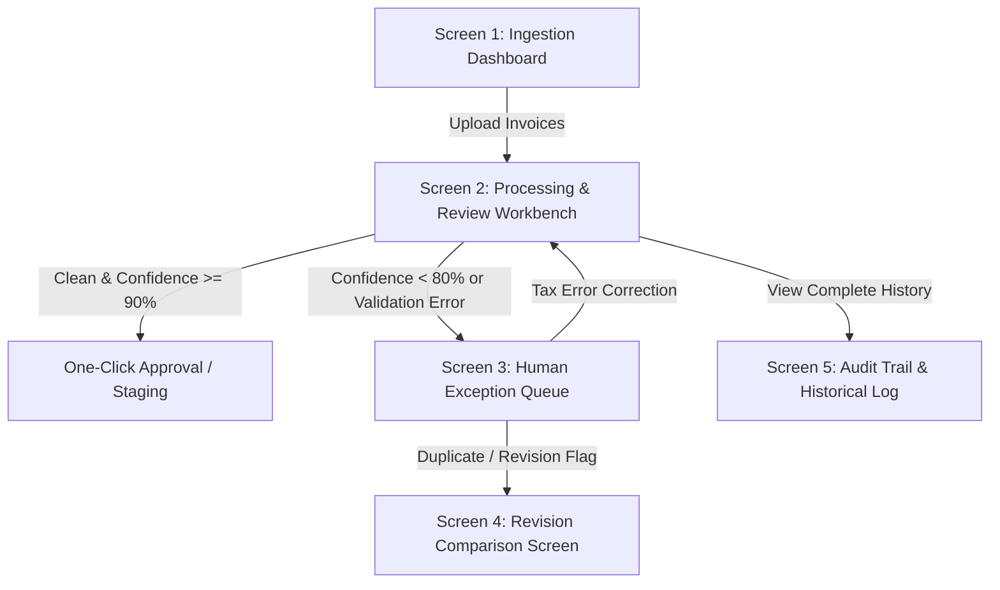

# Product Requirements Document (PRD)
## Enterprise AP Invoice Automation Platform

**Document ID:** PRD-001  
**Version:** 1.0 (Baseline Approved)  
**Status:** Approved for Implementation  
**Product Owner:** AI Solution Architect / Product Manager  
**Business Sponsor:** Head of Global Finance Operations  
**Technical Authority:** Dave M. — Lead Cloud Architect  
**Target Release:** Production Pilot (Week 8) | Hypercare Completion (Week 12)  
**Reference Documents:** [BRD_v0.1.md](file:///Users/lokeshrepaka/Desktop/untitled%20folder/docs/BRD_v0.1.md), [OICR-001_Open_Issues_Register.md](file:///Users/lokeshrepaka/Desktop/untitled%20folder/docs/OICR-001_Open_Issues_Register.md), [Solution Proposal & Commercial Estimation.md](file:///Users/lokeshrepaka/Desktop/untitled%20folder/docs/Solution%20Proposal%20%26%20Commercial%20Estimation.md)

---

## 1. Product Overview & Vision

### 1.1 Product Vision
To provide an enterprise-grade, AI-powered Accounts Payable (AP) Invoice Automation Platform that streamlines invoice ingestion, extracts header and irregular line-item data with high accuracy, executes automated multi-national financial validations, detects duplicate invoices and revisions, and empowers AP clerks with an intuitive exception-handling and re-validation workbench.

### 1.2 Strategic Business Goals
* **Manual Effort Reduction:** Reduce manual invoice processing effort by 5x–10x, cutting average handling time per invoice from 10–15 minutes down to under 15 seconds.
* **Straight-Through Processing (STP):** 
  * **Long-Term Objective:** Achieve at least **70% STP** across total monthly volume (8,000–10,000 invoices).
  * **Pilot Acceptance Threshold:** Achieve at least **65% STP** across the 300-invoice production pilot dataset.
* **Extraction Accuracy:** Achieve $\ge95\%$ macro-average header accuracy (with a $\ge92\%$ floor on critical fields) and $\ge90\%$ line-item extraction accuracy.
* **Financial Risk Mitigation:** Eliminate duplicate payments and tax calculation errors through automated composite-key hashing, country-specific VAT/sales tax rules, and audit-logged manual corrections.

---

## 2. User Personas & Target Users

| Persona | Role & Responsibilities | Pain Points & Needs | Key User Goals |
|---|---|---|---|
| **Sarah — AP Clerk** | Primary user. Uploads invoice files, reviews extracted fields, resolves validation exceptions, adjusts tax/line errors, and approves invoices. | • Manual keying is slow and tedious. • Irregular line-item tables fail in legacy OCR. • Inability to re-validate tax mismatches without restarting. | • Fast batch ingestion. • Visual confidence highlights (yellow/amber). • One-click approval for clean invoices. • Clear error messages and "Re-Validate" action. |
| **Michael — Finance Manager** | Secondary approver. Reviews high-value invoices (>$10,000), manages PO price variances (>5%), monitors KPIs. | • Lack of visibility into month-end backlog. • Duplicate invoices slipping through unnoticed. • Unclear audit trails for manual adjustments. | • Escalated approval queue. • Clear reason codes for clerk edits. • Audit trail showing before/after values and timestamps. |
| **Dave — Lead Cloud Architect** | Technical and compliance authority. Ensures platform security, uptime (99.5%), and Azure governance. | • Cross-region data leakage. • Static secrets leaking into logs. • GDPR erasure vs. 7-year statutory retention conflicts. | • Strictly East US 2 residency. • Entra ID Managed Identities. • Immutable Blob storage with pseudonymization support. |

---

## 3. End-to-End User Journeys

### Journey 1: Single & Bulk Invoice Ingestion
1. **Initiation:** Sarah navigates to the Ingestion Dashboard and drags a batch of invoices (PDF, scanned PDF, JPG, PNG, or XLSX; up to 100 files, max 25MB each) into the dropzone.
2. **Intake Validation:** The system immediately validates MIME type and file integrity. Unsupported files (e.g., `.tiff`, password-protected PDFs) are rejected with a clear descriptive error.
3. **Storage & Queue:** Valid files are uploaded to Azure Blob Storage under an immutable storage container. A unique `InvoiceID` is issued, and an asynchronous processing job is enqueued.
4. **Feedback:** Sarah sees an active progress bar with processing state indicators (`QUEUED`, `PROCESSING`, `COMPLETED`).

### Journey 2: Straight-Through Processing (STP)
1. **Automated Extraction:** The background AI extraction service identifies the document type, extracts 10 header fields and all line items, and scores field confidences.
2. **Validation Engine:** The system executes automated financial checks (line total, invoice total, tax rates, vendor locale date resolution, PO match, duplicate check).
3. **Threshold Check:** 
   * Invoice total is under USD $10,000.
   * Total differs from PO by $\le5\%$.
   * Confidence scores across **all** fields are $\ge90\%$.
   * All financial calculations balance within agreed tolerances ($\pm0.02$ line, $\pm0.05$ invoice).
4. **Auto-Approval:** The invoice transitions to `VALIDATED` (or is eligible for one-click clerk approval). Extracted data is exported to the Azure SQL staging table.

### Journey 3: Medium-Confidence Visual Review
1. **Identification:** An invoice extracts with all fields $\ge80\%$ confidence, but one or more fields fall between **80% and 89%** (e.g., an ambiguous date or blurry unit price).
2. **Visual Cue:** The invoice appears in Sarah's review queue. In the workbench, the affected fields are highlighted in **light-yellow**.
3. **Action:** Sarah visually compares the highlighted field against the original invoice in the split-screen viewer. If accurate, she confirms with one click. If erroneous, she edits the field and confirms.

### Journey 4: Low-Confidence & Financial Exception Handling
1. **Flagging:** An invoice has a critical field with confidence **$<80\%$**, or fails mathematical validation (e.g., subtotal + tax $\neq$ total by $>0.05$).
2. **Queueing:** The invoice is assigned status `REQUIRES_APPROVAL` and routed to the **Human Exception Queue**, highlighted in **amber/red**.
3. **Clerk Review:** Sarah opens the exception item. The validation panel highlights the exact arithmetic discrepancy (e.g., Stated Total: $1,250.00; Calculated: $1,240.00).

### Journey 5: Tax Mismatch Correction & Re-Validation Workflow
1. **Tax Rejection:** The system calculates tax based on the vendor country (e.g., Germany 19% MwSt), but the invoice stated 0% without an exemption note, setting status to `REJECTED_TAX_MISMATCH`.
2. **Investigation:** Sarah inspects the document in the split-screen viewer and finds an EU reverse-charge annotation (`Steuerschuldnerschaft des Leistungsempfängers`).
3. **Correction & Reason:** Sarah adjusts the tax code to `REVERSE_CHARGE_0%`, and selects the mandatory reason code: `Tax Code / Exemption Override`.
4. **Re-Validation Action:** Sarah clicks the **"Re-Validate"** button.
5. **System Response:** The validation engine immediately re-evaluates the invoice rules. Calculations balance; status transitions from `REJECTED_TAX_MISMATCH` to `VALIDATED`.
6. **Audit Capture:** The system immutably logs Sarah’s user ID, timestamp, prior value, new value, and selected reason code.

### Journey 6: Revision & Duplicate Resolution
1. **Duplicate Detection:** An uploaded invoice matches an existing record's Vendor Tax ID and Invoice Number.
2. **Condition A (Exact Duplicate):** If the Total Amount matches, the system flags it as `DUPLICATE_INVOICE` and blocks duplicate export.
3. **Condition B (Revision Detected):** If the Total Amount differs, or the file contains a revision suffix (`-REV`, `v2`), the system assigns status `FLAGGED_POTENTIAL_REVISION`.
4. **Side-by-Side Review:** Sarah is presented with a side-by-side comparison screen showing the previously approved invoice and the new revision.
5. **Resolution:** Sarah chooses between:
   * *Accept as Revision:* Supersedes the old record and routes for new validation.
   * *Reject as Erroneous Duplicate:* Discards the new submission.

### Journey 7: High-Value Manager Approval
1. **Escalation:** An invoice successfully passes all extraction and validation rules, but its total is **USD $14,500** (exceeds $10,000 threshold) or PO variance is **7.2%** (>5%).
2. **Manager Queue:** Status transitions to `REQUIRES_MANAGER_APPROVAL`.
3. **Approval:** Michael (Finance Manager) receives a notification, inspects the high-value breakdown and PO variance, enters approval comments, and signs off. Status transitions to `STAGED_FOR_EXPORT`.

---

## 4. Screen Specifications & UX Requirements

### Screen 1: Ingestion Dashboard
* **Primary Elements:**
  * Drag-and-drop file upload zone supporting multi-file selection.
  * Vendor selection / auto-detection selector.
  * Active batch summary card: Total Uploaded, Processing, Passed, Needs Review.
  * Live status table showing File Name, File Size, Upload Time, Detection Mode, and Real-Time Status.

### Screen 2: Processing & Review Workbench (Split-Screen)
* **Left Pane (50% width):** High-resolution PDF/image document viewer with zoom, pan, multi-page navigation, and bounding-box overlay highlighting extracted entities.
* **Right Pane (50% width):**
  * **Header Card:** Vendor Name, Tax ID, Invoice #, Invoice Date, Due Date, PO #, Subtotal, Tax Amount, Grand Total, Currency.
  * **Confidence Color Cues:** Green ($\ge90\%$), Light-Yellow (80%–89%), Amber/Red ($<80\%$).
  * **Line-Item Table:** Editable grid displaying Line #, Description, Qty, Unit Price, Line Total, Tax Rate.
  * **Validation Alert Box:** Displays real-time pass/fail indicators for line arithmetic, total arithmetic, tax rate check, and PO cross-match.
  * **Action Bar:** "Approve (One-Click)", "Re-Validate", "Send to Exception Queue", "Reject".

### Screen 3: Human Exception Queue
* **Filter & Search Controls:** Filter by Exception Type (`Tax Mismatch`, `Low Confidence`, `Duplicate / Revision`, `PO Discrepancy`, `High Value >$10k`). Search by Vendor Name, Invoice Number, or Date Range.
* **Queue Grid:** Urgency indicator, Invoice Number, Vendor, Stated Total, Primary Exception Cause, Elapsed Time in Queue.
* **Bulk Actions:** Bulk retry validation, assign to clerk.

### Screen 4: Revision Side-by-Side Comparison Screen
* **Left Column:** Original Approved Invoice (PDF preview, extracted fields, approval timestamp, approving clerk).
* **Right Column:** New Incoming Invoice (PDF preview, modified fields highlighted in yellow/red).
* **Diff Summary Table:** Direct comparison of Total Amount, Line Items, Tax Rates, and Revision Markers.
* **Decision Controls:** "Confirm as Authorized Revision (Supersede Old)" or "Reject as Unauthorized Duplicate".

### Screen 5: Audit Trail & Historical Log Viewer
* **Search Controls:** Search by Invoice ID, Invoice #, Vendor Tax ID, or User ID.
* **Timeline View:** Interactive chronological timeline displaying:
  * Ingestion timestamp and raw file hash.
  * Automated extraction model version, confidence scores, and raw JSON payload.
  * Validation engine results and error codes.
  * Manual edits: Field Name, Old Value, New Value, User Identity, Timestamp, Mandatory Reason Code, and User Comments.
  * Approval actions and export to Azure SQL staging.

---

## 5. System Behaviour & Business Logic Rules

### 5.1 Intake & Ingestion Rules
* **BR-001 Formats:** PDF (native and scanned), JPG, PNG, XLSX. Max file size: 25 MB.
* **BR-002 Languages:** English, German, Spanish.
* **BR-003 Handwritten Content:** Tolerates occasional handwritten remarks (up to 5% of documents) without crashing.
* **BR-025 Regional Residency:** All files and data remain strictly in **Azure East US 2**.

### 5.2 Extraction & Confidence Rules
* **BR-004 Header Fields (10):** Vendor Name, Vendor Tax ID, Invoice Number, Invoice Date, Due Date, Purchase Order Number, Subtotal, Total Tax Amount, Total Amount, Currency.
* **BR-005 Line-Item Fields (5):** Description, Quantity, Unit Price, Line Total, Line Tax Rate.
* **BR-006 Accuracy (Q-01):** Macro-average header $\ge95\%$ ($\ge92\%$ floor on Tax ID, Invoice #, Date, Total); line-item $\ge90\%$.
* **BR-007 Confidence Routing (Q-03):**
  * $\ge90\%$: Eligible for one-click clerk approval.
  * 80%–89%: Light-yellow visual confirmation required.
  * $<80\%$: `REQUIRES_APPROVAL` flag, amber/red highlight, Human Exception Queue.

### 5.3 Financial & Tax Validation Rules
* **BR-009 Line Calculation (Q-05):**
  $$\text{Line Total} = \text{Quantity} \times \text{Unit Price} \quad (\text{Tolerance: } \pm0.02)$$
* **BR-010 Invoice Total Calculation (Q-05):**
  $$\text{Subtotal} + \text{Total Tax} = \text{Total Amount} \quad (\text{Tolerance: } \pm0.05)$$
* **BR-011 Multi-Country Tax Validation (Q-05):**
  * *United States:* State/jurisdiction sales tax verified against Vendor Master table.
  * *United Kingdom (UK VAT):* Standard 20%, Reduced 5%, Zero-Rate 0%.
  * *Germany (MwSt):* Standard 19%, Reduced 7%, Zero-Rate 0%.
  * *Spain (IVA):* Standard 21%, Reduced 10%, Super-Reduced 4%, Zero-Rate 0%.
  * *Exemptions/Reverse-Charge:* Permitted when valid Tax ID / VAT number and explicit invoice annotations exist.
* **BR-012 Date & Locale Disambiguation (Q-04):**
  * US Vendors: Interpreted as `MM/DD/YYYY`.
  * European Vendors (UK, DE, ES): Interpreted as `DD/MM/YYYY`.
  * Ambiguous dates from unlisted vendors flag for human verification.
* **BR-012a Currency Normalization:** Synced daily with European Central Bank (ECB) rates in Azure SQL. Conversion date is invoice date.

### 5.4 Duplicate & Revision Handling Rules
* **BR-013 Duplicate Identification:** Composite business key:
  $$\text{Composite Key} = \text{SHA256}(\text{Vendor Tax ID} + \text{Invoice Number} + \text{Total Amount})$$
* **BR-013a Revisions (Q-06):** Invoices with matching Invoice # but differing Total Amount, or containing `-REV` suffix, transition to `FLAGGED_POTENTIAL_REVISION` for side-by-side review.
* **BR-013b Credit Notes (Q-06):** Negative line items or negative balance totals transition to `CREDIT_NOTE` and route to credit netting workflow.

### 5.5 Exception & Approval Rules
* **BR-014 Manager Approval:** Mandatory if Total > USD $10,000 OR difference between invoice total and PO > 5%.
* **BR-015 Clerk Approval:** Permitted if Total $\le$ $10,000, confidence $\ge90\%$, and all validations pass.
* **BR-016 / BR-017 Manual Corrections & Reason Codes (Q-07):** Editing lines, prices, or taxes requires a mandatory reason code:
  * `OCR Misread / Scan Distortion`
  * `Vendor Rounding Discrepancy`
  * `Tax Code / Exemption Override`
  * `Vendor Discount Applied`
  * `Other (Mandatory Comment Required)`
* **BR-018 Re-Validation Workflow:** Clerk edits and clicks "Re-Validate" $\implies$ rules re-run $\implies$ status transitions to `VALIDATED` if checks pass.
* **BR-019 SAP Boundary:** Direct SAP posting excluded in Phase 1; data is staged in Azure SQL for manual review/export.

---

## 6. Product Acceptance Criteria

| ID | Category | Requirement / Target | Verification Method |
|---|---|---|---|
| **AC-001** | Header Accuracy | Macro-average accuracy $\ge95\%$ across 300 pilot invoices | Automated evaluation script vs. ground truth (Q-14) |
| **AC-002** | Critical Field Floor | $\ge92\%$ accuracy on Vendor Tax ID, Invoice #, Date, Total | Automated evaluation script field scoring (Q-01) |
| **AC-003** | Line-Item Accuracy | $\ge90\%$ accuracy across all line items | Automated evaluation script line comparison (Q-01) |
| **AC-004** | Pilot STP | $\ge65\%$ straight-through processing across 300 invoices | Automated evaluation report calculation (Q-01) |
| **AC-005** | Platform Stability | Zero unhandled system crashes during batch processing | Azure Application Insights log audit |
| **AC-006** | User Usability | Written affirmative sign-off from $\ge2$ AP clerks | Formal clerk UAT survey / sign-off document |
| **AC-007** | Automated Suite | Joint execution of automated evaluation script against ground truth | Finance Team & Consultant verification (Q-14) |
| **AC-008** | Hypercare Sign-Off | 30 calendar days completed with zero unresolved Sev 1 bugs | Formal Week 12 sign-off by Business Sponsor (Q-12) |

---

## 7. Out of Scope (Phase 1)
* Direct automated invoice posting to SAP ERP.
* Automated SAP payment execution or bank integration.
* TIFF document format support (deferred to Phase 2).
* Real-time automated vendor portal integration.
* External third-party AI APIs (all inference must use client Azure OpenAI in East US 2).

---
*End of Product Requirements Document*

