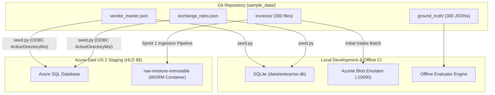

# Phase 10: Infrastructure, Data Storage & Cloud Seeding Evolution

> **Document Scope:** Data storage architecture, Azure Blob WORM container seeding, local Azurite emulator alignment, offline CI storage performance, and synthetic data privacy boundaries introduced in **Phase 10 (Synthetic Sample Data — P10-1 through P10-4)**.  
> **Target Audience:** Cloud Architects, DevOps Engineers, Data Platform Engineers, and Security Compliance Officers.

---

## 1. Storage Architecture: Dual Local / Cloud Data Substrate

Phase 10 establishes the static data substrate required to seed both local development environments and the Azure East US 2 staging environment.

---

## 2. Infrastructure & Networking Characteristics

### 2.1 Azure Blob WORM Container Alignment (ADR-005, N6)
- **Container Structure:** The 300 synthetic documents mirror the exact blob naming convention used in production:
  `raw-invoices-immutable/{vendor_id}/{year}/{month}/{invoice_id}.pdf`
- **Immutability Policy:** When pushed to Azure Storage, invoices inherit the 7-year WORM immutability policy (2557 days) configured via `infrastructure/main.bicep`.
- **Blob Metadata Tagging:** Each uploaded blob receives canonical metadata headers (`VendorID`, `UploadTimestamp`, `FileHash`) tested in P4-4.

### 2.2 Local Azurite Emulator Parity (P4-2)
- **Zero Cloud Egress (ADR-001, N2):** During local development and testing, `docker-compose.yml` mounts `azurite_data:/data`, allowing local upload and retrieval of the 300 sample files without touching external networks.
- **Port Pinning:** Azurite is strictly bound to `127.0.0.1:10000` to prevent exposure on local networks (`SEC-233`).

---

## 3. Data Privacy & Regulatory Compliance (N7, N8)

1. **GDPR Exemption via Synthetic Generation:** Because 100% of names, addresses, and tax numbers are synthetic, the pilot dataset has zero personal data exposure under GDPR Article 17 (Right to Erasure) or Article 4 (PII definitions).
2. **Deterministic Reproducibility:** The sample corpus has fixed checksums, enabling cryptographic verification that files have not been tampered with or replaced.
3. **Bandwidth & CI Optimization:** Storing sample documents within the repository ensures GitHub Actions runners execute tests offline in under 30 seconds without downloading gigabytes of test assets from external cloud buckets.

