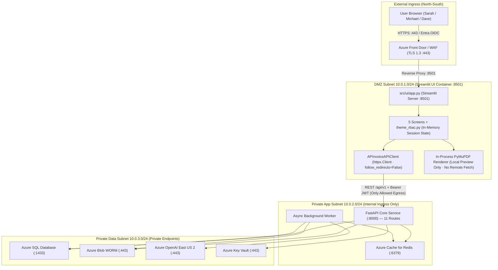
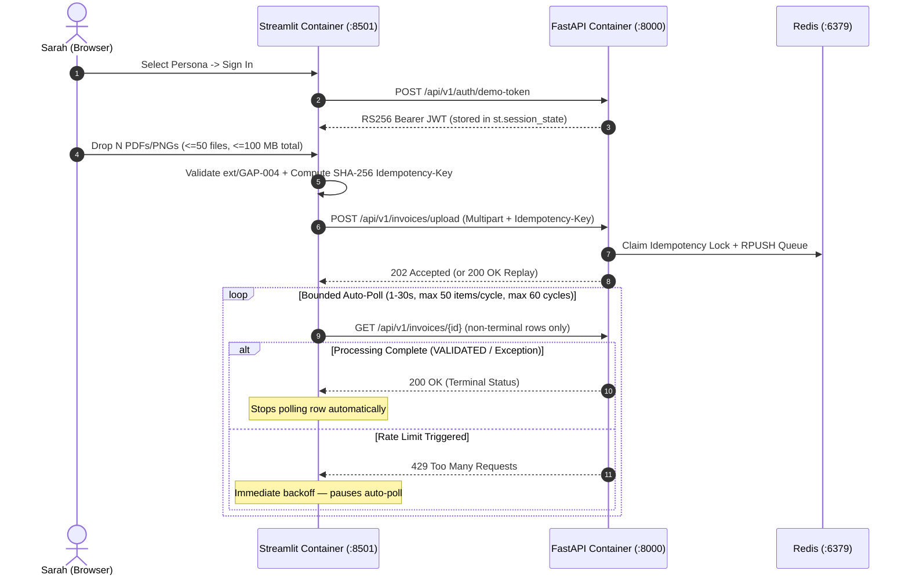
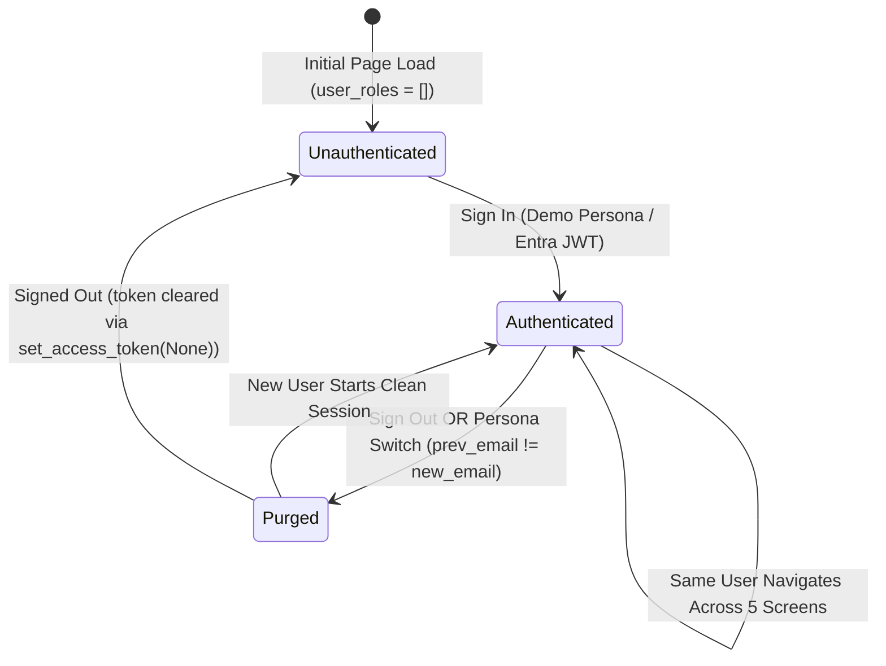

# Phase 11: Infrastructure, Container Networking & UI-to-API Routing Evolution

> **Document Scope:** Network boundary separation, Docker Compose & Azure Container Apps topology, Streamlit (`:8501`) → FastAPI (`:8000`) internal REST wiring, session-state memory isolation, bounded polling & HTTP `429` circuit-breaking, and offline test transport architecture introduced during **Phase 11 (Streamlit UI — P11-1 through P11-7)**.  
> **Target Audience:** Cloud Solution Architects, DevOps / Platform Engineers, Security Architects, and SREs.

---

## 1. Phase 11 Runtime Topology & Strict Presentation-Tier Isolation

Phase 11 activates the **Presentation Container (`streamlit-ui`, TCP `:8501`)** in our three-tier architecture (`Browser → WAF / Front Door → Streamlit UI :8501 → FastAPI API :8000 → Private Data Stores`).

**Critical Infrastructure & Network Security Invariant:**
The Streamlit UI container resides in the **DMZ / Public-facing App Subnet (`10.0.1.0/24`)** (in Azure) or on the shared `ap-frontend` bridge network (in local Docker Compose) and holds **ZERO network routes, ZERO Managed Identity grants, and ZERO Python SDK imports** to Azure SQL (`:1433`), Azure Cache for Redis (`:6379`), Azure Blob Storage (`:443`), Azure Key Vault (`:443`), or Azure OpenAI (`:443`).
- **Single Egress Target:** `AP_API_BASE_URL` (internal Docker service DNS `http://api:8000` / `http://ap-api:8000` locally, or `https://<internal-fqdn>` inside Azure East US 2 VNet).
- **Enforced in Code (`SEC-187`):** `validate_api_base_url()` in `src/ui/api_client.py` rejects cleartext `http://` to any host outside `{localhost, 127.0.0.1, ::1, api, fastapi, ap-api}`, blocks embedded URL credentials, and sets `follow_redirects=False` so an open redirect can never leak an Entra ID Bearer JWT to an external host.

---

## 2. Subtask-by-Subtask Wiring & Routing Evolution

### 2.1 P11-1 — Single-Pipe `httpx` Transport & Connection Lifecycle (`src/ui/api_client.py`)

- **Connection Pooling & Cleanup:** `APInvoiceAPIClient` wraps a single `httpx.Client` instance with bounded connect timeout (`5.0s`), bounded request timeout (`[0.1s, 120.0s]`, default `30.0s`), and deterministic cleanup (`__enter__`/`__exit__` + `finally: client.close()` in `app.py`).
- **Response Memory Cap (`SEC-189`):** Every response body is capped at `MAX_RESPONSE_BYTES = 10 MB` before JSON parsing, protecting Streamlit container RAM from oversized backend payloads.
- **Upload Stream Cap (`SEC-190`):** Client-side upload rejects empty or `> 25 MB` files before opening a multipart HTTP stream to FastAPI.

### 2.2 P11-2 — App Router, Sidebar Auth & Bounded Live Polling (`app.py`, `ingestion_dashboard.py`)

- **Local Docker vs. Cloud Wiring:**
  - Local Dev (`CLAUDE.md §14`): `AP_API_BASE_URL=http://127.0.0.1:8000` (host loopback) or `http://api:8000` (Docker Compose bridge DNS).
  - Azure East US 2 Staging/Prod: `AP_API_BASE_URL=https://ca-ap-api.internal.<env>.eastus2.azurecontainerapps.io` (internal Container Apps HTTPS ingress; NSG denies all direct internet traffic to FastAPI).

### 2.3 P11-3 through P11-7 — Multi-Screen Route Map & Memory Isolation

| UI Route | Module | Backend Endpoints Consumed | Resource & Network Caps |
|---|---|---|---|
| Sidebar (Global) | `src/ui/app.py` | `GET /health`, `GET /api/v1/auth/demo-personas`, `POST /api/v1/auth/demo-token`, `GET /api/v1/auth/me` | Masked token input (`type="password"`); full session purge on Sign Out / persona switch |
| `/` | `src/ui/ingestion_dashboard.py` | `POST /api/v1/invoices/upload`, `GET /api/v1/invoices/{id}` | 50 files / 100 MB per batch; 500 tracked rows; 50 polls/cycle; 60 poll cycles max; HTTP 429 halt |
| `/workbench/{id}` | `src/ui/review_workbench.py` | `GET /api/v1/invoices/{id}`, `POST /api/v1/invoices/{id}/revalidate`, `POST /api/v1/invoices/{id}/approve` | Zero remote blob fetches (anti-SSRF); local PyMuPDF bounded to 25 MB / 200 pages / 4096px |
| `/exceptions` | `src/ui/exception_queue.py` | `GET /api/v1/invoices/exceptions`, `GET /api/v1/invoices/{id}`, `POST /api/v1/invoices/{id}/approve` | Page `limit <= 100`; `MAX_BULK_SELECTION = 50`; `MAX_STORED_ASSIGNMENTS = 1000`; HTTP 429 halt |
| `/revision/{id}` | `src/ui/revision_screen.py` | `GET /api/v1/invoices/{orig}`, `GET /api/v1/invoices/{rev}`, `GET /api/v1/invoices/{orig}/audit` | `MAX_REVALIDATE_LINES = 500` line diff cap; `MAX_DECISION_HISTORY = 200`; 256-char suffix regex cap |
| `/audit/{id}` | `src/ui/audit_viewer.py` | `GET /api/v1/invoices/{id}/audit` | Read-only (`st.dataframe` only); `limit <= 200`; in-memory CSV/JSON export with validated filename stem |
| Shared Policy | `src/ui/theme_rbac.py` | None (pure in-process policy + `get_settings()`) | Zero I/O; zero sockets; dynamic threshold sync with FastAPI config |

---

## 3. Session State Lifecycle & Shared-Workstation Isolation

Because Streamlit stores per-browser-tab state inside `st.session_state` inside the UI container's Python process, Phase 11 enforces strict memory bounds and identity-change purging (`_clear_session_batch_state()` in `src/ui/app.py`):

**Keys Purged Automatically on Sign Out or Persona Switch (`SEC-193`, `SEC-197`, `SEC-200`, `SEC-203`, `SEC-206`):**
`access_token`, `user_email`, `user_name`, `user_roles`, `batch_items`, `poll_cycles`, `selected_workbench_invoice_id`, `workbench_invoice`, `workbench_last_revalidation`, `exception_assignments`, `revision_original_id`, `revision_incoming_id`, `revision_pair`, `revision_decisions`, `audit_invoice_id`, `audit_trail`.

---

## 4. Zero-Socket Offline Testing Topology (CI & Local Dev)

To keep CI fast (**23.84s for all 650 tests**) and 100% offline with zero Docker daemon dependency during unit/integration testing, Phase 11 introduced two clean `httpx.BaseTransport` test harnesses:
1. **Unit Layer (`tests/unit/test_ui_*.py` — ~0.12s per module):** Injects stateful in-memory `httpx.BaseTransport` mocks into the real `APInvoiceAPIClient` + headless `_FakeStreamlit` stubs, testing full HTTP serialization, Pydantic validation, error mapping, security sanitization, and Streamlit screen rendering with zero sockets and zero SQLite overhead.
2. **Integration Layer (`tests/integration/test_ui_*_integration.py`):** Injects `_TestClientBridgeTransport(TestClient(app))` into `APInvoiceAPIClient`, routing synchronous `httpx` requests straight into the real FastAPI ASGI stack backed by temp SQLite + `FakeRedis` + `InMemoryWORMBlobClient`—proving end-to-end wire contract and RBAC parity offline!

