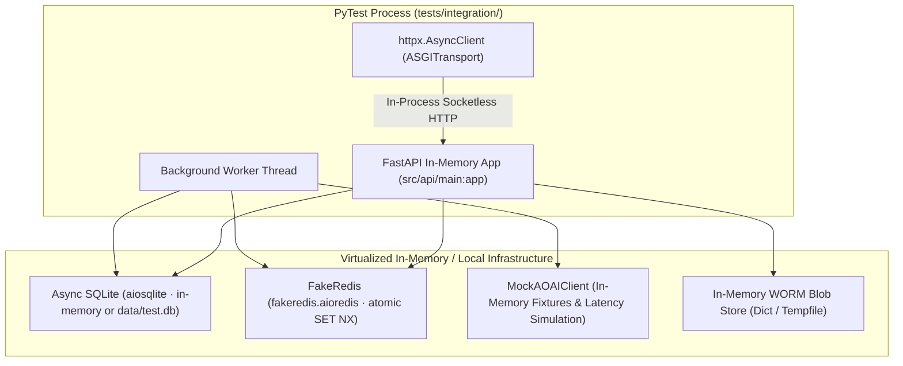

# Phase 12: Infrastructure, Test Isolation & Mocked Transport Evolution

> **Document Scope:** Test harness infrastructure, offline Azure service mocking, in-memory transport virtualization (`httpx.ASGITransport`), atomic Redis lock simulation, and database rollback isolation verified during **Phase 12 (Integration Tests — P12-1 through P12-5)**.  
> **Target Audience:** SREs, Test Infrastructure Engineers, DevOps Architects, and Platform Leads.

---

## 1. The Strict Offline Test Harness Architecture

Enterprise CI/CD pipelines must execute fast, reliably, and deterministically without depending on live cloud credentials, internet connectivity, or Azure subscription quotas.

---

## 2. Core Infrastructure Mechanisms

### 2.1 In-Process ASGITransport (Zero Network Sockets)
- Rather than launching a real Uvicorn server on TCP port `8000` and curling it, tests bind directly via `httpx.ASGITransport(app=app)`.
- Eliminates TCP socket exhaustion, local port conflicts, and OS firewall permissions.

### 2.2 Atomic Redis Concurrency Simulation (`fakeredis`)
- P12-5 tests concurrent race conditions using Python `asyncio.gather()`.
- `fakeredis` accurately simulates single-threaded Redis command atomicity (`SET NX EX` and `WATCH/MULTI/EXEC`), proving distributed lock correctness offline.

### 2.3 Isolated Transaction Rollback (`pytest-asyncio`)
- Database integration tests wrap operations in isolated async sessions, guaranteeing zero cross-test data pollution.
- `AuditLogger` uses independent dedicated sessions to prove that even if an invoice transaction rolls back, audit events remain durable and persisted.

