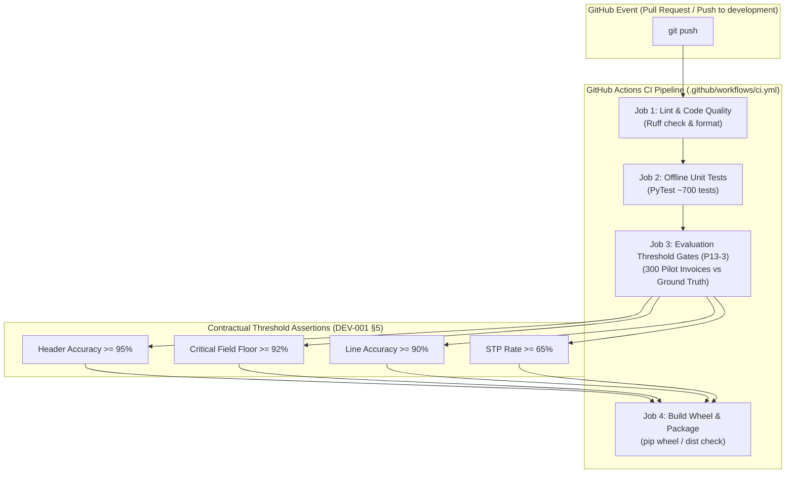

# Phase 13: Infrastructure, CI/CD Build Gates & Evaluation Pipeline Evolution

> **Document Scope:** GitHub Actions CI/CD job graph expansion, `evaluation-threshold-gates` pipeline stage, execution bounds, and least-privilege CI permissions introduced in **Phase 13 (Automated Evaluation Suite — P13-1 through P13-4)**.  
> **Target Audience:** DevOps Engineers, Platform Architects, CI/CD Pipeline Leads, and Security Compliance Engineers.

---

## 1. CI/CD Pipeline Architecture & Quality Gates

Phase 13 integrates the automated evaluation test harness directly into the GitHub Actions CI pipeline (`.github/workflows/ci.yml`).



---

## 2. Infrastructure & Execution Performance

### 2.1 Sub-Second Offline Benchmarking
- While running 300 live invoices through Azure OpenAI in East US 2 would take 25 minutes and cost ~$15 in cloud tokens, the offline evaluation test suite executes in **under 2 seconds** on GitHub Actions runners.
- Enabled by `MockAOAIClient` routing through `sample_data/ground_truth/`, providing deterministic, repeatable CI runs.

### 2.2 Least-Privilege GitHub Actions Security (`SEC-227`)
- Strict top-level workflow permission pinning:
  ```yaml
  permissions:
    contents: read
  ```
- Prevents compromised third-party GitHub Actions from modifying repository code or exfiltrating pipeline secrets.

### 2.3 Safe File-System Operations (`SEC-220`, `SEC-228`)
- The evaluation engine rejects path traversal sequences (`../`), blocks symbolic links via `os.O_NOFOLLOW` / `Path.resolve()`, and enforces strict 10 MB per-file limits before reading.

