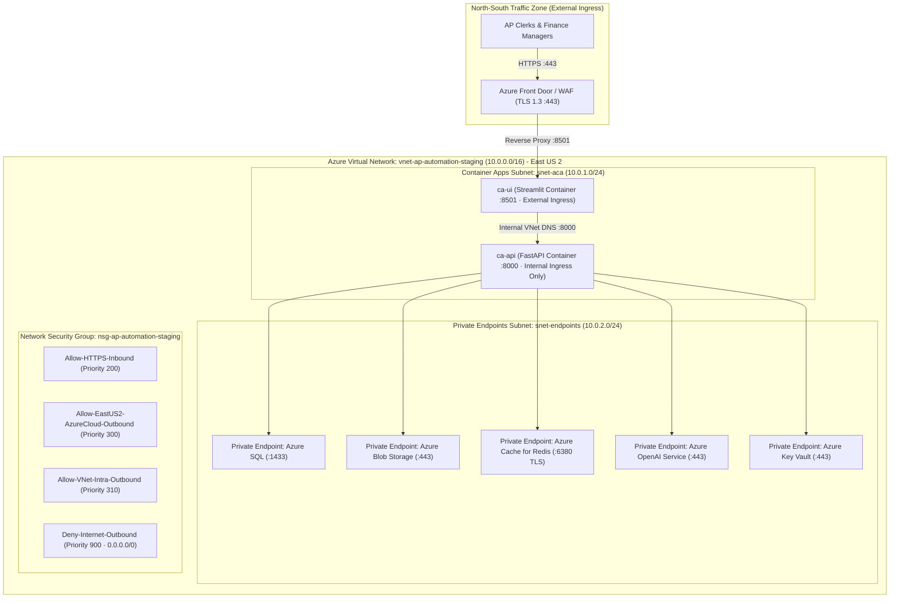

# Phase 14: Infrastructure, Cloud Landing Zone & Azure East US 2 Architecture

> **Document Scope:** Azure East US 2 cloud architecture, Virtual Network topology, Network Security Groups, Private Endpoints, Azure Container Apps scaling, and Keyless Entra ID Managed Identity wiring established in **Phase 14 (Infrastructure & Delivery — P14-1 through P14-5)**.  
> **Target Audience:** Principal Cloud Architects, Infrastructure Engineers, Azure Solutions Architects, and Security Engineers.

---

## 1. Azure East US 2 Landing Zone Topology (HLD §6, ADR-001)

The platform is provisioned strictly within **Azure East US 2** to enforce corporate data residency and GDPR compliance (N2, ADR-001):

---

## 2. Infrastructure Component Specifications

| Resource | Azure Resource Provider | SKU / Tier | Security & Network Configuration |
|---|---|---|---|
| **Virtual Network** | `Microsoft.Network/virtualNetworks` | `10.0.0.0/16` | Subnets: `snet-aca` (delegated to ACA) and `snet-endpoints`. |
| **Network Security Group** | `Microsoft.Network/networkSecurityGroups` | Standard | High-priority rule `Deny-Internet-Outbound` denies all outbound to `0.0.0.0/0`. |
| **Container Apps Environment** | `Microsoft.App/managedEnvironments` | Consumption | VNet-integrated (`internal: true`), sending logs to Log Analytics workspace. |
| **FastAPI Backend App** | `Microsoft.App/containerApps` (`ca-api`) | 1.0 CPU / 2.0 GiB | Internal ingress only on port 8000, autoscale 1–5 replicas, non-root user. |
| **Streamlit UI App** | `Microsoft.App/containerApps` (`ca-ui`) | 0.5 CPU / 1.0 GiB | External HTTPS ingress on port 8501, autoscale 1–3 replicas, non-root user. |
| **Azure SQL Database** | `Microsoft.Sql/servers` + `databases` | Standard S1 | Entra ID ActiveDirectory-only auth, TLS 1.2+, `publicNetworkAccess: Disabled`. |
| **Blob WORM Storage** | `Microsoft.Storage/storageAccounts` | Standard_LRS | `allowSharedKeyAccess: false`, 7-year (2557 days) immutable WORM legal hold. |
| **Azure Cache for Redis** | `Microsoft.Cache/redis` | Basic C0 | Port 6380 TLS only, non-SSL port disabled, private endpoint only. |
| **Azure OpenAI Service** | `Microsoft.CognitiveServices/accounts` | S0 | Deployments: `gpt-4o-vision` and `gpt-4o-mini`, private endpoint only. |
| **Azure Key Vault** | `Microsoft.KeyVault/vaults` | Standard | RBAC authorization enabled, soft-delete, purge protection, private endpoint only. |

---

## 3. Keyless Security & RBAC Identity Matrix (ADR-007, N1)

All communication between compute and datastores uses **Microsoft Entra ID Managed Identities**:
- Zero connection strings with passwords.
- Zero storage account keys committed or used (`allowSharedKeyAccess: false`).
- Built-in role definitions assigned directly via Bicep template:
  - **Key Vault Secrets User:** `4633458b-17de-408a-b874-0445c86b69e6`
  - **Storage Blob Data Contributor:** `ba92f5b4-2d11-453d-a403-e96b0029c9fe`
  - **Cognitive Services OpenAI User:** `5e0dc982-0038-4745-9372-2f3b90048e9c`

