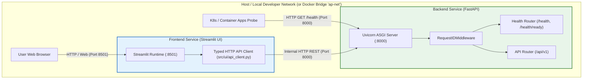
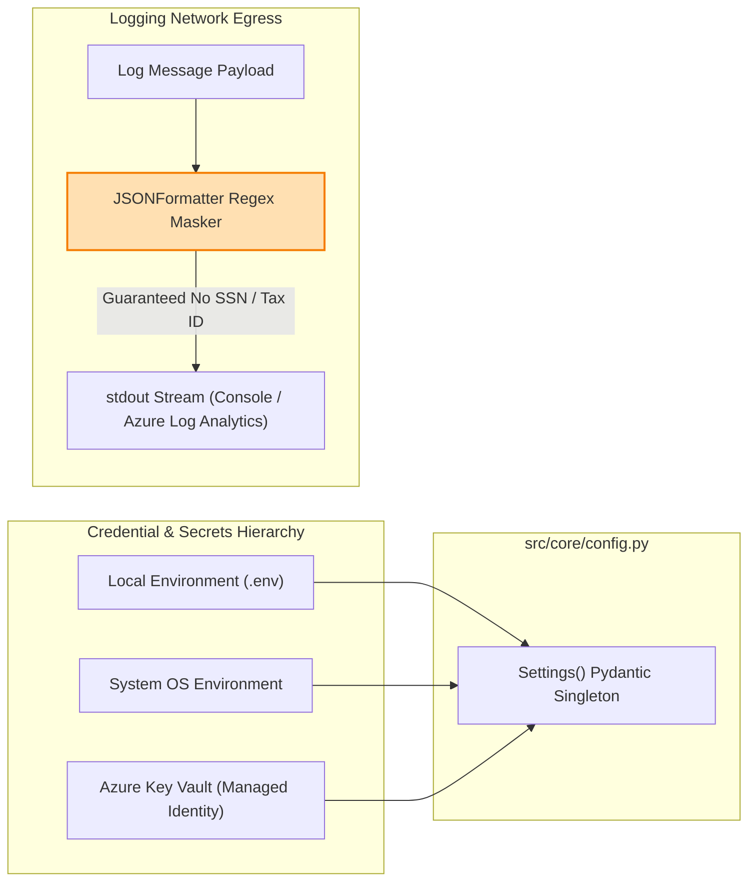
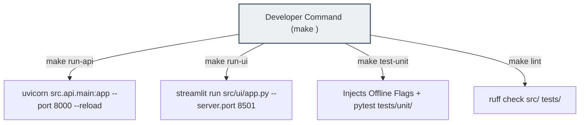
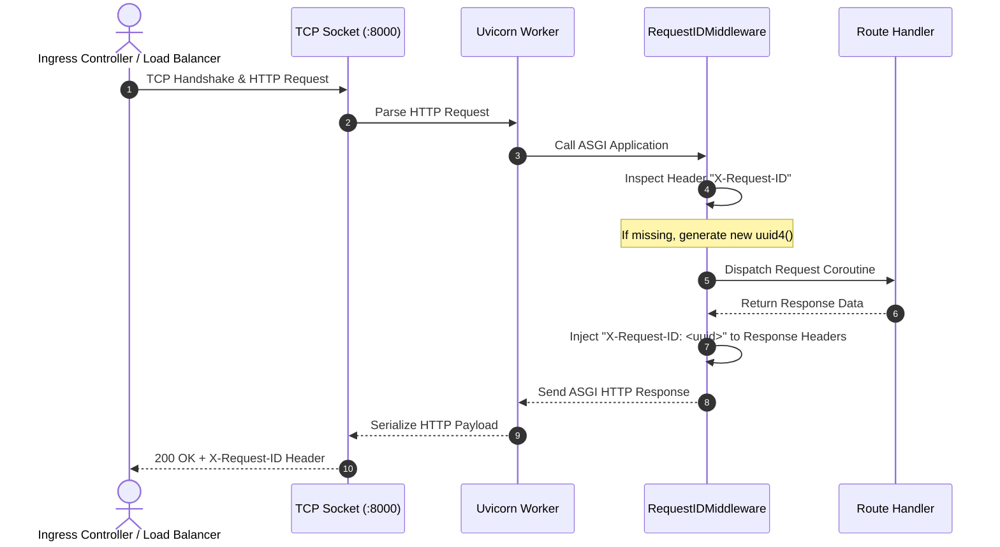
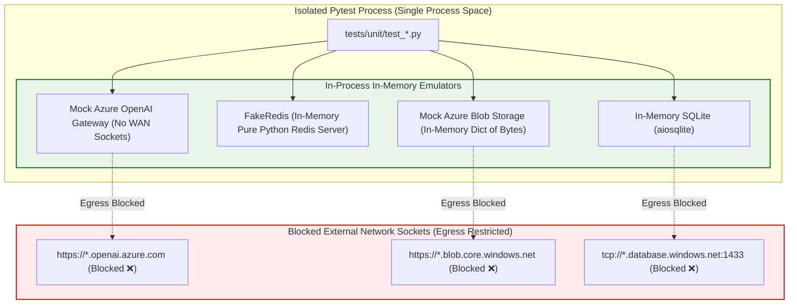
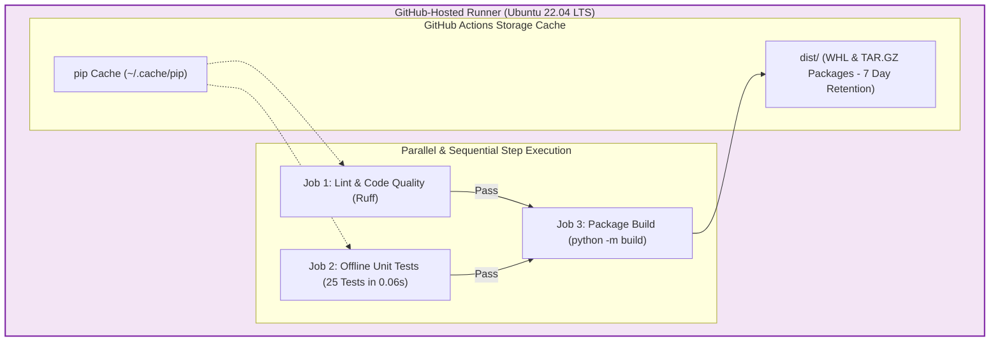
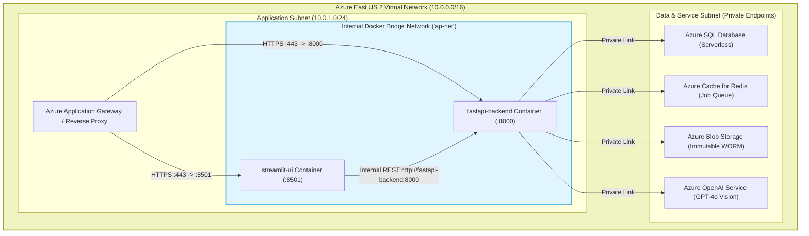

# Phase 1: Infrastructure & Component Wiring Evolution

> **Document Scope:** Infrastructure topology, component wiring, port routing, and runtime networking evolution during **Phase 1 (Runtime Skeleton)**.  
> **Target Audience:** DevOps Engineers, Cloud Architects, Site Reliability Engineers (SREs), and Infrastructure Evaluators.

---

## 1. Infrastructure Philosophy & Target Architecture

The infrastructure strategy of the **Enterprise AP Invoice Automation Platform** is architected around two core paradigms:

1. **Local Autonomous Runtime (\$0 Cloud Spend):** The local development and automated CI environment must be completely self-contained. It operates with zero external network egress, emulating all Azure cloud resources (Azure SQL, Azure Cache for Redis, Azure Blob Storage, Azure OpenAI) purely in-memory.
2. **Production Enterprise Cloud Target (Azure East US 2):** Production infrastructure leverages Azure Container Apps / App Service with Entra ID Managed Identities, private VNet endpoints, serverless databases, and immutable WORM storage.

```
┌──────────────────────────────────────────────────────────────────────────────────┐
│                           INFRASTRUCTURE DUALITY                                 │
│                                                                                  │
│   DEVELOPMENT / CI RUNTIME                      PRODUCTION AZURE EAST US 2       │
│   ┌──────────────────────────┐                  ┌───────────────────────────┐    │
│   │ • Localhost / Docker Net │                  │ • Private VNet / Subnets  │    │
│   │ • In-Memory SQLite       │   Identical      │ • Azure SQL Serverless    │    │
│   │ • In-Memory FakeRedis    │   Application    │ • Azure Cache for Redis   │    │
│   │ • Mock AOAI & Mock Blob  │   Codebase       │ • Azure Blob WORM Storage │    │
│   │ • Cost: $0.00 / month    │ ───────────────► │ • Azure OpenAI (Private)  │    │
│   │ • Test Latency: 0.06s    │                  │ • Zero Static Credentials │    │
│   └──────────────────────────┘                  └───────────────────────────┘    │
└──────────────────────────────────────────────────────────────────────────────────┘
```

---

## 2. Component Wiring & Network Port Allocation

In Phase 1, the core application components, ports, and internal traffic routes were established as follows:



### Port Mapping Table

| Component | Default Port | Environment Variable | Binding Address | Description |
|---|---|---|---|---|
| **FastAPI Backend** | `8000` | `PORT_API` | `127.0.0.1` (Dev) / `0.0.0.0` (Container) | REST API, Health Probes, and Job Status |
| **Streamlit UI** | `8501` | `PORT_UI` | `127.0.0.1` (Dev) / `0.0.0.0` (Container) | Review Workbench, Dashboard & Exception Queue |
| **Internal REST Bridge** | Direct | `API_BASE_URL` | `http://127.0.0.1:8000` | Client-to-Backend HTTP communication |

---

## 3. Subtask-by-Subtask Infrastructure Evolution

### 3.1 Subtask P1-1: Runtime Isolation & Package Boundary Wiring

In **P1-1 (`feature/project-bootstrap`)**, we isolated the application runtime from system-level Python packages using modern standard packaging:

- **Packaging Standard:** PEP 621 / `pyproject.toml` with `setuptools.build_meta`.
- **Virtual Environment Isolation:** Strict separation of application dependencies (`fastapi`, `uvicorn`, `pydantic`, `sqlalchemy`) from development/testing dependencies (`pytest`, `fakeredis`, `ruff`).
- **File System Sandboxing:** Read-only access to static invoice samples (`sample_data/invoices/`) and write-only access to isolated output directories.

---

### 3.2 Subtask P1-2: Security Wiring & PII Egress Filtering

In **P1-2 (`feature/core-config-logging`)**, the security infrastructure boundary was formalized.



- **Zero Static Credentials:** The application runtime does not accept static database passwords or Azure API keys in production. Instead, it relies on Entra ID Managed Identity (`DefaultAzureCredential`).
- **Log Egress Network Protection:** Before any log record leaves the process memory space to `stdout` or remote telemetry sinks (Azure Monitor / Application Insights), our `JSONFormatter` intercepts and redacts all US Social Security Numbers (`\d{3}-\d{2}-\d{4}`) and Tax IDs (`\d{2}-\d{7}`).

---

### 3.3 Subtask P1-3: Host Command Routing via Makefile

In **P1-3 (`feature/makefile-dev-commands`)**, a standardized host command routing layer was established to ensure parity across developer workstations and Docker containers.



---

### 3.4 Subtask P1-4: ASGI Network Pipeline & Ingress Health Probes

In **P1-4 (`feature/api-health-middleware`)**, the network packet lifecycle through the FastAPI ASGI server was architected.



#### Health Probe Routing Strategy:
- **`GET /health` (Liveness):**
  - Path: `/health`
  - Latency: < 2ms.
  - Used by Kubernetes / Azure Container Apps to detect process deadlock. If this fails, the container is restarted.
- **`GET /health/ready` (Readiness):**
  - Path: `/health/ready`
  - Latency: 5–20ms.
  - Verifies connections to downstream dependencies (SQL, Redis, Blob Storage). If this fails, the container is temporarily removed from the load balancer pool.

---

### 3.5 Subtask P1-5: Virtualized Test Network Topology ($0 Cloud Spend)

In **P1-5 (`feature/test-harness-offline`)**, we architected the **Socket-Level Virtualization Topology**:



#### Test Virtualization Mechanics:
1. **SQLite In-Memory Database:** Uses `sqlite+aiosqlite:///:memory:` via SQLAlchemy's `StaticPool`. Every test session gets an isolated database without requiring a running SQL server daemon.
2. **FakeRedis Socket Interceptor:** Uses `fakeredis.FakeRedis()`, which emulates all Redis strings, hashes, and queues in memory without requiring a Redis daemon on port `6379`.
3. **Mock AOAI & Blob Clients:** Implemented as async/sync mock objects returning pre-canned, valid financial extraction payloads. **Zero external HTTP requests are made.**

---

### 3.6 Subtask P1-6: GitHub Actions Runner Virtualization

In **P1-6 (`feature/ci-pipeline-github-actions`)**, the automated CI container infrastructure was implemented:



---

## 4. Production Multi-Container Docker Target (Preview)

As the project advances toward Phase 14 (Production Cloud Delivery), the components established in Phase 1 will be packaged into a multi-container Docker topology on an internal bridge network:



---

## 5. Infrastructure Verification Matrix

| Subtask | Infrastructure Component | Verification Command | Result |
|---|---|---|---|
| **P1-1** | Virtual Environment & Dependencies | `python3 -m pip check` | 0 broken dependencies ✅ |
| **P1-2** | PII Redaction Filter | Unit test: `test_logging_masks_pii()` | Redacted `***-**-XXXX` ✅ |
| **P1-3** | Makefile Host Command Routing | `make help` | All 8 targets verified ✅ |
| **P1-4** | FastAPI ASGI & Health Probes | Unit test: `test_health_endpoint()` | 200 OK + `X-Request-ID` ✅ |
| **P1-5** | Zero-Network Virtualization | Unit test: `test_offline_isolation()` | 0 WAN sockets used ✅ |
| **P1-6** | GitHub Actions Runner Execution | CI Workflow Test: `test_ci_workflow.py` | 100% Validated in CI ✅ |
