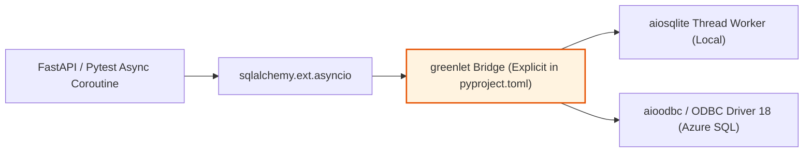
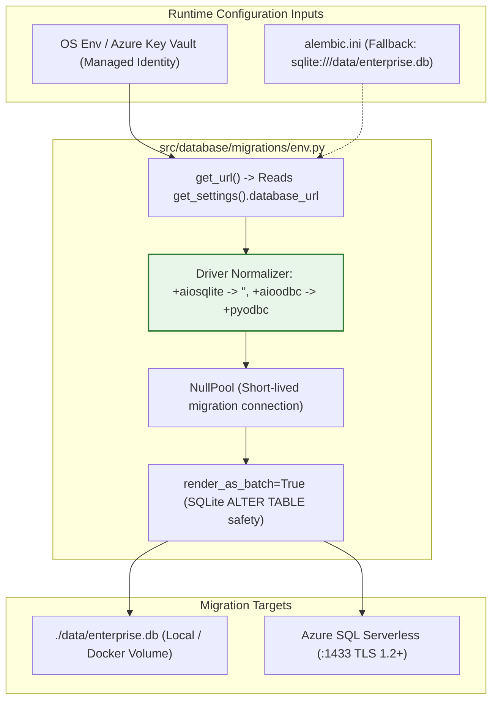
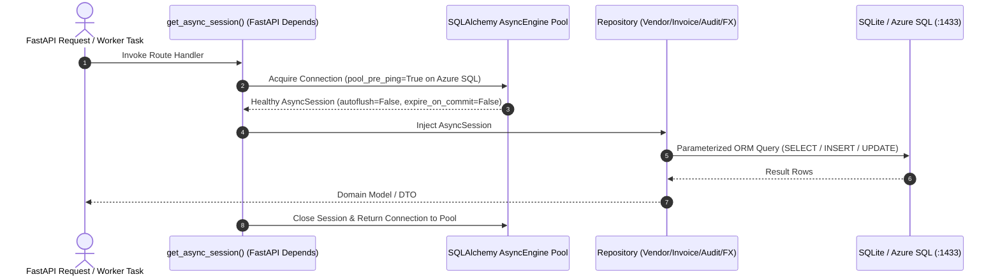
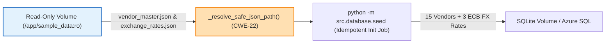
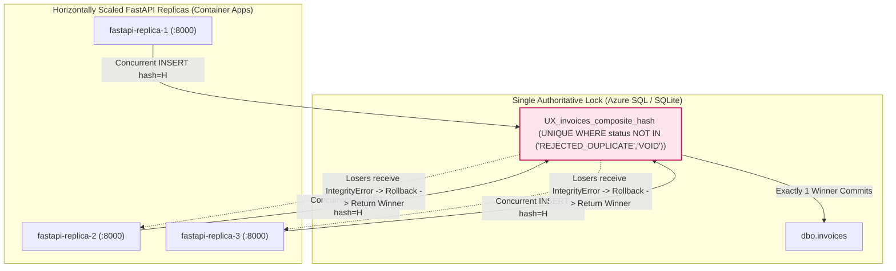
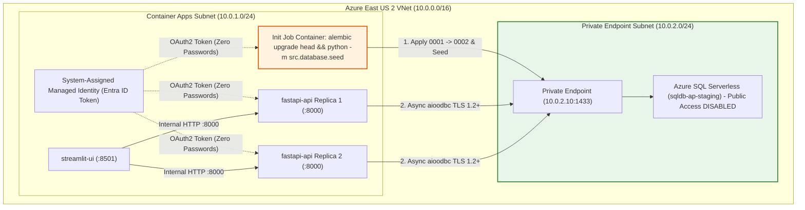

# Phase 2: Infrastructure, Database Wiring & Docker Evolution

> **Document Scope:** Database driver architecture, connection pooling, Alembic migration routing, Docker volume/network topology, and Azure SQL Private Link wiring evolved during **Phase 2 (Persistence and Vendor Master)**.  
> **Target Audience:** DevOps Engineers, Cloud Solution Architects, DBAs, and Site Reliability Engineers (SREs).

---

## 1. Persistence Infrastructure Philosophy: Dual-Engine Parity

In Phase 1, the application ran completely statelessly with zero persistent storage. In **Phase 2**, we introduced stateful relational persistence without sacrificing our **\$0 local developer velocity** rule.

The persistence infrastructure uses a **single codebase, dual-driver architecture** controlled via `Settings.USE_LOCAL_SQLITE` in [`src/core/config.py`](file:///Users/lokeshrepaka/Desktop/untitled%20folder/src/core/config.py):

```
┌───────────────────────────────────────────────────────────────────────────────────────┐
│                      DUAL-ENGINE DATABASE INFRASTRUCTURE                              │
│                                                                                       │
│  LOCAL / CI RUNTIME (USE_LOCAL_SQLITE=true)      PRODUCTION (Azure East US 2)         │
│  ┌────────────────────────────────────────┐      ┌──────────────────────────────────┐ │
│  │ • Async Driver: sqlite+aiosqlite       │      │ • Async Driver: mssql+aioodbc    │ │
│  │ • Migration Driver: sqlite (stdlib)    │      │ • Migration Driver: mssql+pyodbc │ │
│  │ • Pool (:memory:): StaticPool          │      │ • Pool: QueuePool (20 + 10 ovf)  │ │
│  │ • Storage: RAM / ./data/enterprise.db  │      │ • Health: pool_pre_ping=True     │ │
│  │ • Auth: Local File Permissions         │      │ • Auth: Entra ID Managed Identity│ │
│  │ • Network: Zero TCP Sockets ($0/mo)    │      │ • Network: Private Link :1433    │ │
│  └────────────────────────────────────────┘      └──────────────────────────────────┘ │
└───────────────────────────────────────────────────────────────────────────────────────┘
```

---

## 2. Subtask-by-Subtask Infrastructure & Wiring Evolution

### 2.1 Subtask P2-1: Async ORM Runtime Dependencies (`greenlet` + `aiosqlite`)

In **P2-1 (`feature/sqlalchemy-models`)**, introducing SQLAlchemy 2.0's asynchronous ORM revealed a critical runtime packaging dependency in Linux CI runners:
- SQLAlchemy's `sqlalchemy.ext.asyncio` bridges synchronous ORM state machines onto Python's `asyncio` event loop via C-level coroutines provided by **`greenlet`**.
- While macOS workstations often had `greenlet` pre-installed globally, clean Ubuntu GitHub Actions runners raised `ModuleNotFoundError: No module named 'greenlet'`.
- **Infrastructure Fix:** Explicitly pinned `"greenlet>=3.0.0"` and `"aiosqlite>=0.20.0"` in [`pyproject.toml`](file:///Users/lokeshrepaka/Desktop/untitled%20folder/pyproject.toml), ensuring deterministic builds across developer machines, CI containers, and Docker images.



---

### 2.2 Subtask P2-2: Alembic Migration Engine & Driver Normalization

In **P2-2 (`feature/database-schema-migrations`)**, we wired Alembic (`alembic.ini` + `src/database/migrations/env.py`) to operate across both local SQLite and Azure SQL without ever storing static credentials in `alembic.ini`.



#### Key Infrastructure Choices:
- **`poolclass=pool.NullPool` in `env.py`:** Migration containers are short-lived CLI jobs (`alembic upgrade head`). Using `NullPool` ensures connections close immediately after DDL commits instead of holding open idle TCP sockets on Azure SQL Serverless.
- **`render_as_batch=True`:** SQLite lacks native support for certain `ALTER TABLE` operations; enabling batch mode ensures future migrations remain 100% portable across SQLite and SQL Server.

---

### 2.3 Subtask P2-3: Async Connection Pooling & Session Lifecycle Wiring

In **P2-3 (`feature/repository-layer`)**, [`src/database/session.py`](file:///Users/lokeshrepaka/Desktop/untitled%20folder/src/database/session.py) established production-grade connection pool routing:



#### Connection Pool Matrix

| Environment | URL Scheme | Pool Strategy | Parameters | Rationale |
|---|---|---|---|---|
| **Offline Unit Tests** | `sqlite+aiosqlite:///:memory:` | `StaticPool` | `check_same_thread=False` | Shares one persistent in-memory DB across multiple async sessions within a test. |
| **Local Dev Server** | `sqlite+aiosqlite:///.../data/enterprise.db` | Default Async Pool | `check_same_thread=False` | Persistent local file volume; isolated from git via `.gitignore` (`*.db`). |
| **Azure Production** | `mssql+aioodbc://@<server>/<db>` | `QueuePool` | `pool_size=20`, `max_overflow=10`, `pool_pre_ping=True` | Auto-recovers dropped connections when Azure SQL Serverless auto-resumes from pause. |

---

### 2.4 Subtask P2-4: Containerized Seed Execution & File Containment

In **P2-4 (`feature/seed-vendor-master`)**, we wired `python -m src.database.seed` to read JSON reference files safely from `SAMPLE_DATA_DIR` (`./sample_data` locally or mounted read-only volume `/app/sample_data:ro` in Docker).



---

### 2.5 Subtask P2-5: Database-Level Index Concurrency & Zero-Downtime Upgrade Path

In **P2-5 (`feature/database-composite-hash`)**, we wired additive migration `0002_composite_hash_unique_index.py` so the database engine itself serializes concurrent duplicate invoice writes across multiple horizontally scaled FastAPI container replicas:



**Why this matters at the infrastructure level:** Even when FastAPI scales from 1 container to 10 replicas behind an Azure Load Balancer, **no distributed application lock is needed** to prevent duplicate active invoices—the filtered unique B-tree index in Azure SQL guarantees atomic ACID enforcement across every replica.

---

## 3. Docker & Production Azure East US 2 Persistence Wiring

As Phase 2 merges into the production container topology (deployed in Phase 14), database migrations and seeding run as an **Init Job** before new API container revisions receive traffic:



### Local Docker Compose Equivalent (Preview for Dev/Demo)

| Service / Volume | Mount / Network | Role |
|---|---|---|
| `ap-net` (Docker Bridge) | Internal DNS (`fastapi-backend:8000`) | Isolates inter-service HTTP traffic from host network. |
| `ap_sqlite_data` (Named Volume) | Mounted at `/app/data` | Persists `enterprise.db` across container restarts locally. |
| `./sample_data` (Bind Mount `:ro`) | Mounted at `/app/sample_data:ro` | Supplies `vendor_master.json` & `exchange_rates.json` read-only to `seed.py`. |

---

## 4. Phase 2 Infrastructure Verification Matrix

| Subtask | Infrastructure Layer | Verification Mechanism | Status |
|---|---|---|---|
| **P2-1** | Async ORM Runtime (`greenlet` + `aiosqlite`) | Verified on local macOS (Py 3.13) & Ubuntu CI (Py 3.11) | Verified ✅ |
| **P2-2** | Alembic Migration Engine & Driver Normalization | `command.upgrade("head")` $\to$ `downgrade("base")` | Verified ✅ |
| **P2-3** | `StaticPool` & Async Session Wiring | 6 async repository tests across isolated sessions | Verified ✅ |
| **P2-4** | Read-Only Seed Containment & Idempotent CLI | `test_seed_all_end_to_end_sqlite_file` + CWE-22 test | Verified ✅ |
| **P2-5** | Multi-Session Partial Unique Index Lock | Multi-session `session_a`/`session_b` race test + Alembic `0002` | Verified ✅ |

