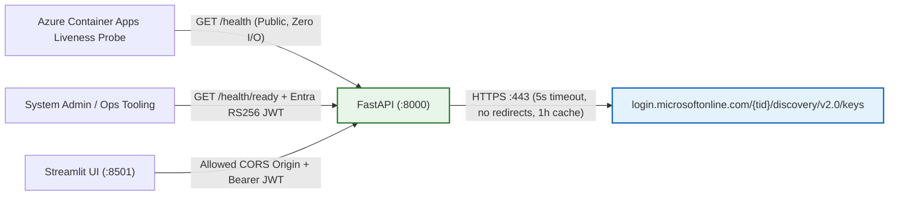
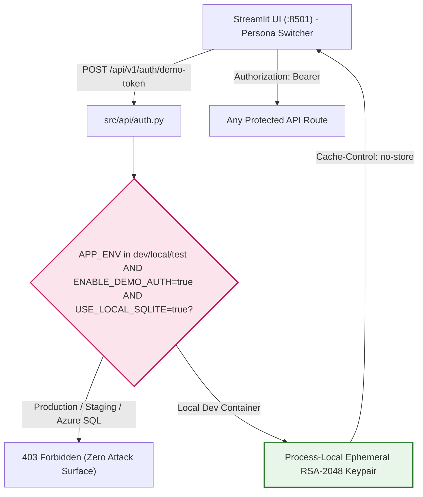
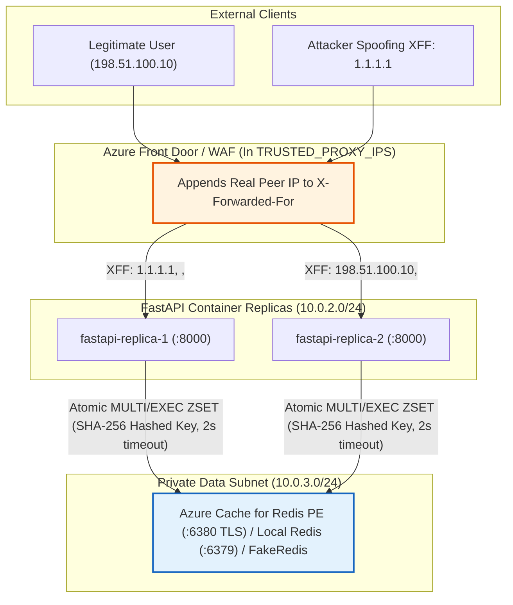
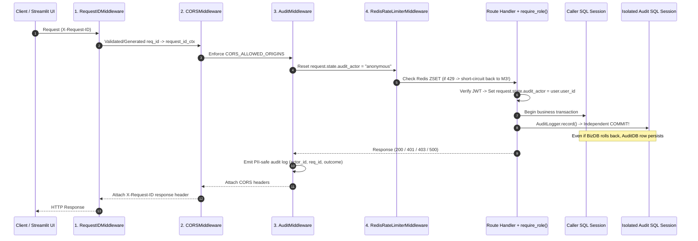
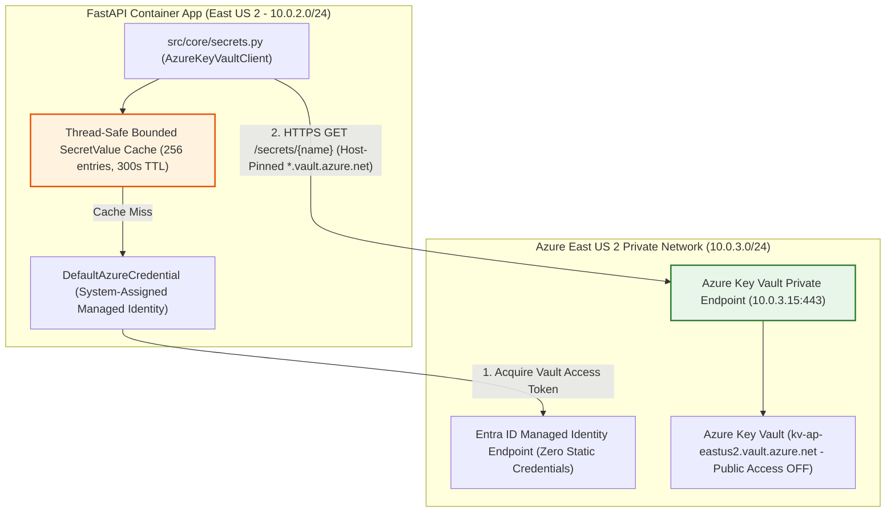
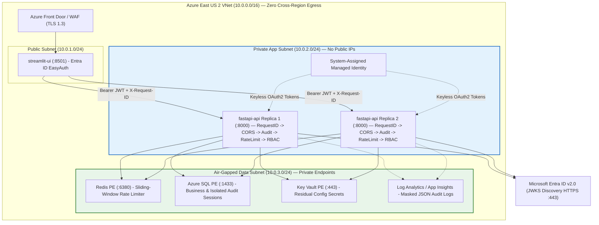

# Phase 3: Infrastructure, Security Wiring & Docker Evolution

> **Document Scope:** Network trust boundaries, reverse-proxy header routing, Redis rate-limit wiring, Entra ID OIDC discovery egress, Managed Identity Key Vault Private Link routing, and local Docker Compose vs. Azure East US 2 topology evolved during **Phase 3 (Identity and Security)**.  
> **Target Audience:** Cloud Solution Architects, DevOps Engineers, Security Architects, and SREs.

---

## 1. Security Infrastructure Philosophy: Zero-Trust Offline Parity

In Phase 1 and Phase 2, we established dual-engine parity for FastAPI and SQL (`SQLite` locally vs. `Azure SQL` in production). In **Phase 3**, we extended that exact zero-cost, zero-static-secret parity across **all four security infrastructure boundaries**:

```text
┌────────────────────────────────────────────────────────────────────────────────────────┐
│                     PHASE 3 DUAL-MODE SECURITY INFRASTRUCTURE                          │
│                                                                                        │
│  LOCAL / CI RUNTIME (100% Offline, $0)        PRODUCTION (Azure East US 2 VNet)        │
│  ┌───────────────────────────────────────┐    ┌──────────────────────────────────────┐ │
│  │ • Auth: Ephemeral RSA-2048 Keypair    │    │ • Auth: Entra ID v2.0 JWKS HTTPS     │ │
│  │   (Triple-gated dev/local/test only)  │    │   (Private/Trusted Egress Allowlist) │ │
│  │ • Rate Limit: fakeredis.aioredis      │    │ • Rate Limit: Azure Cache for Redis  │ │
│  │   (In-memory ZSET MULTI/EXEC)         │    │   (Private Endpoint :6380 TLS 1.2+)  │ │
│  │ • Audit DB: Isolated aiosqlite tx     │    │ • Audit DB: Isolated Azure SQL tx    │ │
│  │ • Secrets: LocalKeyVaultStub (empty)  │    │ • Secrets: Azure Key Vault PE (:443) │ │
│  │   (Scoped KV_STUB_ env opt-in only)   │    │   via System-Assigned Managed ID     │ │
│  │ • Proxy Trust: TRUSTED_PROXY_IPS=[]   │    │ • Proxy Trust: Front Door / WAF IPs  │ │
│  └───────────────────────────────────────┘    └──────────────────────────────────────┘ │
└────────────────────────────────────────────────────────────────────────────────────────┘
```

---

## 2. Subtask-by-Subtask Infrastructure & Component Wiring Evolution

### 2.1 Subtask P3-1: Entra ID JWKS Discovery, CORS Allowlisting & Dependency Packaging

In **P3-1 (`feature/entra-id-jwt-rbac`)**, we wired cryptographic JWT verification (`pyjwt[crypto]>=2.8.0` added to `pyproject.toml`) and tightened CORS ingress boundaries:
- **Outbound JWKS Discovery Pin:** `EntraJWKSClient` strictly allows HTTPS calls to `https://login.microsoftonline.com/{validated_uuid}/discovery/v2.0/keys` with `follow_redirects=False`, `5.0s` timeout, `256 KB` payload cap, and a `60s` unknown-`kid` refresh cooldown—preventing SSRF and outbound JWKS amplification storms.
- **Explicit CORS Origin Allowlist (`CORS_ALLOWED_ORIGINS`):** Replaced `allow_origins=["*"]` with explicit trusted UI origins (`["http://localhost:8501", "http://127.0.0.1:8501"]` locally; Azure Front Door HTTPS FQDN in staging/production).
- **Protected Readiness Probe:** Azure Container Apps liveness probes hit public `GET /health` (zero I/O), whereas deep diagnostic `GET /health/ready` requires an authenticated `system_admin` Bearer JWT.



---

### 2.2 Subtask P3-2: Local Demo Auth Routing & Environment Isolation

In **P3-2 (`feature/auth-demo-tokens`)**, we wired `/api/v1/auth/demo-token`, `/api/v1/auth/demo-personas`, and `/api/v1/auth/me` directly into the FastAPI router without introducing any external identity container for local Docker development:



**Container / Replica Note:** Because the ephemeral RSA keypair lives strictly in process memory, demo mode is intentionally scoped to single-process local development (`uvicorn --port 8000` or single-container local `docker compose`). Multi-replica staging/production containers exclusively use Microsoft Entra ID JWKS so all replicas validate the exact same Entra ID tokens statelessly.

---

### 2.3 Subtask P3-3: Redis Networking, Reverse-Proxy Trust Chain & Multi-Replica Throttling

In **P3-3 (`feature/rate-limit-redis`)**, we wired `RedisRateLimiterMiddleware` to share rate-limit state across horizontally scaled FastAPI containers via Redis (`REDIS_URL` with `2.0s` socket connect/read timeouts) and established the reverse-proxy IP trust model (`TRUSTED_PROXY_IPS`):



**Why Redis over In-Process Memory Counters:** When Azure Container Apps scales FastAPI from 1 replica to 5 replicas during month-end invoice surges (BR-022), in-process counters would allow $5\times$ the intended request rate. Centralizing atomic ZSET state in Azure Cache for Redis enforces one consistent global ceiling across every replica.

---

### 2.4 Subtask P3-4: Canonical Middleware Pipeline & Isolated Audit DB Connections

In **P3-4 (`feature/audit-middleware`)**, we locked the exact HTTP middleware execution order inside `src/api/main.py` and separated audit database commits onto their own isolated connection/transaction path:



---

### 2.5 Subtask P3-5: Keyless Managed Identity & Azure Key Vault Private Endpoint Wiring

In **P3-5 (`feature/core-keyvault-stub`)**, we wired `src/core/secrets.py` so production containers obtain short-lived tokens from the Azure Instance Metadata Service (IMDS) / Container Apps Managed Identity endpoint and talk exclusively to the private Key Vault endpoint over TLS 1.2+:



---

## 3. Complete Phase 3 Local Docker Compose vs. Azure East US 2 Topology



### Local Docker Compose Wiring Matrix (Phase 3 Additions)

| Service / Component | Local Docker / Offline Mode | Production Azure East US 2 |
|---|---|---|
| **Identity Provider** | `ENABLE_DEMO_AUTH=true` (in-memory RSA-2048) | Microsoft Entra ID v2.0 (`AZURE_TENANT_ID` + `AZURE_CLIENT_ID`) |
| **Rate Limit Store** | `USE_FAKE_REDIS=true` or Docker `redis:7-alpine` (`redis://redis:6379/0`) | Azure Cache for Redis Private Endpoint (`rediss://...:6380/0`) |
| **Audit Persistence** | Isolated `aiosqlite` transaction (`/app/data/enterprise.db`) | Isolated `aioodbc` transaction on Azure SQL Private Endpoint |
| **Secrets Provider** | `USE_MOCK_KEY_VAULT=true` (`LocalKeyVaultStub`, empty by default) | `USE_MOCK_KEY_VAULT=false` (`AzureKeyVaultClient` + Managed Identity) |
| **CORS / Proxy Trust** | `CORS_ALLOWED_ORIGINS=["http://localhost:8501"]`, `TRUSTED_PROXY_IPS=[]` | Front Door origin + explicit WAF/Front Door `TRUSTED_PROXY_IPS` |

---

## 4. Phase 3 Infrastructure Verification Matrix

| Subtask | Infrastructure Control | Offline Verification | CI / Build Status |
|---|---|---|---|
| **P3-1** | `pyjwt[crypto]` + RS256 JWKS Client + Explicit CORS | 15 tests in `test_security.py` (ephemeral RSA-2048, zero network) | PR #6 Merged ✅ |
| **P3-2** | Ephemeral RSA Demo Auth + Triple Prod Gate | 10 tests in `test_demo_auth.py` (prod/staging/Azure SQL blocked) | PR #7 Merged ✅ |
| **P3-3** | `fakeredis.aioredis` ZSET Pipeline + Anti-XFF Proxy Routing | 12 tests in `test_rate_limit.py` (zero Lua, 0 warnings) | PR #8 Merged ✅ |
| **P3-4** | Canonical 4-Layer Middleware Stack + Isolated Audit Session | 10 tests in `test_audit.py` (rollback survival, CRLF + PII path safety) | PR #9 Merged ✅ |
| **P3-5** | Managed Identity Key Vault URL Pin + Offline Stub + Secret Scanner | 8 tests in `test_secrets.py` (full `src/` static-secret scan) | PR #10 Merged ✅ |
