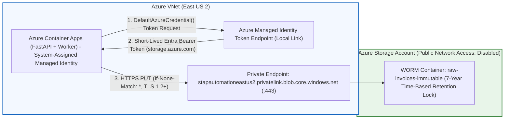
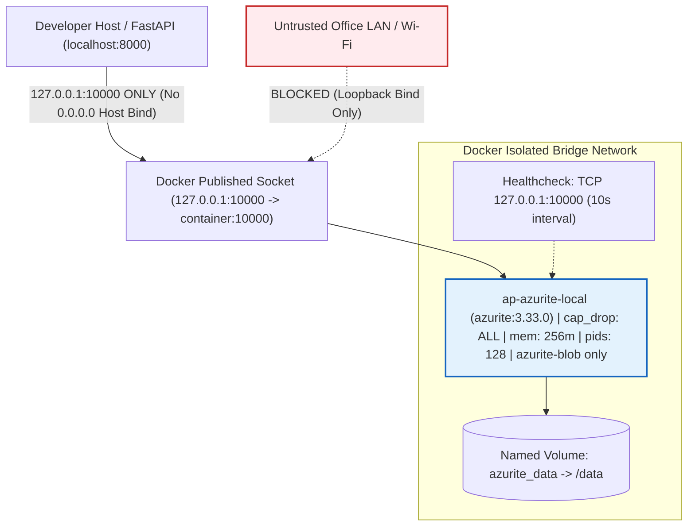
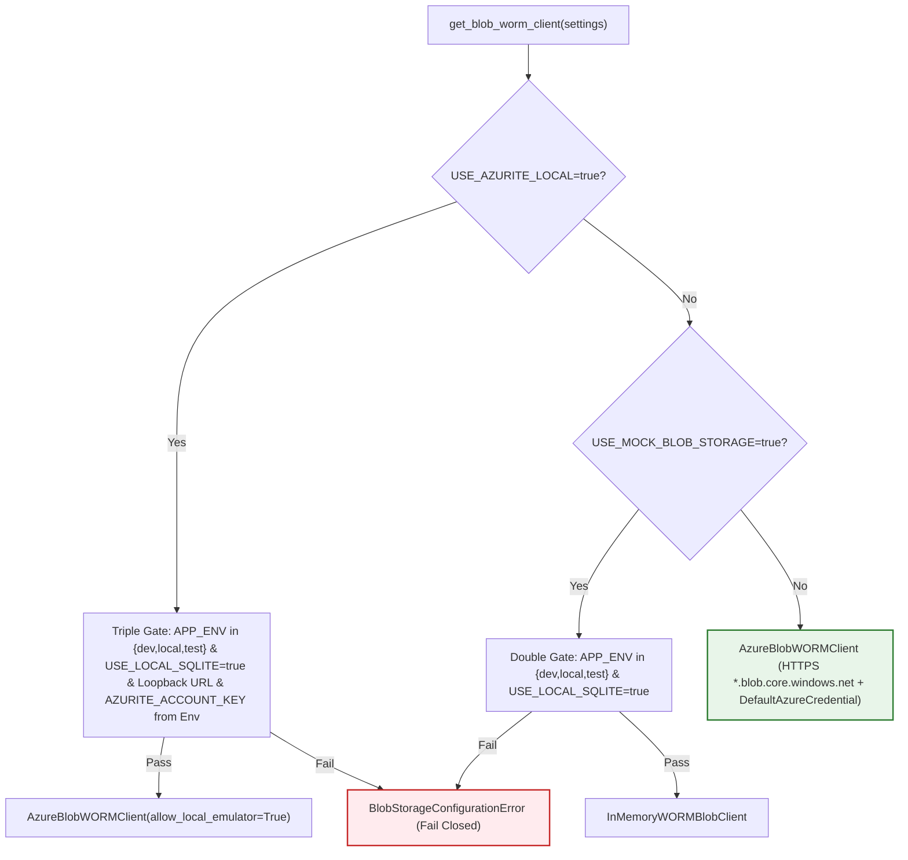
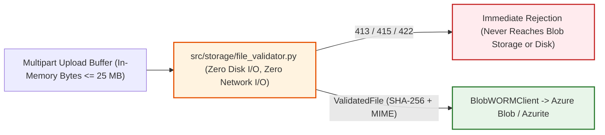
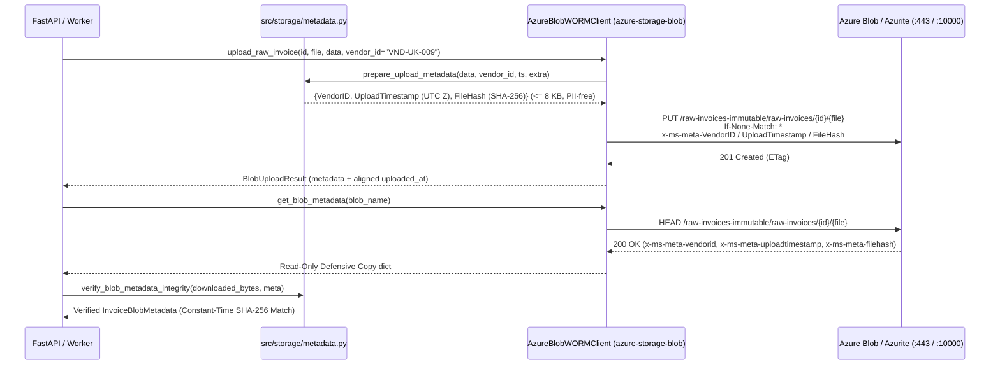

# Phase 4: Infrastructure, Docker Networking & Storage Wiring Evolution

> **Document Scope:** Storage network topology, Azure Private Link & Managed Identity egress, hardened Azurite Docker Compose networking (`docker-compose.azurite.yml`), wire-protocol HTTP transport wiring, and storage-layer runtime configuration evolved during **Phase 4 (Azure Storage Layer — P4-1 through P4-4)**.  
> **Target Audience:** Cloud Solution Architects, DevOps Engineers, Security Architects, and SREs.

---

## 1. Storage Infrastructure Philosophy: Three-Tier Offline-to-Cloud Parity

In Phases 1–3, we established zero-cost local parity for FastAPI, SQL, Redis, Entra ID, and Key Vault. In **Phase 4**, we designed a **three-tier storage runtime topology** that lets identical application code (`BlobWORMClientProtocol`) run seamlessly across offline CI, local Docker Azurite, and Azure East US 2 VNet Private Link:

```text
┌─────────────────────────────────────────────────────────────────────────────────────────────────┐
│                         PHASE 4 THREE-TIER STORAGE INFRASTRUCTURE                               │
│                                                                                                 │
│  TIER 1: OFFLINE CI ($0, 0 Sockets)   TIER 2: LOCAL DOCKER ($0)       TIER 3: AZURE EAST US 2   │
│  ┌──────────────────────────────┐     ┌──────────────────────────┐    ┌───────────────────────┐ │
│  │ • InMemoryWORMBlobClient     │     │ • Azurite v3.33.0 Docker │    │ • Azure Storage Acct  │ │
│  │ • In-Process HttpTransport   │     │   127.0.0.1:10000 ONLY   │    │   (LRS/ZRS East US 2) │ │
│  │   (Real azure-storage-blob   │     │ • cap_drop: ALL          │    │ • Private Endpoint    │ │
│  │    SDK wire signing & XML)   │     │ • mem_limit: 256m        │    │   HTTPS :443 Only     │ │
│  │ • PyMuPDF + stdlib zipfile   │     │ • pids_limit: 128        │    │ • System-Assigned MI  │ │
│  │   file validation in-RAM     │     │ • Key via .env ONLY      │    │   (Storage Blob Data  │ │
│  │ • Triple-gated dev/test only │     │ • Triple-gated dev only  │    │    Contributor)       │ │
│  │                              │     │                          │    │ • 7-Yr WORM Lock      │ │
│  └──────────────────────────────┘     └──────────────────────────┘    └───────────────────────┘ │
└─────────────────────────────────────────────────────────────────────────────────────────────────┘
```

---

## 2. Subtask-by-Subtask Infrastructure & Component Wiring Evolution

### 2.1 Subtask P4-1: Keyless Azure Blob WORM Wiring & Production Egress Pinning

In **P4-1 (`feature/storage-blob-worm-client`)**, we added `azure-storage-blob>=12.19.0` and `azure-identity>=1.15.0` wiring through `src/storage/blob_client.py` and `src/core/config.py`:

- **Environment Variables Wired (`src/core/config.py`, `.env.example`):**
  - `AZURE_BLOB_ACCOUNT_URL` (strictly validated against `^https://([a-z0-9]{3,24})\.blob\.core\.windows\.net/?$`)
  - `AZURE_BLOB_WORM_CONTAINER` (default `raw-invoices-immutable`, Azure DNS container rules enforced)
  - `USE_MOCK_BLOB_STORAGE` (triple-gated: requires `APP_ENV in {dev, local, test}` AND `USE_LOCAL_SQLITE=true`)
- **Timeout & Socket Discipline:**
  - `BLOB_OPERATION_TIMEOUT_SECONDS = 30`, `BLOB_EXISTS_TIMEOUT_SECONDS = 10`
  - Bounded `download_blob(offset=0, length=MAX_BLOB_SIZE_BYTES + 1, max_concurrency=1)` prevents unbounded connection-pool or memory exhaustion.
- **Zero-Secret Managed Identity Flow (Azure East US 2):**



---

### 2.2 Subtask P4-2: Hardened Azurite Docker Compose Networking & Local Wiring

In **P4-2 (`feature/storage-azurite-local`)**, we introduced [`docker-compose.azurite.yml`](file:///Users/lokeshrepaka/Desktop/untitled%20folder/docker-compose.azurite.yml), [`src/storage/azurite.py`](file:///Users/lokeshrepaka/Desktop/untitled%20folder/src/storage/azurite.py), and `Makefile` targets (`make run-azurite`, `make stop-azurite`).

#### Container Security & Network Hardening (`docker-compose.azurite.yml`)

| Hardening Control | Setting in `docker-compose.azurite.yml` | Security Threat Mitigated |
|---|---|---|
| **Loopback-Only Port Binding** | `"127.0.0.1:10000:10000"` | Prevents LAN/Wi-Fi exposure of the local blob emulator (`SEC-059`, `CWE-668`). |
| **Pinned Image Tag** | `mcr.microsoft.com/azure-storage/azurite:3.33.0` | Eliminates supply-chain drift from mutable `:latest` tags. |
| **Least-Privilege Capabilities** | `cap_drop: [ALL]` + `no-new-privileges:true` | Drops all Linux root capabilities and blocks `setuid` privilege escalation. |
| **Resource Ceilings** | `mem_limit: 256m`, `pids_limit: 128` | Contains runaway Node.js memory or fork-bomb impact on developer hosts. |
| **Blob-Only Surface** | `command: [azurite-blob, --blobHost, "0.0.0.0", --blobPort, "10000", ...]` | Disables unused Queue (`:10001`) and Table (`:10002`) listeners entirely. |
| **Zero-Credential Compose** | No `AZURITE_ACCOUNTS` or keys in YAML | Enforces zero static credentials committed to Git (`SEC-062`, `CWE-798`). |
| **TCP Healthcheck** | `node -e "require('net').connect(10000, '127.0.0.1')..."` | Verifies readiness cleanly without `curl` or external binaries. |



#### Local Environment Precedence (`get_blob_worm_client`)



---

### 2.3 Subtask P4-3: In-Memory Zero-Disk File Validation Boundary

In **P4-3 (`feature/storage-file-validator`)**, we deliberately designed `validate_invoice_file()` to operate **100% in memory** (`bytes` + `io.BytesIO` + `fitz.open(stream=data, ...)`):

- **Zero Temp-File Attack Surface:** Malicious uploads never touch `/tmp` or container filesystems—eliminating symlink races, Zip-Slip disk writes (`CWE-22`), leftover PII files on container crash, and read-only root filesystem (`read_only: true`) incompatibilities in Azure Container Apps.
- **CPU & Memory Isolation Bounds:**
  - File size capped at `25 MB` before any parser runs.
  - PNG `IHDR` & JPEG `SOF` bounds (`<= 20,000 px`, `<= 50M pixels`) checked *before* MuPDF decodes pixels.
  - PDF scan capped at `200` pages and `10,000` xref objects.
  - XLSX archive capped at `500` entries, `100 MB` declared uncompressed size, `100:1` compression ratio, `2 MB` per XML member, and `10 MB` cumulative XML scan budget.



---

### 2.4 Subtask P4-4: Azure HTTP Wire-Header Metadata Routing (`x-ms-meta-*`)

In **P4-4 (`feature/storage-blob-metadata`)**, we aligned our storage metadata model directly with Azure Blob Storage's HTTP/1.1 REST wire protocol:

- **Outbound `PUT` Headers:** `azure-storage-blob` serializes `metadata={"VendorID": ..., "UploadTimestamp": ..., "FileHash": ...}` into HTTP request headers:
  - `x-ms-meta-VendorID: VND-UK-009`
  - `x-ms-meta-UploadTimestamp: 2026-11-18T10:00:00Z`
  - `x-ms-meta-FileHash: <64-char lowercase sha256>`
  - Combined wire size of all `x-ms-meta-<k>: <v>\r\n` headers is strictly capped at **8,192 bytes** (`MAX_TOTAL_METADATA_BYTES`) before sending the HTTP request, preventing Azure `400 MetadataTooLarge` failures.
- **Inbound `HEAD` (`get_blob_properties`) Normalization:** Both Azure Blob Storage and Azurite return HTTP metadata headers lowercased (`x-ms-meta-vendorid`, `x-ms-meta-uploadtimestamp`, `x-ms-meta-filehash`). `parse_invoice_blob_metadata()` normalizes keys case-insensitively while rejecting duplicate case-colliding headers (`CWE-436`).



---

## 3. Production Readiness Checklist for Phase 4 Infrastructure

| Infrastructure Control | Local Dev / CI | Azure East US 2 Production | Status |
|---|---|---|---|
| **Authentication** | Ephemeral/Env Azurite Key or In-Memory Mock | System-Assigned Managed Identity (`DefaultAzureCredential`) | Verified ✅ |
| **Network Isolation** | `127.0.0.1:10000` loopback bind / zero-socket CI | Private Endpoint (`*.privatelink.blob.core.windows.net`), Public Access Disabled | Verified ✅ |
| **WORM Retention** | `If-None-Match: *` + zero delete APIs | `If-None-Match: *` + 7-year (`2555`-day) Immutable Storage Lock | Verified ✅ |
| **Container Hardening** | `cap_drop: ALL`, `no-new-privileges`, `256m` RAM | Azure Container Apps non-root, read-only rootfs compatible (zero temp files) | Verified ✅ |
| **CI Offline Execution** | 150 passed in 3.04s (`0` network calls, `0` Docker) | Same wheel built & verified in GitHub Actions | Verified ✅ |

