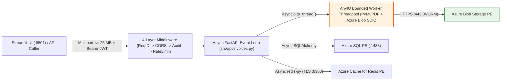
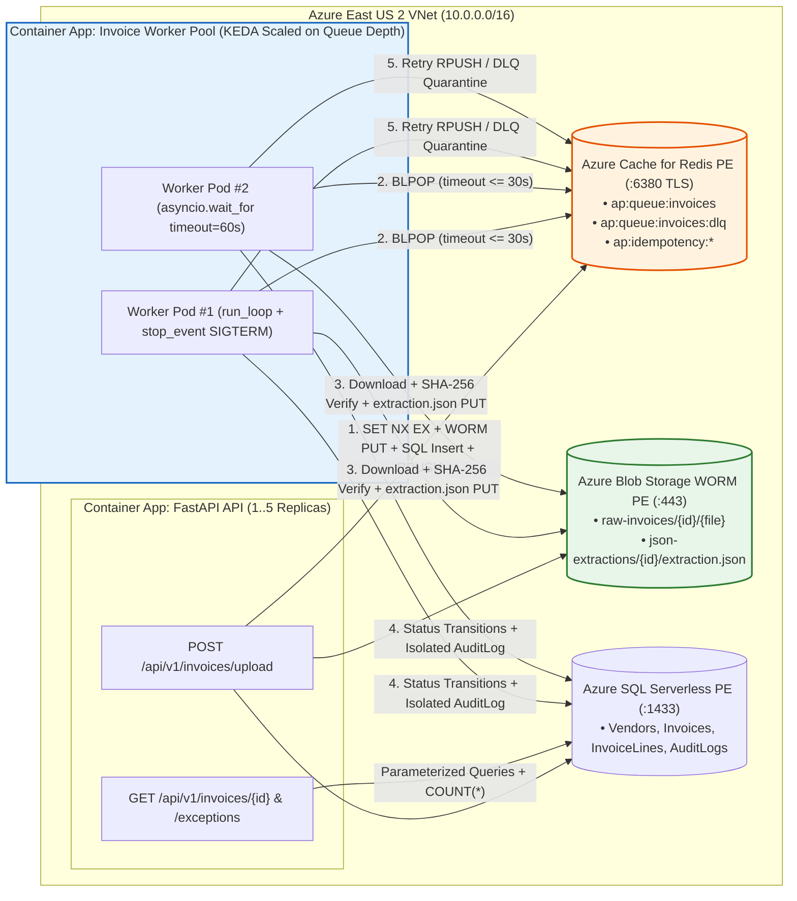
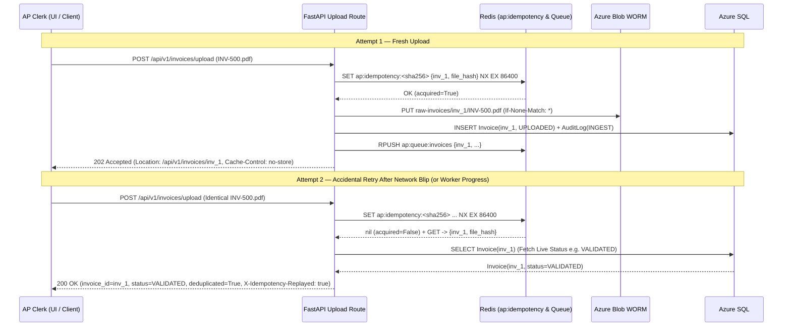

# Phase 5: Infrastructure, Async Worker Topology & Component Wiring Evolution

> **Document Scope:** API-to-Redis-to-Worker runtime wiring, FastAPI async event-loop offloading, Azure Container Apps horizontal autoscaling topology, Redis TLS (`:6380`) & memory-ceiling design, and HTTP routing/caching boundaries evolved during **Phase 5 (Invoice Upload API and Job Queue — P5-1 through P5-5)**.  
> **Target Audience:** Cloud Solution Architects, DevOps Engineers, Security Architects, and SREs.

---

## 1. Phase 5 Runtime Topology: Decoupled API & Stateless Worker Scaling

Before Phase 5, the platform consisted of a single FastAPI web process with health/auth endpoints and isolated storage/database packages. In **Phase 5**, we established the full **producer-queue-consumer distributed topology** that scales horizontally on Azure Container Apps (East US 2) while still running 100% in-process and offline for local development and CI:

```text
┌─────────────────────────────────────────────────────────────────────────────────────────────────┐
│                    PHASE 5 DUAL-MODE PRODUCER-QUEUE-CONSUMER INFRASTRUCTURE                     │
│                                                                                                 │
│  LOCAL / OFFLINE CI ($0, 0 Sockets)             PRODUCTION (Azure East US 2 VNet 10.0.0.0/16)   │
│  ┌─────────────────────────────────────────┐    ┌─────────────────────────────────────────────┐ │
│  │ • API: FastAPI TestClient / Uvicorn     │    │ • API: Azure Container App (FastAPI :8000)  │ │
│  │ • Queue & Idem: fakeredis.aioredis      │    │ • Queue & Idem: Azure Cache for Redis B0    │ │
│  │   (In-RAM RPUSH/LPOP/SET NX/WATCH)      │    │   (Private Endpoint :6380, rediss:// TLS)   │ │
│  │ • Worker: InvoiceBackgroundWorker       │    │ • Worker: Azure Container App / Job (HPA    │ │
│  │   (In-process async run_loop)           │    │   scaled on LLEN ap:queue:invoices depth)   │ │
│  │ • Blob: InMemoryWORM / Azurite :10000   │    │ • Blob: Azure Storage PE (:443, WORM + MI)  │ │
│  │ • SQL: aiosqlite (:memory: / local.db)  │    │ • SQL: Azure SQL Serverless PE (:1433 + MI) │ │
│  └─────────────────────────────────────────┘    └─────────────────────────────────────────────┘ │
└─────────────────────────────────────────────────────────────────────────────────────────────────┘
```

---

## 2. Subtask-by-Subtask Infrastructure & Component Wiring Evolution

### 2.1 Subtask P5-1: FastAPI Upload Ingress, Threadpool Offloading & Middleware Stack

In **P5-1 (`feature/api-invoice-upload`)**, we mounted `invoices_router` onto `src/api/main.py` *inside* the locked 4-layer Phase 3 middleware stack and protected the asyncio event loop from CPU/blocking-I/O starvation:

- **Full Request Execution Order on `POST /api/v1/invoices/upload`:**
  1. `RequestIDMiddleware` — validates/mints `X-Request-ID`, sets `request_id_ctx`.
  2. `CORSMiddleware` — explicit `CORS_ALLOWED_ORIGINS` allowlist (`Idempotency-Key` header allowed).
  3. `AuditMiddleware` — records HTTP status & verified actor telemetry.
  4. `RedisRateLimiterMiddleware` — atomic sliding-window throttle before hitting file parsing.
  5. `guard_upload_content_length` dependency — rejects `Content-Length > 26 MB` (`413`) or negative/malformed (`400`) before multipart processing.
  6. `require_role(AP_CLERK, FINANCE_MANAGER)` — Entra ID / Demo RS256 RBAC (`401`/`403`).
  7. `_read_upload_bounded` — async 64 KB chunk loop aborting strictly at `25 MB` (`413`), closing `UploadFile` in `finally`.
  8. `asyncio.to_thread` worker pool — offloads CPU-heavy PyMuPDF/ZIP validation (`file_validator.py`) and blocking Azure Storage SDK upload (`blob_client.py`) so concurrent `/health` probes and API reads never stall (`SEC-078`).



---

### 2.2 Subtask P5-2: Redis Keyspace Layout, TLS Enforcement & 250 MB Memory Protection

In **P5-2 (`feature/core-redis-job-queue`)**, we formalized the Redis data architecture specifically around **Azure Cache for Redis Basic B0 (`250 MB` RAM)** (`HLD §256`):

| Redis Key Pattern | Data Structure | Bounding / TTL Control | Purpose |
|---|---|---|---|
| `ap:rate_limit:<sha256>` | Sorted Set (`ZSET`) | Sliding window `EX` + `ZREM` on 429 (P3-3) | Per-client HTTP abuse throttling |
| `ap:queue:invoices` | List (`RPUSH` / `LPOP` / `BLPOP`) | `<= 64 KB` per job, `MAX_QUEUE_DEPTH = 100,000` | FIFO async invoice processing queue |
| `ap:queue:invoices:dlq` | List (`RPUSH` + `LTRIM`) | Capped at latest `10,000` entries, `2 KB` preview | Poison-pill & retry-exhausted quarantine |
| `ap:idempotency:<sha256>` | String (JSON) | `SET NX EX` TTL `86,400s` (24h, bounds `60s..7d`) | Atomic upload deduplication claims |

**Transport & Environment Hardening (`src/core/redis_client.py`):**
- `socket_connect_timeout = 2.0s` and `socket_timeout = 2.0s` prevent slow Redis sockets from cascading into API timeouts.
- `validate_redis_url()` enforces `rediss://` (TLS 1.2+ on port `6380`) in any non-local environment (`staging`, `production`, `prod`, `uat`), blocking unencrypted `redis://` traffic (`SEC-084`, `CWE-319`).
- `get_redis_queue_client()` hard-blocks `USE_FAKE_REDIS=true` outside `dev`/`local`/`test` OR whenever `USE_LOCAL_SQLITE=false`.

---

### 2.3 Subtask P5-3: Background Worker Container Wiring & HPA Autoscaling

In **P5-3 (`feature/worker-pipeline-skeleton`)**, `InvoiceBackgroundWorker` (`src/services/worker.py`) was engineered as a **completely stateless async consumer** suitable for Azure Container Apps KEDA/HPA scaling driven by `LLEN ap:queue:invoices`:



**Graceful Shutdown & Operational Discipline:**
- `run_loop(stop_event=..., poll_timeout_seconds=1)` integrates directly with Linux `SIGTERM` handlers on Azure Container Apps—finishing the active in-flight job cleanly before exiting without dropping work.
- When `poll_timeout_seconds=0` is used in local/test harnesses, empty polls yield with `await asyncio.sleep(0.05)` to prevent 100% CPU busy-spin (`SEC-092`).

---

### 2.4 Subtasks P5-4 & P5-5: HTTP Routing Precedence, Proxy Cache Safety & Idempotent Replay Sequence

In **P5-4** and **P5-5**, we wired HTTP routing precedence, proxy cache headers, and atomic replay coordination across FastAPI, Redis, WORM Blob, and SQL:

- **Static-Before-Dynamic FastAPI Route Order:**
  1. `POST /api/v1/invoices/upload`
  2. `GET /api/v1/invoices/exceptions` *(registered BEFORE `/{invoice_id}` to prevent path shadowing!)*
  3. `GET /api/v1/invoices/{invoice_id}`
- **Reverse-Proxy / CDN Hygiene (`SEC-082`, `SEC-100`, `CWE-525`):** Every upload receipt, detail response, and exception queue page sets `Cache-Control: no-store` so Azure Front Door, corporate proxies, and browser disk caches never retain financial invoice payloads.



---

## 3. Phase 5 Infrastructure Readiness Checklist

| Control | Local / Offline CI | Production (Azure East US 2) | Status |
|---|---|---|---|
| **Redis Queue & Idempotency** | `fakeredis.aioredis` (`0.04s`, 0 sockets) | Azure Cache for Redis Basic B0 PE (`:6380`, `rediss://` TLS) | Verified ✅ |
| **Event-Loop Non-Blocking** | `asyncio.to_thread` for PyMuPDF & Blob SDK | `asyncio.to_thread` + bounded 64 KB multipart streaming | Verified ✅ |
| **Worker Scaling & Shutdown** | `InvoiceBackgroundWorker.run_loop(max_jobs)` | Container Apps HPA on `LLEN ap:queue:invoices` + `SIGTERM` `stop_event` | Verified ✅ |
| **HTTP Cache & Error Hygiene** | `Cache-Control: no-store`, sanitized `503`/`422` | Same headers behind Azure Front Door / WAF | Verified ✅ |
| **CI Offline Verification** | **193 passed, 1 skipped** in `5.34s` (68 files) | GitHub Actions Lint + Unit Tests + Wheel Build green | Verified ✅ |

