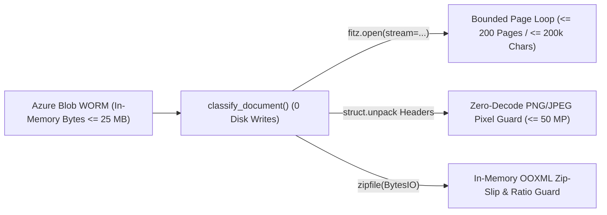
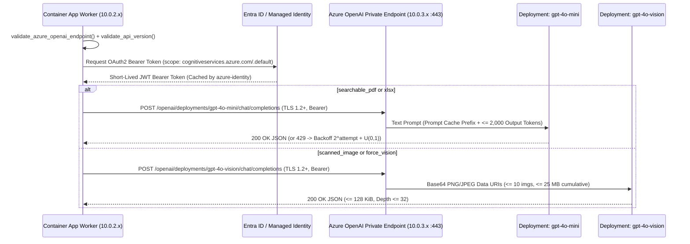
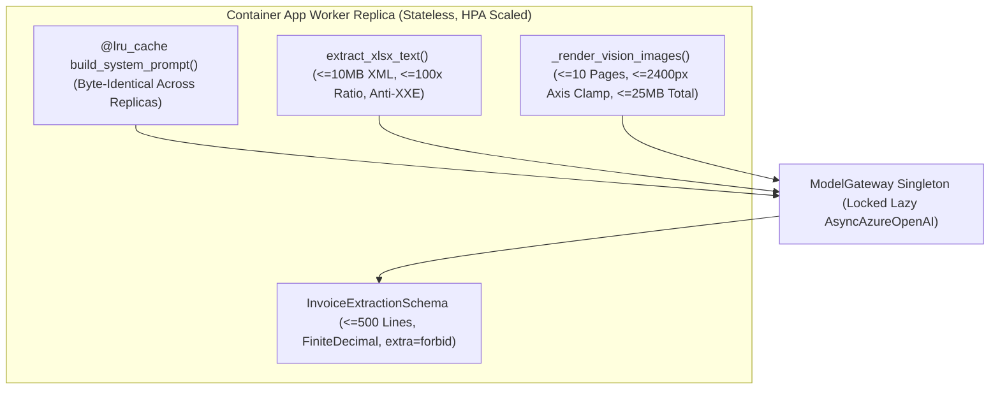
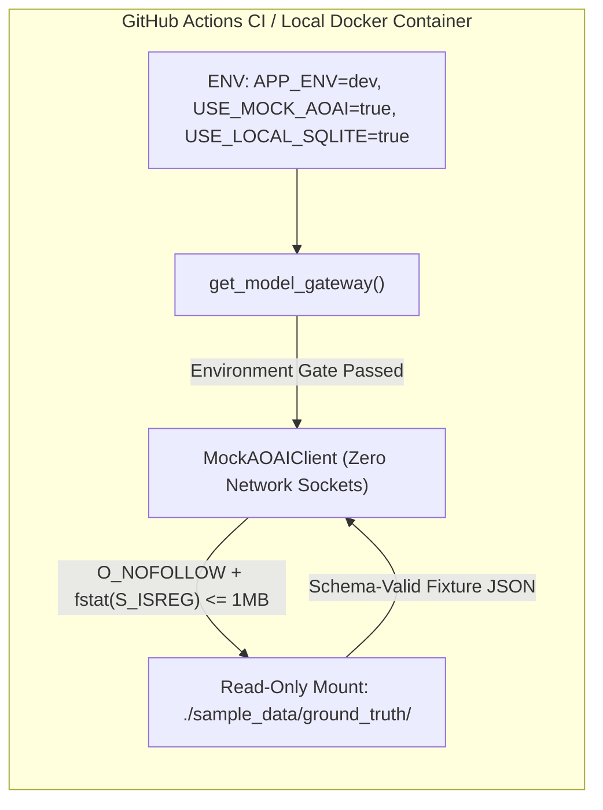

# Phase 6: Infrastructure, Azure OpenAI Networking & Component Wiring Evolution

> **Document Scope:** Azure East US 2 Private Endpoint networking for Azure OpenAI, keyless Microsoft Entra ID Managed Identity token flow, local/CI zero-network isolation vs. production cloud topology, memory/CPU resource ceilings for PDF/XLSX/Vision rendering, and singleton cache wiring evolved during **Phase 6 (Extraction Engine and Model Gateway — P6-1 through P6-5)**.  
> **Target Audience:** Cloud Solution Architects, DevOps / Platform Engineers, Security Architects, and SREs.

---

## 1. Phase 6 Dual-Mode Infrastructure Topology (Offline CI vs. Azure East US 2 Production)

Phase 6 introduces the platform's first AI inference dependency while preserving our strict **zero-network local/CI guarantee (`CLAUDE.md §13`)** and **Azure East US 2 data-residency boundary (`N2`, `ADR-001`, `ADR-007`)**:

```text
┌───────────────────────────────────────────────────────────────────────────────────────────────────┐
│                  PHASE 6 DUAL-MODE AI EXTRACTION INFRASTRUCTURE TOPOLOGY                          │
│                                                                                                   │
│  LOCAL DEV / OFFLINE CI ($0, 0 Sockets)             PRODUCTION (Azure East US 2 VNet 10.0.0.0/16) │
│  ┌──────────────────────────────────────────────┐   ┌───────────────────────────────────────────┐ │
│  │ • Worker Container / Pytest Process          │   │ • Azure Container App / Worker Job        │ │
│  │   └─ ExtractionEngine                        │   │   (System-Assigned Managed Identity)      │ │
│  │      ├─ PyMuPDF (In-Memory PDF/PNG)          │   │   └─ ExtractionEngine                     │ │
│  │      ├─ Stdlib ZipFile+ET (In-Memory XLSX)   │   │      ├─ KeylessAzureOpenAIClient          │ │
│  │      ├─ ModelGateway (USE_MOCK_AOAI=true)    │   │      │  ├─ IMDS/Entra ID Token Provider   │ │
│  │      └─ MockAOAIClient                       │   │      │  │  (cognitiveservices.azure.com)  │ │
│  │         └─ Local FS (O_NOFOLLOW):            │   │      │  └─ Private Endpoint (:443 TLS)    │ │
│  │            ./sample_data/ground_truth/       │   │      │     *.openai.azure.com (East US 2) │ │
│  │ • Blocked in prod/staging via CWE-489 gate   │   │      │     ├─ Deployment: gpt-4o-mini     │ │
│  │ • Zero outbound sockets / zero API keys      │   │      │     └─ Deployment: gpt-4o-vision   │ │
│  └──────────────────────────────────────────────┘   │ • NSG Deny All Cross-Region Egress (N2)   │ │
│                                                     └───────────────────────────────────────────┘ │
└───────────────────────────────────────────────────────────────────────────────────────────────────┘
```

---

## 2. Subtask-by-Subtask Infrastructure & Component Wiring Evolution

### 2.1 Subtask P6-1: In-Memory Binary Inspection & Worker Memory Bounds (`document_classifier.py`)

In **P6-1 (`feature/extraction-document-classifier`)**, all classification runs strictly in-memory inside the worker container—no temporary files written to container ephemeral disk (preventing `/tmp` exhaustion and leftover PII files on container crash):

- **Memory & CPU Guardrails per Worker Container:**
  - Max input payload: `25 MB` (`MAX_CLASSIFIER_SIZE_BYTES`).
  - Max PDF pages inspected: `200` (`MAX_CLASSIFIER_PDF_PAGES`) with incremental `200,000`-character text cap inside the page loop.
  - Pre-decode raster pixel-bomb check: `<= 20,000 px` per axis and `<= 50,000,000` total pixels before decoding.
  - XLSX archive bounds: `<= 500` entries, `<= 100 MB` uncompressed total, `<= 100x` compression ratio.



---

### 2.2 Subtask P6-2: Keyless Managed Identity, Private Endpoint Pinning & Retry Topology (`model_gateway.py`)

In **P6-2 (`feature/extraction-model-gateway`)**, we designed the exact production network and authentication boundary between Azure Container Apps workers and Azure OpenAI East US 2:

1. **Keyless Entra ID Auth Flow (`ADR-007`, Zero `api_key=`):**
   - `KeylessAzureOpenAIClient` lazily initializes `AsyncAzureOpenAI` under a `threading.Lock()` using `DefaultAzureCredential()` + `get_bearer_token_provider(..., "https://cognitiveservices.azure.com/.default")`.
   - SDK internal retries are disabled (`max_retries=0`) so `ModelGateway` owns deterministic **LLD §6.2** retry timing (`2**attempt + Uniform(0, 1)`, max 4 attempts) and per-request timeout (`45.0s` default, capped at `120.0s`).
2. **SSRF & Token-Exfiltration Network Pinning (`SEC-111`, `SEC-116`):**
   - `validate_azure_openai_endpoint()` strictly allows ONLY `https://<resource>.openai.azure.com/`—guaranteeing Entra ID Bearer tokens are **never** sent to plaintext HTTP, attacker domains, or internal IMDS/VNet endpoints.
   - `validate_api_version()` pins query strings to `YYYY-MM-DD[-(preview|alpha|beta)]`, and `validate_deployment_name()` pins URL path segments to `[A-Za-z0-9._-]{1,64}`.
3. **Production vs. Offline Singleton Cache Wiring (`get_model_gateway()`):**
   - Cache key: `(env_name, USE_MOCK_AOAI, USE_LOCAL_SQLITE, SAMPLE_DATA_DIR, AZURE_OPENAI_ENDPOINT, AZURE_OPENAI_API_VERSION, MINI_DEPLOYMENT, GPT4O_DEPLOYMENT)`.
   - Pre-cache security gate blocks `USE_MOCK_AOAI=true` outside `{dev, local, test}` or when `USE_LOCAL_SQLITE=false`.



---

### 2.3 Subtasks P6-3 & P6-4: Container Memory Caps, Prompt Cache Prefix Alignment & Layer Boundaries

In **P6-3 (`schemas.py`)** and **P6-4 (`extract_engine.py`)**, we hardened the compute and memory profile of container workers handling hostile documents:

- **Vision PDF Rendering Ceiling (`SEC-128`):** PyMuPDF rendering scales each page via `min(150/72, 2400 / max(width, height))` so even a malicious `10,000 × 10,000 pt` PDF MediaBox clamps cleanly to `<= 2400 × 2400 px` instead of allocating >1.3 GB RAM and triggering a Container App OOMKill (`SIGKILL 137`).
- **XLSX Zero-Dependency Stdlib XML Extraction (`SEC-127`):** Uses Python stdlib `zipfile` + `xml.etree.ElementTree` (zero extra Docker image bloat!) with `<= 10 MB` XML cap, `<= 100x` ratio cap, `<!DOCTYPE`/`<!ENTITY` rejection, `<= 50,000` shared strings, and `<= 2,000`-char cell truncation.
- **Process-Wide Prompt Cache Determinism:** `build_system_prompt()` is `@lru_cache(maxsize=1)` with `json.dumps(..., sort_keys=True, separators=(",", ":"))`, guaranteeing every worker replica in Azure Container Apps sends the **exact same byte prefix** to Azure OpenAI East US 2 for optimal prompt cache hit rates across horizontally scaled replicas.



---

### 2.4 Subtask P6-5: Local Docker / CI Zero-Network Wiring & Hardened Fixture I/O (`mock_aoai_client.py`)

In **P6-5 (`feature/extraction-mock-aoai-client`)**, we wired `MockAOAIClient` directly into `get_model_gateway()` for offline Docker Compose (`docker-compose.yml` local stack) and GitHub Actions CI runners:

- **Container & CI Environment Variables:**
  - `APP_ENV=dev` (or `local` / `test`)
  - `USE_MOCK_AOAI=true`
  - `USE_LOCAL_SQLITE=true`
  - `USE_FAKE_REDIS=true`
  - `SAMPLE_DATA_DIR=./sample_data`
- **Hardened Local Filesystem Boundary (`SEC-133`, `SEC-134`):**
  - Strictly resolves `sample_data/ground_truth/<INV-YYYY-NNNN[-REV]>_ground_truth.json` via `os.open(..., os.O_RDONLY | os.O_NOFOLLOW)` + `os.fstat()` regular-file verification (`S_ISREG`) + `<= 1 MB` bounded read + `try/finally` FD close—eliminating symlink escapes, TOCTOU races, FIFO hangs, and FD leaks inside Docker volumes.



---

## 3. Production Deployment & Network Checklist for Phase 6

| Control | Local / CI Setting | Azure East US 2 Production Setting | Enforced By |
|---|---|---|---|
| **AI Backend** | `USE_MOCK_AOAI=true` (`MockAOAIClient`) | `USE_MOCK_AOAI=false` (`KeylessAzureOpenAIClient`) | `get_model_gateway()` + `MockAOAIClient.__init__()` (`CWE-489`) |
| **Auth Method** | None (0 network calls) | System-Assigned Entra ID Managed Identity (`Cognitive Services OpenAI User` RBAC role) | `DefaultAzureCredential` + `get_bearer_token_provider` (`ADR-007`) |
| **Endpoint Pin** | Not contacted | `https://<resource>.openai.azure.com/` over Private Endpoint (`:443`) | `validate_azure_openai_endpoint()` (`CWE-918`) |
| **Egress Policy** | Offline (no sockets) | VNet NSG denies all outbound traffic outside East US 2 Private Endpoints | Azure Bicep / NSG (`N2`) + Base64-only Vision guard |
| **Rate Limit Resilience** | Scripted 429 unit tests | `2**attempt + Uniform(0,1)`, max 4 attempts (`max_retries=0` on SDK) | `ModelGateway.invoke()` (`LLD §6.2`) |
| **Token & Memory Caps** | Enforced identically | Output `<= 2,000` tokens, Response `<= 128 KiB` / depth `<= 32`, Vision `<= 10` imgs / `<= 25 MB` / `<= 2400px` | `ModelGateway`, `ExtractionEngine`, `InvoiceExtractionSchema` |

