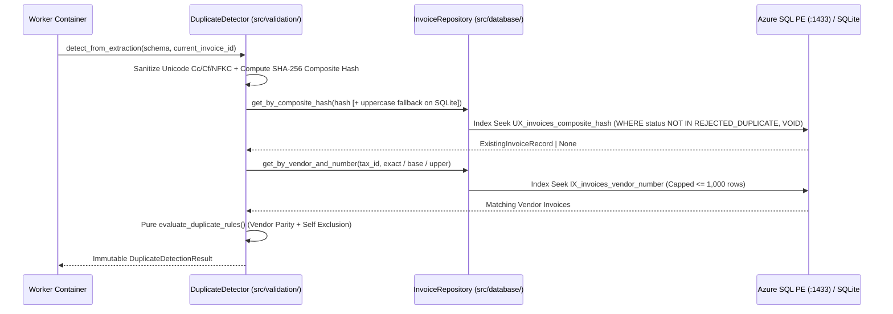
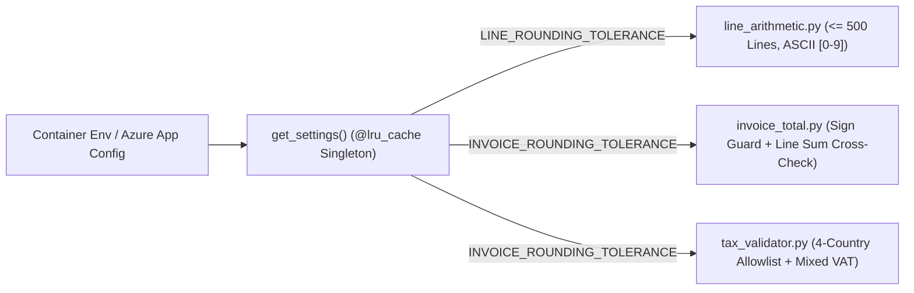
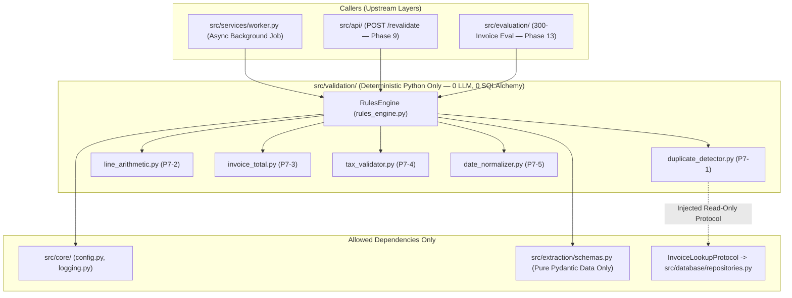

# Phase 7: Infrastructure, Runtime Wiring & Component Boundary Evolution

> **Document Scope:** In-process deterministic execution model, zero-network / zero-sidecar CPU/memory profile, read-only protocol wiring to Azure SQL / SQLite, dynamic `get_settings()` configuration binding across FastAPI API & Background Worker containers, and strict layer-boundary enforcement evolved during **Phase 7 (Validation Rules Engine — P7-1 through P7-6)**.  
> **Target Audience:** Cloud Solution Architects, DevOps / Platform Engineers, Security Architects, and SREs.

---

## 1. Phase 7 Runtime Placement & Container Topology

Unlike Phase 4 (Azure Blob Storage), Phase 5 (Redis Queue), and Phase 6 (Azure OpenAI East US 2), **Phase 7 introduces ZERO new external network dependencies, ZERO new Azure cloud services, and ZERO extra third-party Python packages.**

The entire `src/validation/` package runs as **pure, stateless, CPU-bound deterministic Python** inside two existing containers in our Azure Container Apps (East US 2) and local Docker Compose topologies:

1. **Background Worker Container (`InvoiceBackgroundWorker`):** Runs `RulesEngine.validate_extraction()` immediately after `ExtractionEngine` finishes, using a single read-only SQL query path via `InvoiceLookupProtocol` (Azure SQL Private Endpoint in production / in-memory SQLite in offline CI) to check duplicates and revisions.
2. **FastAPI API Container (`POST /api/v1/invoices/{id}/revalidate` — Phase 9):** Runs synchronous `RulesEngine.validate_revalidation()` directly inside the HTTP request lifecycle with **zero external I/O**, delivering sub-millisecond clerk feedback (`< 2 ms` p99).

```text
┌───────────────────────────────────────────────────────────────────────────────────────────────────┐
│              PHASE 7 DETERMINISTIC VALIDATION RUNTIME & NETWORK BOUNDARY TOPOLOGY                 │
│                                                                                                   │
│  FASTAPI API CONTAINER (:8000)                         BACKGROUND WORKER CONTAINER (HPA Scaled)   │
│  ┌──────────────────────────────────────────────┐      ┌────────────────────────────────────────┐ │
│  │ POST /api/v1/invoices/{id}/revalidate (P9-1) │      │ 1. Dequeue Job (Redis :6379)           │ │
│  │   └─ RulesEngine.validate_revalidation()     │      │ 2. Download WORM Blob (:443 PE)        │ │
│  │      ├─ P7-2 Line Arithmetic (0 I/O)         │      │ 3. Extract via AOAI East US 2 (:443 PE)│ │
│  │      ├─ P7-3 Invoice Total (0 I/O)           │      │ 4. RulesEngine.validate_extraction()   │ │
│  │      ├─ P7-4 Tax Validator (0 I/O)           │      │    ├─ P7-1 DuplicateDetector ──┐       │ │
│  │      ├─ P7-5 Date Normaliser (0 I/O)         │      │    ├─ P7-2..P7-5 (Pure CPU)    │       │ │
│  │      └─ Credit-Note Safety Guard (0 I/O)     │      │    └─ RulesEngineResult        │       │ │
│  │   (Zero LLM Sockets · Zero Blob Sockets)     │      └────────────────────────────────┼───────┘ │
│  └──────────────────────────────────────────────┘                                       │         │
│                                                                      Read-Only Protocol │         │
│                                                                 (InvoiceLookupProtocol) │         │
│                                                                                         ▼         │
│                                                      ┌──────────────────────────────────────────┐ │
│                                                      │ Azure SQL Private Endpoint (10.0.3.x:1433)│ │
│                                                      │ (Local CI: sqlite+aiosqlite:///:memory:)  │ │
│                                                      │ • UX_invoices_composite_hash (FR-09)     │ │
│                                                      │ • IX_invoices_vendor_number (FR-10)      │ │
│                                                      │ • dbo.Vendors (Tax Rate & Date Locale)   │ │
│                                                      └──────────────────────────────────────────┘ │
└───────────────────────────────────────────────────────────────────────────────────────────────────┘
```

---

## 2. Subtask-by-Subtask Infrastructure & Component Wiring Evolution

### 2.1 Subtask P7-1: Read-Only Protocol Decoupling & SQL Index Utilization (`duplicate_detector.py`)

In **P7-1 (`feature/validation-duplicate-detector`)**, we avoided coupling `src/validation/` to SQLAlchemy sessions, connection pools, or Azure SQL ODBC drivers by introducing two `@runtime_checkable` protocols:
- `ExistingInvoiceRecord` (duck-typed projection satisfied by SQLAlchemy `Invoice` ORM)
- `InvoiceLookupProtocol` (async `get_by_composite_hash()` + `get_by_vendor_and_number()`, satisfied directly by `InvoiceRepository`)

This guarantees **zero write capability** inside the detector (`CLAUDE.md §16.1`: a hash collision can never overwrite an existing row) and leverages the two Phase-2 SQL indexes we already provisioned:
- `UX_invoices_composite_hash` (partial unique non-clustered index excluding `REJECTED_DUPLICATE` and `VOID`) → `O(log N)` point lookup.
- `IX_invoices_vendor_number` (`(vendor_tax_id, invoice_number)`) → `O(log N)` revision lookup, bounded at `MAX_EXISTING_LOOKUP_RECORDS = 1,000` to cap container memory (`CWE-400`).



---

### 2.2 Subtasks P7-2 & P7-3: Dynamic Settings Binding & Container Resource Ceilings (`line_arithmetic.py`, `invoice_total.py`)

In **P7-2** and **P7-3**, both validators wire directly into `src/core/config.py::get_settings()` (environment variables injected via Azure Container Apps secrets/config or Docker Compose `.env`) with strict fail-closed bounds:
- `LINE_ROUNDING_TOLERANCE` (default `0.02`, validated to `[0.00, 100.00]`)
- `INVOICE_ROUNDING_TOLERANCE` (default `0.05`, validated to `[0.00, 100.00]`)
- Hard CPU/RAM DoS caps inside container workers: `MAX_LINE_ITEMS = 500`, `MAX_DECIMAL_INPUT_CHARS = 32`, `MAX_DECIMAL_FRACTION_DIGITS = 6`, SQL `DECIMAL(18, 2)` overflow ceiling (`999,999,999,999.99`).



---

### 2.3 Subtasks P7-4 & P7-5: Vendor Master Context Wiring & Zero-Latency In-Memory Lookups (`tax_validator.py`, `date_normalizer.py`)

In **P7-4** and **P7-5**, neither validator performs database I/O directly. Instead, the orchestrating service/API fetches the vendor record once from `VendorRepository` (or in-memory cache) and passes an immutable `VendorRuleContext(country_code, date_locale, standard_tax_rate)` into the validators:
- **Zero N+1 Queries:** One `dbo.Vendors` lookup per invoice supplies both `standard_tax_rate` (US sales tax, P7-4) and `date_format_locale` (US `MM/DD/YYYY` vs. EU `DD/MM/YYYY`, P7-5).
- **Zero External Regex / Locale OS Dependency:** `date_normalizer.py` never relies on container OS `LC_TIME` locales (which vary wildly between macOS dev laptops and `python:3.11-slim` Linux Docker images!). Strict ASCII `[0-9]` regexes guarantee identical deterministic behavior across macOS, GitHub Actions Ubuntu runners, and Azure Container Apps Linux replicas.

---

### 2.4 Subtask P7-6: Complete Validation Layer Wiring & Strict Import Boundary Matrix (`rules_engine.py`)

In **P7-6 (`feature/validation-rules-engine`)**, `RulesEngine` became the single entry façade for both the Background Worker (`validate_extraction`) and the Re-Validation API (`validate_revalidation`).



### Layer Isolation Verification Matrix (Enforced in CI Unit Tests)

| Validation Module | Allowed Imports | Explicitly Blocked & Asserted in Pytest |
|---|---|---|
| `duplicate_detector.py` | `src.core.logging`, `src.extraction.schemas`, stdlib, `pydantic` | `openai`, `sqlalchemy`, `model_gateway`, `extract_engine`, `mock_aoai_client`, `src.storage`, `src.api`, `src.ui` |
| `line_arithmetic.py` | `src.core.config`, `src.core.logging`, `src.extraction.schemas`, stdlib, `pydantic` | `openai`, `sqlalchemy`, `model_gateway`, `extract_engine`, `mock_aoai_client`, `src.storage`, `src.api`, `src.ui` |
| `invoice_total.py` | `src.core.config`, `src.core.logging`, `src.extraction.schemas`, stdlib, `pydantic` | `openai`, `sqlalchemy`, `model_gateway`, `extract_engine`, `mock_aoai_client`, `src.storage`, `src.api`, `src.ui` |
| `tax_validator.py` | `src.core.config`, `src.core.logging`, `src.extraction.schemas`, stdlib, `pydantic` | `openai`, `sqlalchemy`, `model_gateway`, `extract_engine`, `mock_aoai_client`, `src.storage`, `src.api`, `src.ui` |
| `date_normalizer.py` | `src.core.logging`, `src.extraction.schemas`, stdlib, `pydantic` | `openai`, `sqlalchemy`, `model_gateway`, `extract_engine`, `mock_aoai_client`, `src.storage`, `src.api`, `src.ui` |
| `rules_engine.py` | `src.core.logging`, `src.extraction.schemas`, `src.validation.*`, stdlib, `pydantic` | `openai`, `sqlalchemy`, `model_gateway`, `extract_engine`, `mock_aoai_client`, `src.storage`, `src.api`, `src.ui` |

---

## 3. Container Performance & CI Footprint (Phase 7 Verified)

- **Zero New Docker Image Bloat:** `pyproject.toml` dependencies unchanged (0 new third-party runtime packages added in Phase 7).
- **300-Invoice Full 5-Rule Validation Throughput:** All 300 pilot ground-truth invoices (1,068 line items) execute through `RulesEngine.validate_extraction()` in **`< 0.40s` total** (~1.3 ms/invoice on single core).
- **CI Execution Time:** All **360 offline tests** pass in **7.10s** locally and ~49s in GitHub Actions Ubuntu (`python:3.11`), with zero Docker containers, zero network sockets, and **\$0 cloud spend**.

