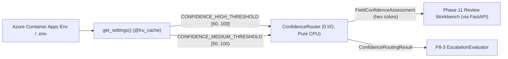
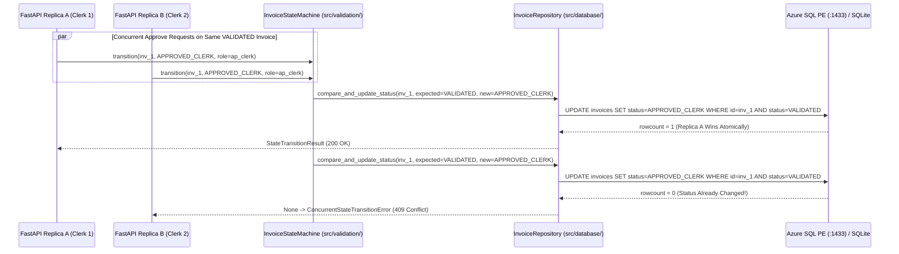
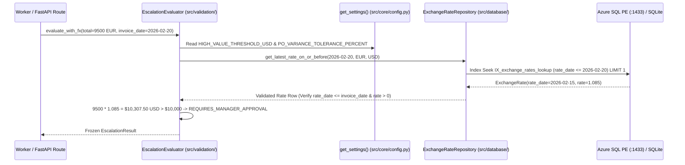

# Phase 8: Infrastructure, Runtime Wiring & Component Boundary Evolution

> **Document Scope:** Runtime deployment placement across FastAPI API & Background Worker containers, protocol-decoupled SQL persistence & atomic CAS locking (`compare_and_update_status`), invoice-date ECB FX index lookups, dynamic environment configuration via `get_settings()`, and strict zero-egress / zero-LLM boundary enforcement evolved during **Phase 8 (Confidence Routing and State Machine — P8-1 through P8-3)**.  
> **Target Audience:** Cloud Solution Architects, DevOps / Platform Engineers, Security Architects, and SREs.

---

## 1. Phase 8 Runtime Placement & Container Topology

Just like Phase 7, **Phase 8 introduces ZERO new external network sockets, ZERO new cloud resources, ZERO new Docker containers, and ZERO new PyPI packages.** All three Phase 8 modules execute in-process inside the two existing Azure Container Apps (East US 2) / Docker Compose compute workloads, communicating strictly over existing Private Endpoints (`Azure SQL :1433`, `Redis :6379`) or offline SQLite in CI:

1. **Background Worker Container (`InvoiceBackgroundWorker`):** Runs the complete extraction → validation → confidence routing → ECB FX escalation → atomic FSM status transition chain (`UPLOADED → EXTRACTING → <routed_status>`) using `ActorRole.SYSTEM` (strictly confined by `_SYSTEM_ALLOWED_TRANSITIONS`).
2. **FastAPI API Container (`:8000` — Phase 9 endpoints `/revalidate` & `/approve`):** Invokes `ConfidenceRouter.route_revalidation()`, `EscalationEvaluator.evaluate_with_fx()`, and `InvoiceStateMachine.transition()` inside authenticated Entra ID requests (`ap_clerk` / `finance_manager` / `system_admin`), writing status updates via atomic SQL CAS (`compare_and_update_status`) so concurrent clerk/manager clicks across horizontally scaled Container App replicas can never race!

```text
┌─────────────────────────────────────────────────────────────────────────────────────────────────────┐
│              PHASE 8 RUNTIME WIRING, ATOMIC CAS & CONTAINER BOUNDARY TOPOLOGY                       │
│                                                                                                     │
│  FASTAPI API REPLICAS (:8000, HPA Scaled)            BACKGROUND WORKER REPLICAS (HPA Scaled)        │
│  ┌────────────────────────────────────────────┐      ┌────────────────────────────────────────────┐ │
│  │ POST /revalidate & POST /approve (Phase 9) │      │ InvoiceBackgroundWorker (src/services/)    │ │
│  │  • Entra ID JWT -> ActorRole (Clerk/Mgr)   │      │  • ActorRole.SYSTEM (Strict Allowlist)     │ │
│  │  • P8-1 ConfidenceRouter.route_revalidation│      │  • P7-6 RulesEngine.validate_extraction()  │ │
│  │  • P8-3 EscalationEvaluator (ECB FX) ──────┼──┐   │  • P8-1 ConfidenceRouter.route_extraction()│ │
│  │  • P8-2 InvoiceStateMachine.transition() ──┼──┼───┼─► P8-3 EscalationEvaluator (ECB FX) ───┐   │ │
│  │     (Zero LLM Sockets · Zero Blob Sockets) │  │   │  • P8-2 InvoiceStateMachine.transition()│   │ │
│  └────────────────────────────────────────────┘  │   └───────────────────────────────────────┼┼───┘ │
│                                                  │  Protocol Interfaces (0 SQLAlchemy in     ││     │
│                                                  │  src/validation/):                        ││     │
│                                                  │   • InvoiceStatusRepositoryProtocol       ││     │
│                                                  │   • ExchangeRateLookupProtocol            ││     │
│                                                  ▼                                           ▼▼     │
│  ┌────────────────────────────────────────────────────────────────────────────────────────────────┐ │
│  │                    AZURE SQL DATABASE PRIVATE ENDPOINT (10.0.3.x:1433)                         │ │
│  │                    (Local Dev & Offline CI: sqlite+aiosqlite:///:memory:)                      │ │
│  │  • dbo.Invoices — Atomic CAS UPDATE ... WHERE invoice_id = :id AND status = :expected (CWE-362)│ │
│  │  • dbo.ExchangeRates — Index Seek IX_exchange_rates_lookup (rate_date <= invoice_date, ccy)    │ │
│  │  • dbo.AuditLogs — Append-Only Transition & Approval Audit Trail                               │ │
│  └────────────────────────────────────────────────────────────────────────────────────────────────┘ │
└─────────────────────────────────────────────────────────────────────────────────────────────────────┘
```

---

## 2. Subtask-by-Subtask Infrastructure & Wiring Evolution

### 2.1 Subtask P8-1: Environment Configuration & Container Threshold Injection (`confidence_router.py`, `config.py`)

In **P8-1 (`feature/validation-confidence-router`)**, we added two strongly-bounded environment variables to `src/core/config.py` and `.env.example` (injected via Azure Container Apps environment config or Docker Compose `.env`):
- `CONFIDENCE_HIGH_THRESHOLD=90.0` (validated `60.0 <= val <= 100.0`)
- `CONFIDENCE_MEDIUM_THRESHOLD=80.0` (validated `50.0 <= val < 100.0`, and strictly `< CONFIDENCE_HIGH_THRESHOLD`)

**Container Reliability & DoS Guards:**
- `MAX_CONFIDENCE_FIELDS = 2600` (10 header + 500 lines × 5 fields = 2,510) bounds per-request CPU and memory inside FastAPI/Worker pods (`CWE-400`).
- Fail-closed threshold floors (`SEC-162`) prevent a bad Terraform/Bicep or `.env` rollout (such as `0.90`/`0.80`) from starting up silently in staging or production.



---

### 2.2 Subtask P8-2: Multi-Replica Concurrency Safety via Atomic SQL CAS (`state_machine.py`, `repositories.py`)

In a horizontally scaled Azure Container Apps deployment (e.g., 3 FastAPI replicas + 2 Worker replicas), two actors can attempt to transition the same `invoice_id` concurrently (for example, two clerks clicking Approve simultaneously, or a clerk clicking Re-Validate while a stale worker job retries).

In **P8-2 (`feature/validation-state-machine`)**, we solved this at the **database engine layer** without introducing distributed Redis locks or holding open long SQL transactions:
1. `InvoiceStateMachine` reads the current row via `InvoiceStatusRepositoryProtocol.get_by_id()` and validates graph legality, RBAC role authorization, high-value clerk cap (`SEC-165`), and negative-balance protection (`SEC-166`).
2. `InvoiceStateMachine` invokes `InvoiceRepository.compare_and_update_status(invoice_id, expected_status=src, new_status=dst)`, which executes a single parameterized statement:
   ```sql
   UPDATE invoices
   SET status = :new_status, updated_at = :now_utc
   WHERE invoice_id = :invoice_id AND status = :expected_status;
   ```
3. If `rowcount == 1`, the write commits atomically. If `rowcount == 0`, another replica won the race → `rollback()` and raise `ConcurrentStateTransitionError` (`HTTP 409 Conflict`).



---

### 2.3 Subtask P8-3: Invoice-Date ECB FX Index Lookup & Config Wiring (`escalation_rules.py`, `config.py`)

In **P8-3 (`feature/validation-escalation-rules`)**, we wired `EscalationEvaluator` into both `get_settings()` and `ExchangeRateRepository` via the read-only `ExchangeRateLookupProtocol`:
- **Dynamic Settings Binding:** `HIGH_VALUE_THRESHOLD_USD` (`(0, 100_000_000]`, default `10000.00`) and `PO_VARIANCE_TOLERANCE_PERCENT` (`[0, 100]`, default `5.0`) are read dynamically via `get_settings()` and bounded at Pydantic validation time (`SEC-172`).
- **Index-Backed FX Seek:** `ExchangeRateRepository.get_latest_rate_on_or_before(invoice_date, from_currency, "USD")` executes an `O(log N)` range seek on Phase 2's composite index `IX_exchange_rates_lookup (rate_date, from_currency)` with `ORDER BY rate_date DESC LIMIT 1`, cleanly handling weekend/holiday invoice dates without hitting any external FX API (strict East US 2 NSG egress-deny compliance!).



---

## 3. Complete Layer-Boundary & Import Isolation Matrix (End of Phase 8)

Enforced automatically by unit tests (`test_confidence_router.py`, `test_state_machine.py`, `test_escalation_rules.py`) and GitHub Actions CI on every PR:

| Module | Allowed Internal Imports | Strictly Forbidden Imports | Runtime I/O |
|---|---|---|---|
| `src/validation/confidence_router.py` | `src.core.config`, `src.core.logging`, `src.extraction.schemas`, `src.validation.duplicate_detector`, `src.validation.rules_engine` | `openai`, `model_gateway`, `extract_engine`, `sqlalchemy`, `AsyncSession`, `fastapi`, `streamlit` | **0 I/O** (Pure CPU) |
| `src/validation/state_machine.py` | `src.core.config`, `src.core.logging` (+ duck-typed `InvoiceStatusRepositoryProtocol`) | `openai`, `model_gateway`, `extract_engine`, `sqlalchemy`, `AsyncSession`, `fastapi`, `streamlit` | 1 read + 1 atomic CAS SQL write via injected repo |
| `src/validation/escalation_rules.py` | `src.core.config`, `src.core.logging`, `src.extraction.schemas`, `src.validation.confidence_router`, `src.validation.duplicate_detector` (+ duck-typed `ExchangeRateLookupProtocol`) | `openai`, `model_gateway`, `extract_engine`, `sqlalchemy`, `AsyncSession`, `fastapi`, `streamlit` | 0 I/O (sync) or 1 indexed read on `dbo.ExchangeRates` (async) |
| `src/database/repositories.py` | `sqlalchemy`, `src.database.models` (maintains own `VALID_INVOICE_STATUSES` allowlist) | `src.validation.*`, `src.extraction.*`, `src.storage.*` | Parameterized SQLAlchemy async queries only |

---

## 4. Docker Compose & CI Verification Profile (End of Phase 8)

- **Zero External Network Calls in CI:** All **538 offline tests** execute in **7.90 seconds** on GitHub Actions Ubuntu runners (`USE_LOCAL_SQLITE=true`, `USE_FAKE_REDIS=true`, `USE_MOCK_AOAI=true`, `USE_MOCK_BLOB_STORAGE=true`, `USE_MOCK_KEY_VAULT=true`).
- **Docker Container Compatibility:** Zero OS-locale dependencies, zero floating-point drift across ARM64 macOS laptops and x86_64 Linux containers, and atomic SQL CAS syntax (`UPDATE ... WHERE`) portable across both local SQLite (`aiosqlite`) and production Azure SQL (`aioodbc` + Entra ID Managed Identity).

