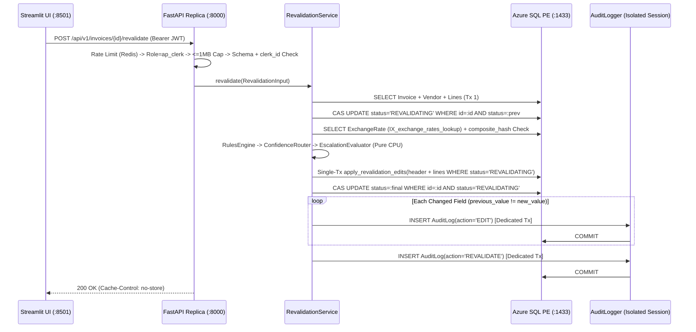
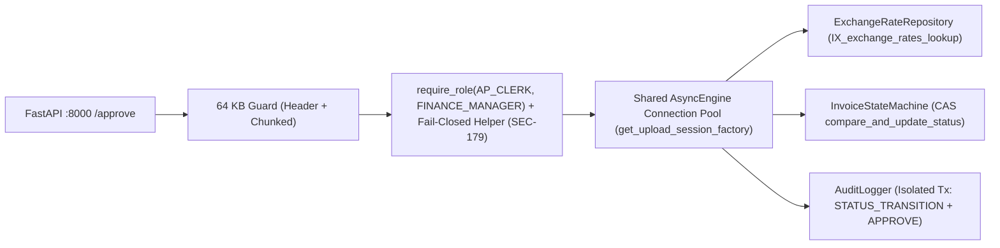

# Phase 9: Infrastructure, Runtime Wiring & Component Boundary Evolution

> **Document Scope:** FastAPI router registration and middleware pipeline wiring (`RequestID -> CORS -> AuditMiddleware -> RedisRateLimiter`), multi-replica SQL transaction boundaries (single-transaction `apply_revalidation_edits` + isolated-transaction `AuditLogger`), fail-fast request payload sizing guards, index-backed chronological audit queries, and zero-egress container posture evolved during **Phase 9 (Re-Validation and Approval API — P9-1 through P9-4)**.  
> **Target Audience:** Cloud Solution Architects, DevOps / Platform Engineers, Security Architects, and SREs.

---

## 1. Phase 9 Runtime Placement & Container Networking Topology

**Phase 9 introduces ZERO new Docker containers, ZERO new external network sockets, ZERO new Azure cloud services, and ZERO new PyPI dependencies.** All three new API routes (`POST /revalidate`, `POST /approve`, `GET /audit`) and both new orchestration services (`RevalidationService`, `ApprovalService`) run in-process inside the existing **FastAPI Core API Container (`:8000`)**, communicating strictly over Private Endpoints inside the Azure East US 2 VNet (`10.0.0.0/16`):
- **Inbound:** HTTPS from Streamlit UI Container (`:8501`) via Azure Front Door / Internal Container Apps Environment ingress with Entra ID RS256 Bearer JWTs.
- **Outbound (Private Endpoints Only):**
  - **Azure Cache for Redis (`10.0.2.x:6379`):** Sliding-window rate limiting (`RedisRateLimiterMiddleware`) on every Phase 9 route.
  - **Azure SQL Database (`10.0.3.x:1433`):** Primary business session (atomic CAS status locks + single-transaction edits + ECB FX index seek + chronological audit reads) AND separate **isolated audit sessions** (`AuditLogger` — never shares a rollback boundary with business writes).
- **Zero LLM / Zero Blob I/O on Phase 9 Paths:** Neither `/revalidate`, `/approve`, nor `/audit` ever opens an Azure OpenAI or Azure Blob Storage socket—keeping API latency deterministic and immune to model throttling!

```text
┌──────────────────────────────────────────────────────────────────────────────────────────────────────────┐
│                 PHASE 9 RUNTIME WIRING, MIDDLEWARE & MULTI-SESSION SQL TOPOLOGY                          │
│                                                                                                          │
│  STREAMLIT UI CONTAINER (:8501)  ──HTTPS + Entra ID RS256 Bearer JWT──►  FASTAPI API REPLICAS (:8000)    │
│                                                                          ┌─────────────────────────────┐ │
│  CANONICAL MIDDLEWARE STACK (outer -> inner, src/api/main.py):           │ 1. RequestIDMiddleware      │ │
│    1. X-Request-ID generation/sanitization -> request_id_ctx             │ 2. CORSMiddleware           │ │
│    2. Strict CORS origin allowlist                                       │ 3. AuditMiddleware          │ │
│    3. Structured security telemetry (200/401/403/409/422/429/500)        │ 4. RedisRateLimiter ────────┼─┼──► Redis PE (:6379)
│    4. Redis ZSET sliding-window rate limiter (fail-closed 503)           └──────────────┬──────────────┘ │
│                                                                                         ▼                │
│  REGISTERED ROUTERS (src/api/main.py):                                                                   │
│  ┌──────────────────────────────┬──────────────────────────────┬───────────────────────────────────────┐ │
│  │ src/api/invoices.py          │ src/api/approvals.py         │ src/api/audit.py                      │ │
│  │ • POST /{id}/revalidate      │ • POST /{id}/approve         │ • GET /{id}/audit (Read-Only, 405     │ │
│  │   Role: ap_clerk             │   Role: ap_clerk | manager   │   on POST/PUT/PATCH/DELETE)           │ │
│  │   Cap: 1 MB Content-Length   │   Cap: 64 KB (Header+Chunked)│   Role: clerk | manager | admin       │ │
│  │   No-Op Guard (P9-4)         │   Live ECB FX Check          │   PII Redaction + nosniff/no-store    │ │
│  └──────────────┬───────────────┴──────────────┬───────────────┴───────────────────┬───────────────────┘ │
│                 ▼                              ▼                                   │                     │
│  ┌──────────────────────────────┐ ┌──────────────────────────────┐                 │                     │
│  │ src/services/revalidation.py │ │ src/services/approval.py     │                 │                     │
│  │ (0 FastAPI / 0 HTTP imports) │ │ (0 FastAPI / 0 HTTP imports) │                 │                     │
│  └──────────────┬───────────────┘ └──────────────┬───────────────┘                 │                     │
│                 │  Business Session (Tx A)       │  Isolated Audit Session (Tx B)  │  Read Session       │
│                 ▼                                ▼                                 ▼                     │
│  ┌─────────────────────────────────────────────────────────────────────────────────────────────────────┐ │
│  │                    AZURE SQL DATABASE PRIVATE ENDPOINT (10.0.3.x:1433)                              │ │
│  │                    (Local Dev & Offline CI: sqlite+aiosqlite:///:memory:)                           │ │
│  │  • dbo.Invoices + dbo.InvoiceLines — Single-Tx apply_revalidation_edits + CAS compare_and_update    │ │
│  │  • dbo.ExchangeRates — Index Seek IX_exchange_rates_lookup (rate_date <= invoice_date, currency)    │ │
│  │  • dbo.AuditLogs — Index Seek IX_audit_logs_invoice_timestamp (invoice_id, timestamp ASC, audit_id) │ │
│  └─────────────────────────────────────────────────────────────────────────────────────────────────────┘ │
└──────────────────────────────────────────────────────────────────────────────────────────────────────────┘
```

---

## 2. Subtask-by-Subtask Infrastructure & Wiring Evolution

### 2.1 Subtask P9-1: Dual-Session Transaction Boundary & Lock Rollback (`invoices.py`, `revalidation.py`, `repositories.py`)

In a horizontally scaled FastAPI deployment (multiple Container App replicas sharing one Azure SQL database), `POST /api/v1/invoices/{id}/revalidate` must guarantee **zero split-brain edits**, **zero wedged `REVALIDATING` locks**, and **audit durability**:

1. **Ingress Guard (`guard_revalidate_content_length` — `SEC-175`):** Rejects `Content-Length > 1 MB` (`413`) or malformed headers (`400`) before JSON parsing allocates pod memory (`CWE-400`).
2. **Atomic CAS Lock Acquisition:** `InvoiceStateMachine.transition(previous_status -> REVALIDATING)` uses `UPDATE invoices SET status='REVALIDATING' WHERE invoice_id=:id AND status=:expected`. Only one replica can win; concurrent callers fail fast with `409 Conflict`.
3. **Single-Transaction Financial Persistence (`apply_revalidation_edits` — `SEC-173`):** Header fields (`subtotal`, `total_tax_amount`, `total_amount`, `total_amount_usd`, `composite_hash`, etc.) and all edited `InvoiceLine` rows commit inside ONE SQL transaction while asserting `Invoice.status == 'REVALIDATING'` and verifying every `line_id` belongs to `invoice_id`. Any `IntegrityError` (e.g., `UX_invoices_composite_hash` collision race) rolls back all header and line edits together, and `_restore_status_best_effort()` releases the `REVALIDATING` lock back to `previous_status`!
4. **Isolated Audit Session (`AuditLogger`):** Opens a dedicated `AsyncSession` per `EDIT` and `REVALIDATE` row so audit commits never share a rollback scope with business logic (`CLAUDE.md §16 rule 9`), emitting a `CRITICAL` SIEM log if post-commit audit persistence ever fails (`SEC-176`).



---

### 2.2 Subtask P9-2: Dedicated Approval Router, Chunked Body Cap & Live FX Sync (`approvals.py`, `approval.py`, `main.py`)

In **P9-2 (`feature/api-approve-route`)**, we registered `approvals_router` on the FastAPI app (`src/api/main.py`) sharing the canonical `get_upload_session_factory` async SQL connection pool (avoiding duplicate SQLAlchemy engine pools inside the container!):
- **Chunked & Header Body Guard (`SEC-180`):** `guard_approval_content_length()` caps approval payloads at **64 KB** both via `Content-Length` header fast-fail AND via `await request.body()` length check when `Transfer-Encoding: chunked` omits `Content-Length`.
- **Two-Step Atomic Escalation & Sync:** For high-value `VALIDATED` invoices approved by a `finance_manager`, `ApprovalService` performs an atomic CAS sync of `total_amount_usd` (computed live via `IX_exchange_rates_lookup`), executes `VALIDATED → REQUIRES_MANAGER_APPROVAL` and `REQUIRES_MANAGER_APPROVAL → APPROVED_MANAGER` via `InvoiceStateMachine`, and writes isolated `STATUS_TRANSITION` + `APPROVE` audit entries (`SEC-177`).



---

### 2.3 Subtask P9-3: Indexed Chronological Audit Query & Response Hardening (`audit.py`, `repositories.py`, `main.py`)

In **P9-3 (`feature/api-audit-trail-route`)**, we registered `audit_router` (`src/api/audit.py`) on `app` as a strictly read-only GET endpoint:
- **Index Utilization:** `AuditLogRepository.list_for_invoice()` executes parameterized `COUNT(*)` and `SELECT ... WHERE invoice_id = :id ORDER BY timestamp ASC, audit_id ASC LIMIT :limit OFFSET :offset` backed directly by Phase 2's composite index `IX_audit_logs_invoice_timestamp (invoice_id, timestamp)`.
- **Bounded Memory Footprint:** Enforces `limit <= 500`, `offset <= 100_000`, `len(action_type) <= 9` params, and `<= 50` chars per `action_type` string (`SEC-182`, `CWE-400`).
- **Response Security Headers (`SEC-183`):** Sets `Cache-Control: no-store` and `X-Content-Type-Options: nosniff` on every response so Azure Front Door, corporate proxies, and browsers never cache or MIME-sniff audit timelines.

---

### 2.4 Subtask P9-4: Zero-DB-I/O Fast-Fail No-Op Boundary (`schemas/invoices.py`, `revalidation.py`)

In **P9-4 (`feature/api-noop-edit-guard`)**, we pushed empty/malformed no-op rejection to the outermost possible runtime boundary so bogus requests never waste SQL connections, CAS locks, or audit storage:

| Rejection Stage | Runtime Cost | What Gets Blocked | HTTP Status |
|---|---|---|---|
| **Stage 1: Pydantic Schema (`src/api/schemas/invoices.py`)** | Pure CPU (0 DB, 0 Redis) | Empty payload, `header_edits={}`, fieldless `line_edit`, explicit JSON `null`, NBSP/exotic whitespace (`SEC-184`) | `422` |
| **Stage 2: Service Entry (`src/services/revalidation.py`)** | Pure CPU (0 DB) | Direct empty `RevalidationInput` DTO (`SEC-185`) | `422` |
| **Stage 3: Pre-Lock DB Check (`src/services/revalidation.py`)** | 1 Read-Only `SELECT` (0 Locks, 0 Writes) | First checks `404` / `409` FSM legality (`SEC-186`), then rejects unchanged header fields, unchanged line entries, `-0.00`/scale/NFC equivalents, or replayed tax flags | `409` (FSM) / `422` (No-Op) |

---

## 3. Infrastructure Security & CI Verification Summary

- **Layering Enforcement via Automated AST Tests:** `test_invoice_revalidate.py`, `test_invoice_approve.py`, and `test_invoice_audit_route.py` run static AST import checks inside CI ensuring `src/api/` never imports `src/validation/` directly and `src/services/` never imports `fastapi`, `starlette`, `httpx`, `openai`, or `src/api/`.
- **Offline CI Determinism:** All **589 tests** execute inside GitHub Actions with `USE_LOCAL_SQLITE=true`, `USE_FAKE_REDIS=true`, `USE_MOCK_AOAI=true`, and zero external network calls, completing lint + test + wheel build green across PRs #34–#37.

