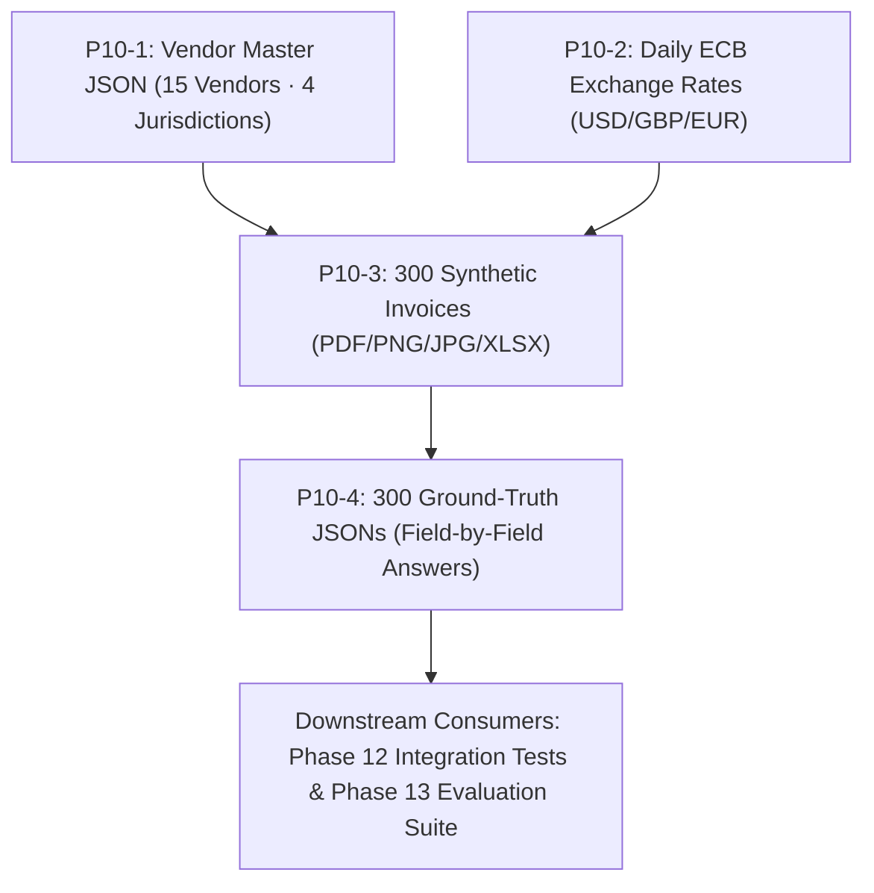
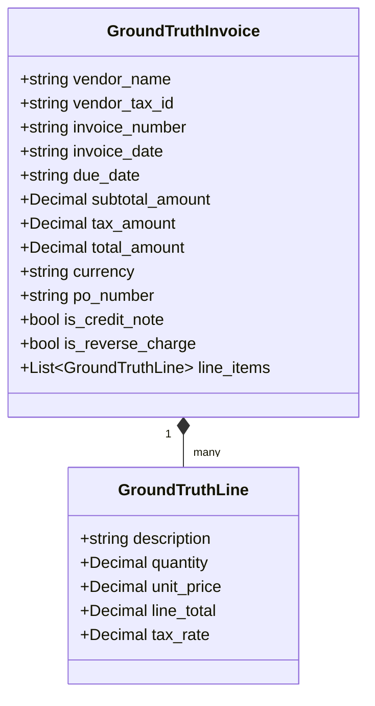

# Phase 10: Project System Design Evolution — Synthetic Benchmark Corpus

> **Document Scope:** Subtask-by-subtask architectural evolution of the synthetic benchmark and ground-truth dataset across **Phase 10 (Synthetic Sample Data — P10-1 through P10-4)**, providing the authoritative data substrate for multi-jurisdiction validation, model gateway testing, and automated accuracy evaluation.  
> **Target Audience:** Solution Architects, Data Engineers, Machine Learning Engineers, FinTech Test Architects, and System Design Interviewers.

---

## 1. Phase 10 Mission & Architectural Baseline

Entering Phase 10, the core processing engine was fully implemented across Phases 1 through 9:
- **FastAPI Core Services (`src/api/`):** Multipart upload, job queue, re-validation, approval, and audit trails.
- **Model Gateway & Extraction Engine (`src/extraction/`):** PyMuPDF classification, GPT-4o-mini / Vision routing, Pydantic schemas.
- **Rules Engine & State Machine (`src/validation/`):** Line math, total math, multi-country tax rates, duplicate detection, and 10-state FSM.

**The Architectural Gap:**
To prove contractual accuracy gates ($\ge95\%$ header, $\ge92\%$ floor, $\ge90\%$ line, $\ge65\%$ STP) required by Milestone 3 (DEV-001 §2, §5), the platform required a statistically significant, realistic benchmark dataset of **300 invoices** with 100% human-verified ground-truth JSONs spanning diverse document formats, international tax regimes, and deliberate financial edge cases.

---

## 2. Progressive Evolution: Subtask-by-Subtask System Design

---

### 2.1 Stage 1 — P10-1: Vendor Master JSON (`sample_data/vendor_master.json`, PR #27)

**Design Decision:**
Establish the authoritative metadata schema defining each vendor's tax jurisdiction, registered date format, and tax treatment:
- **15 Vendors:** V-001 through V-015 distributed across US, UK, DE, and ES.
- **Key Schema Attributes:**
  - `vendor_id`: Unique identifier matching database primary key.
  - `vendor_name`: Legal commercial trading name.
  - `vendor_tax_id`: Standardized tax identifier (EIN, UK VAT ID, German USt-IdNr, Spanish CIF).
  - `country`: Two-letter ISO country code (`US`, `GB`, `DE`, `ES`).
  - `tax_scheme`: Applicable tax category (`US_SALES_TAX`, `UK_VAT`, `DE_MWST`, `ES_IVA`).
  - `date_locale`: Date convention (`US` for `MM/DD/YYYY`, `EU` for `DD/MM/YYYY`).
  - `is_reverse_charge_eligible`: Boolean flag enabling B2B EU reverse-charge validation.

---

### 2.2 Stage 2 — P10-2: Daily Exchange Rates Dataset (`sample_data/exchange_rates.json`, PR #28)

**Design Decision:**
Provide daily historical ECB exchange rates to eliminate real-time network dependency during local runs and automated tests:
- **Currency Triad:** Tracks USD (base reporting currency), GBP, and EUR.
- **Conversion Policy:** Exchange rate is matched to `invoice_date` rather than upload date (CLAUDE.md §6), preventing exchange rate arbitrage on approval.
- **Idempotent DB Seeding:** Directly feeds `src/database/seed.py` for database initialization.

---

### 2.3 Stage 3 — P10-3: 300 Synthetic Invoices Corpus (`sample_data/invoices/`, PR #29)

**Design Decision:**
Generate 300 realistic commercial invoice documents across multiple file formats and layout structures:
- **Format Distribution:**
  - Searchable digital PDFs (70%): Clean text layer testing GPT-4o-mini routing.
  - Scanned / Image PDFs and PNG/JPG files (20%): Raster scans testing GPT-4o Vision routing.
  - Multi-tab Excel XLSX spreadsheets (10%): Tabular data testing openpyxl parsing.
- **7 Problem Case Types (30 invoices):**
  - Handwritten corrections (Vision OCR testing).
  - EU Reverse-charge B2B exemptions (0% tax rate validation).
  - Identical duplicate submissions (composite hash deduplication).
  - Amended revision invoices (`-REV` suffix testing).
  - Credit notes (negative totals and line balances).
  - Ambiguous dates (`05/06/2026` locale disambiguation).
  - Commercial sub-cent rounding discrepancies (±$0.02 line, ±$0.05 total).

---

### 2.4 Stage 4 — P10-4: Ground-Truth JSON Benchmark (`sample_data/ground_truth/`, PR #30)

**Design Decision:**
Create standardized, human-verified JSON schemas mirroring the target `InvoiceExtractionResult` structure:
- **10 Header Fields:** `vendor_name`, `vendor_tax_id`, `invoice_number`, `invoice_date`, `due_date`, `subtotal_amount`, `tax_amount`, `total_amount`, `currency`, `po_number`.
- **Line Items:** Dynamic array of lines, each specifying `description`, `quantity`, `unit_price`, `line_total`, and `tax_rate`.
- **Audit Attributes:** Includes `is_credit_note`, `is_reverse_charge`, and expected terminal status for rules engine cross-verification.

---

## 3. Downstream Architectural Impact

1. **Phase 12 (Integration Testing):** Allowed full upload-to-approval integration tests (`tests/integration/test_upload_extract_validate_route_integration.py`) to run against realistic fixtures with zero external dependencies.
2. **Phase 13 (Automated Evaluation):** Enabled programmatic scoring of precision, recall, and Straight-Through Processing (STP) across all 300 pilot invoices in `tests/evaluation/test_pilot_evaluation_thresholds.py`.
3. **Reproducibility Guarantee:** All 300 invoices and ground-truth JSONs are checked into git under `sample_data/`, guaranteeing identical CI/CD eval runs on every branch.

