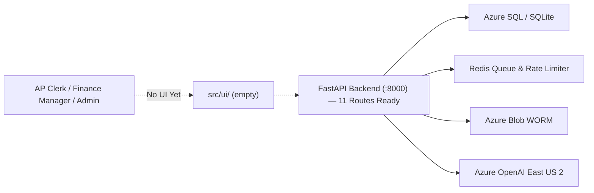
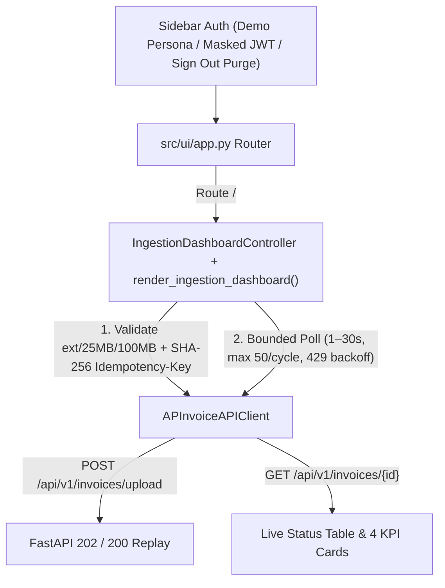
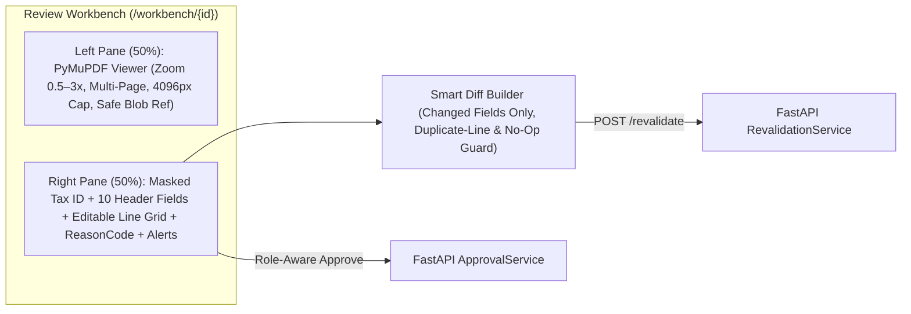
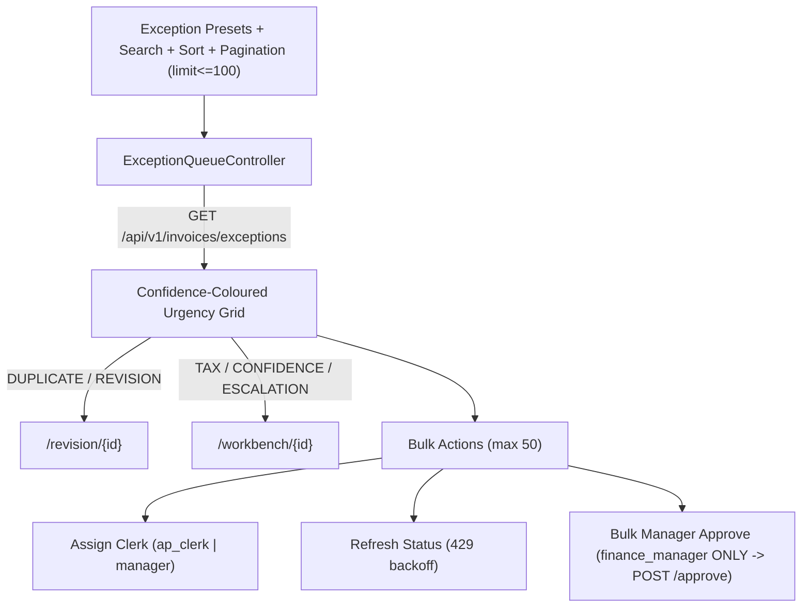
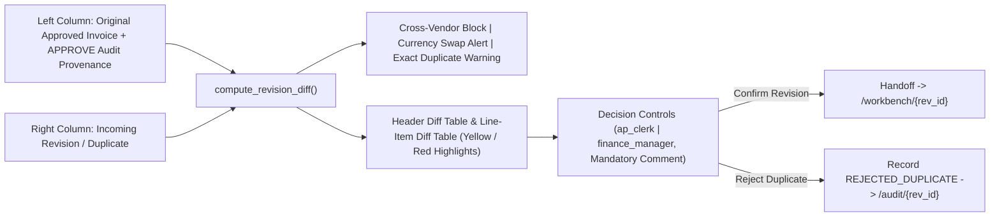
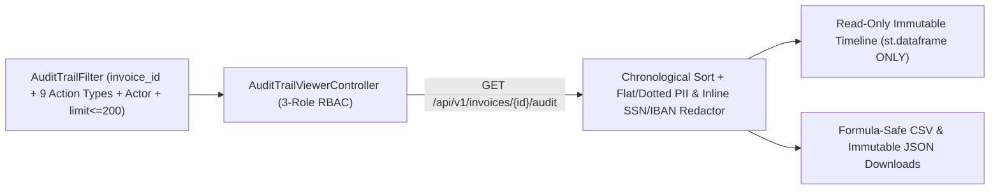
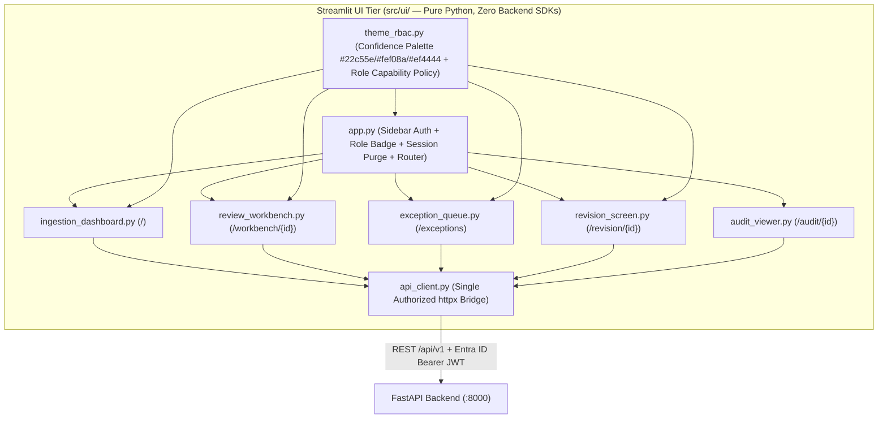

# Phase 11: Project System Design Evolution

> **Document Scope:** Subtask-by-subtask architectural evolution of the presentation tier across **Phase 11 (Streamlit UI — P11-1 through P11-7)**, from a headless API-only backend to a strictly layered, 5-screen, confidence-colour-coded, role-aware enterprise AP web application.  
> **Target Audience:** Solution Architects, Staff Engineers, Frontend/Full-Stack Leads, Security Architects, and System Design Interviewers.

---

## 1. Phase 11 Mission & Architectural Baseline

Entering Phase 11, Phases 1–10 were complete (**47 / 68 tasks · 69%**, **589 passing offline tests**, **186 mitigated security findings**):
- **FastAPI Backend (`src/api/`):** Exposed all 11 HTTP routes (`/health`, `/health/ready`, `/api/v1/auth/demo-personas`, `/api/v1/auth/demo-token`, `/api/v1/auth/me`, `/api/v1/invoices/upload`, `/api/v1/invoices/{id}`, `/api/v1/invoices/exceptions`, `/api/v1/invoices/{id}/revalidate`, `/api/v1/invoices/{id}/approve`, `/api/v1/invoices/{id}/audit`).
- **Presentation Layer (`src/ui/`):** Contained only an empty `__init__.py` placeholder.

**Core Architectural Mandate (`CLAUDE.md §4.2 & §12`):**
1. **Pure Python Streamlit 1.35+ UI** — zero JavaScript/React, zero `unsafe_allow_html=True`.
2. **Strict Tier Isolation** — `src/ui/` communicates exclusively via `src/ui/api_client.py` (wrapping `httpx`). Zero imports from `src.database`, `src.storage`, `src.extraction`, `src.validation`, `src.services`, `sqlalchemy`, `redis`, `openai`, or `azure.*`.
3. **Controller / Renderer Separation** — Every screen separates pure-Python, Pydantic-typed controllers/helpers (unit-testable at millisecond speed without a browser) from thin Streamlit rendering functions (smoke-tested headlessly via injectable `st_module` stubs and end-to-end against real FastAPI via `httpx.BaseTransport`).

---

## 2. Progressive Evolution: Subtask-by-Subtask System Design

### 2.1 Stage 0 — End of Phase 9/10 Baseline (API Complete, Zero UI Layer)

---

### 2.2 Stage 1 — P11-1: Typed HTTP API Client (`src/ui/api_client.py`, PR #38)

**Design Decision:** Before building a single UI page, establish a single hardened transport bridge (`APInvoiceAPIClient` wrapping `httpx.Client`) so URL validation, Bearer JWT injection, redirect blocking, response size capping, and HTTP status → typed exception translation happen in **one audited place**.

```mermaid
flowchart LR
    Pages["Future Streamlit Screens (P11-2..P11-7)"] --> Client["APInvoiceAPIClient (src/ui/api_client.py)"]
    subgraph Guards ["Transport Security Guards (SEC-187..190)"]
        G1["validate_api_base_url() + follow_redirects=False"]
        G2["invoice_id regex + CRLF header check"]
        G3["10 MB response cap + 25 MB upload cap"]
        G4["Bearer token redaction in repr & logs"]
    end
    Client --> Guards
    Guards -->|"httpx.Client (11 typed routes)"| API["FastAPI Backend (:8000)"]
    API -->|"401/403/404/409/422/429/503"| Exc["Typed Exception Hierarchy (8 classes)"]
```

- **Key Contracts Added:** `DemoPersonaPublic`, `DemoPersonasResponse`, `DemoTokenResponse`, `AuthenticatedUserResponse` + canonical `src/api/schemas/invoices.py` reuse.
- **Verification:** `tests/unit/test_ui_api_client.py` (7 tests, **596 total passing**).

---

### 2.3 Stage 2 — P11-2: Ingestion Dashboard (`/`) & Main Shell (`src/ui/app.py`, `src/ui/ingestion_dashboard.py`, PR #39)

**Design Evolution:** Introduced the main Streamlit entrypoint (`streamlit run src/ui/app.py --server.port 8501`) with sidebar authentication (Demo Persona sign-in + masked Bearer token + Sign Out session purge) and Screen 1 (`/`):
- Multi-file drag-and-drop intake (`pdf`, `jpg`, `jpeg`, `png`, `xlsx`; GAP-004 TIFF block; 50-file / 100 MB batch caps).
- Client-side deterministic SHA-256 `Idempotency-Key` generation (`ui-<sha256[:48]>`) deduplicating double-clicks in place.
- Bounded live polling (`IngestionDashboardController.poll_batch_once`) polling only non-terminal rows (`UPLOADED`, `EXTRACTING`, `REVALIDATING`) via `@st.fragment(run_every=...)`, stopping automatically when terminal or on HTTP `429`.

- **Verification:** 10 unit + 1 live-FastAPI integration test (**607 total passing**, `SEC-191`–`SEC-194` closed).

---

### 2.4 Stage 3 — P11-3: Split-Screen Review Workbench (`/workbench/{invoice_id}`, `src/ui/review_workbench.py`, PR #40)

**Design Evolution:** Added PRD Screen 2 split 50/50 between a safe in-memory PyMuPDF document previewer (`Left Pane`) and an allowlisted editable header + line-item workbench (`Right Pane`):
- **Smart Diff Engine (`build_revalidate_request`):** Compares normalized NFC text, ISO dates, and semantic `Decimal` values so untouched fields are omitted—preventing P9-4 no-op rejections and wasted network round-trips.
- **Anti-SSRF Preview Architecture:** Never fetches remote `blob_raw_url` strings directly from the UI; enforces `ALLOWED_PREVIEW_EXTENSIONS`, finite zoom `[0.5, 3.0]`, 25 MB / 200-page / 4096px anti-bomb bounds, and encrypted PDF rejection.

- **Verification:** 8 unit + 1 live-FastAPI PRD Journey 5 integration test (**616 total passing**, `SEC-195`–`SEC-197` closed).

---

### 2.5 Stage 4 — P11-4: Human Exception Queue (`/exceptions`, `src/ui/exception_queue.py`, PR #41)

**Design Evolution:** Added PRD Screen 3 translating business-friendly exception presets (*Tax Mismatch, Low Confidence, Duplicate/Revision, Credit Note, High Value / Manager Escalation*) into strictly validated `GET /api/v1/invoices/exceptions` queries, with urgency classification (`CRITICAL`/`HIGH`/`MEDIUM`), elapsed queue duration, confidence colour coding, context-aware routing (`/revision/{id}` vs `/workbench/{id}`), and bounded bulk actions (`<= 50` items):
- Bulk Assign to Clerk (session-scoped, alphanumeric-start handle allowlist).
- Bulk Refresh Status (per-item error isolation + immediate HTTP `429` pause).
- Bulk Manager Approve (fail-closed `finance_manager`-only, hidden for `ap_clerk`, skips non-approvable statuses like `DUPLICATE_INVOICE` and `CREDIT_NOTE`).

- **Verification:** 9 unit + 1 live-FastAPI integration test (**626 total passing**, `SEC-198`–`SEC-200` closed).

---

### 2.6 Stage 5 — P11-5: Revision Comparison Screen (`/revision/{invoice_id}`, `src/ui/revision_screen.py`, PR #42)

**Design Evolution:** Added PRD Screen 4 comparing an Original Approved Invoice (loaded alongside its immutable `APPROVE` audit actor & timestamp from `GET /audit`) against a Flagged Revision / Duplicate submission:
- Linear-time suffix detection (`-REV`, `v2`, `-R1`, `AMENDED`) + authoritative Tax ID vendor parity blocking `UNKNOWN` placeholder cross-vendor spoofing.
- Yellow (`#fef08a`) vs. Red (`#ef4444`) header & line-item delta engine (`ADDED`/`REMOVED`/`MODIFIED`/`UNCHANGED`) + signed total/tax/percentage deltas.
- Auditable decision controls that **never** bypass `POST /approve` (`Confirm as Authorized Revision` hands off to `/workbench/{id}` for full deterministic re-validation).

- **Verification:** 8 unit + 1 live-FastAPI integration test (**635 total passing**, `SEC-201`–`SEC-203` closed).

---

### 2.7 Stage 6 — P11-6: Immutable Audit Trail Viewer (`/audit/{invoice_id}`, `src/ui/audit_viewer.py`, PR #43)

**Design Evolution:** Added PRD Screen 5—a strictly immutable, append-only chronological viewer open to all 3 authenticated roles (`ap_clerk`, `finance_manager`, `system_admin`):
- Guaranteed oldest-to-newest chronological sort by `(timestamp, audit_id)` with 9-action allowlist filtering and actor filtering.
- Multi-layer PII redaction (flat + dotted sensitive field names like `invoice.iban`, inline SSN/IBAN regex redaction in comments, Bearer/JWT redaction) applied uniformly across on-screen display, CSV export (formula-neutralized), and JSON export.
- AST test enforces **zero `st.data_editor`** calls inside `audit_viewer.py` so mutability can never creep in.

- **Verification:** 6 unit + 1 live-FastAPI integration test (**642 total passing**, `SEC-204`–`SEC-206` closed).

---

### 2.8 Stage 7 — P11-7: Centralized Confidence Colour Coding & Role-Aware Capability Engine (`src/ui/theme_rbac.py`, PR #44)

**Final Advanced Architecture (End of Phase 11):** Refactored confidence colour classification and role-based UI visibility into a single audited policy module (`src/ui/theme_rbac.py`) consumed across all screens:
- **Dynamic Thresholds (`CLAUDE.md §16.8`):** `HIGH_VALUE_THRESHOLD_USD` and `PO_VARIANCE_TOLERANCE_PERCENT` are read live from `get_settings()`.
- **Fail-Closed Clerk Protection (`SEC-207`):** Uses conservative `max(total_amount, total_amount_usd)` on USD invoices (defeating stale lower `total_amount_usd`), hides Approve completely for `ap_clerk` on `>\$10,000.00`, missing non-USD FX, PO variance `>5%`, credit notes, `<90%` confidence, or non-`VALIDATED` status—and verifies UI-backend parity against FastAPI HTTP `403`.
- **Full-Directory AST Gate (`SEC-208`):** Sweeps every `src/ui/*.py` module in CI proving zero layering violations and zero `unsafe_allow_html=True`.

---

## 3. Summary of Phase 11 Architectural Metrics

| Subtask | Module(s) | PR | Unit + Int Tests | Security Controls Closed |
|---|---|---|---|---|
| **P11-1** | `src/ui/api_client.py` | `#38` | 7 unit | `SEC-187`–`SEC-190` |
| **P11-2** | `src/ui/ingestion_dashboard.py`, `src/ui/app.py` | `#39` | 10 unit + 1 int | `SEC-191`–`SEC-194` |
| **P11-3** | `src/ui/review_workbench.py` | `#40` | 8 unit + 1 int | `SEC-195`–`SEC-197` |
| **P11-4** | `src/ui/exception_queue.py` | `#41` | 9 unit + 1 int | `SEC-198`–`SEC-200` |
| **P11-5** | `src/ui/revision_screen.py` | `#42` | 8 unit + 1 int | `SEC-201`–`SEC-203` |
| **P11-6** | `src/ui/audit_viewer.py` | `#43` | 6 unit + 1 int | `SEC-204`–`SEC-206` |
| **P11-7** | `src/ui/theme_rbac.py` + cross-screen wiring | `#44` | 7 unit + 1 int | `SEC-207`–`SEC-208` |
| **Total** | **8 `src/ui/` modules** | **7 PRs** | **61 new tests (650 total)** | **22 findings (`SEC-187`–`SEC-208`)** |

