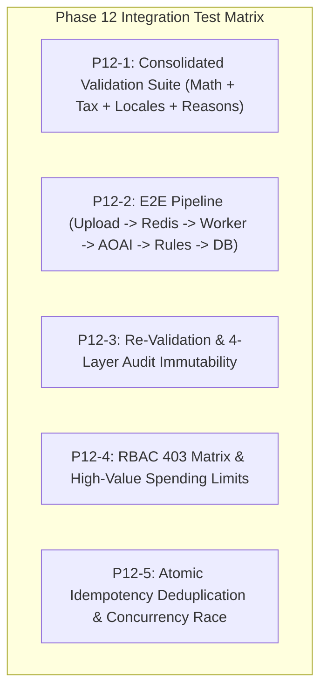
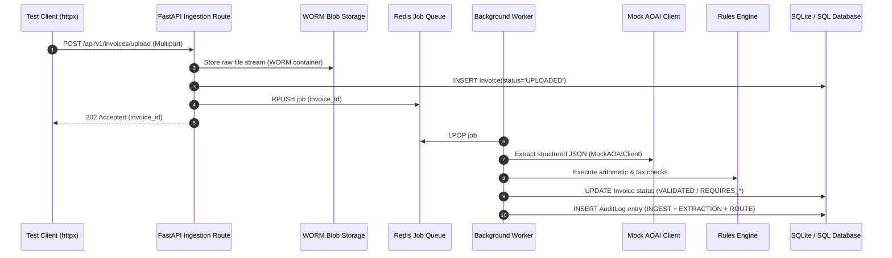

# Phase 12: Project System Design Evolution — End-to-End Integration Test Architecture

> **Document Scope:** Architectural evolution, cross-tier integration testing patterns, multi-layer security assertions, and offline test fixture design across **Phase 12 (Integration Tests — P12-1 through P12-5)**.  
> **Target Audience:** Principal Test Architects, Backend Engineering Leads, Security Engineers, and System Design Interviewers.

---

## 1. Phase 12 Mission & Architectural Baseline

Entering Phase 12, all functional components (Phases 1–9), synthetic benchmark data (Phase 10), and the Streamlit frontend (Phase 11) were functionally implemented.

**The Engineering Challenge:**
Individual units had been verified in isolation, but how do we prove the **entire asynchronous distributed system** functions reliably under concurrent uploads, idempotency replays, role permission attacks, and audit tampering attempts?

Phase 12 engineered **5 deep integration test suites** proving end-to-end reliability across every tier:

---

## 2. Progressive Evolution: Subtask-by-Subtask System Design

### 2.1 P12-1: Consolidated Validation Unit Suite (`tests/unit/test_validation_unit_suite.py`, PR #45)
- **Design Focus:** Unified test harness running all deterministic rules together across the full range of test fixtures:
  - Line math ($\pm0.02$) and invoice total math ($\pm0.05$).
  - Country-specific tax schemes (US, UK 20/5%, DE 19/7%, ES 21/10/4%).
  - Date locale disambiguation and Vendor Master resolution.
  - Reason code enumeration and mandatory comment enforcement.
- **AST Layering Audit:** Verified `src/validation/` has zero imports from `src/extraction/` or external LLM libraries.

---

### 2.2 P12-2: Full E2E Pipeline Integration (`tests/integration/test_upload_extract_validate_route_integration.py`, PR #46)
- **Design Focus:** Validates the asynchronous workflow from HTTP intake through Redis FIFO queue, worker background execution, Model Gateway extraction, rules calculation, and SQL persistence.

- **Outcomes Proven:** High-confidence invoices automatically transition to `VALIDATED` (Straight-Through Processing). Problem cases accurately route to `REQUIRES_REVIEW` or `REQUIRES_APPROVAL`.

---

### 2.3 P12-3: Re-Validation & 4-Layer Audit Immutability (`tests/integration/test_revalidate_and_audit_immutability_integration.py`, PR #47)
- **Design Focus:** Tests PRD Journey 5 (clerk edits an invoice, triggers re-validation, and approves) and verifies **unconditional audit log immutability**.
- **The 4-Layer Enforcement Mechanism (`SEC-215`, `SEC-216`):**
  1. **HTTP Layer:** `PUT`, `PATCH`, `DELETE` routes on `/api/v1/invoices/{id}/audit` return `405 Method Not Allowed`.
  2. **Service/Repo Layer:** `AuditLogRepository` omits update/delete methods.
  3. **ORM Layer:** SQLAlchemy event listeners `before_update` and `before_delete` raise `AuditLogImmutabilityError`.
  4. **Database Engine Layer:** SQLite `BEFORE UPDATE` and `BEFORE DELETE` triggers raise SQL abort errors.

---

### 2.4 P12-4: RBAC 403 Scenarios & Spending Limits (`tests/integration/test_rbac_403_and_auth_integration.py`, PR #48)
- **Design Focus:** Proves that Microsoft Entra ID role claims are enforced fail-closed across all 11 FastAPI routes.
- **Test Scenarios:**
  - Unauthenticated requests $\implies$ `401 Unauthorized`.
  - Forged tokens, expired tokens, or invalid issuer $\implies$ `401 Unauthorized`.
  - `ap_clerk` attempting to approve invoices $> \$10,000$ USD (or EUR/GBP equivalents) $\implies$ `403 Forbidden`.
  - `finance_manager` approving $> \$10,000$ USD $\implies$ `200 OK` + `APPROVED_MANAGER`.

---

### 2.5 P12-5: Atomic Idempotency Deduplication & Concurrency (`tests/integration/test_idempotency_deduplication_integration.py`, PR #49)
- **Design Focus:** Tests distributed idempotency locking via Redis `SET NX EX`.
- **Test Scenarios:**
  - Sequential duplicate submission $\implies$ Returns original `invoice_id` with `200 OK` and `X-Idempotency-Replayed: true`.
  - Concurrent upload race condition (5 simultaneous identical requests) $\implies$ Exactly 1 request returns `202 Accepted`, 4 return `200 OK` replay; zero duplicate jobs enqueued; `mock_aoai.call_count == 1`.
  - Conflict detection: Re-submitting the same `Idempotency-Key` with altered file bytes or different vendor returns `409 Conflict` (`SEC-219`).

