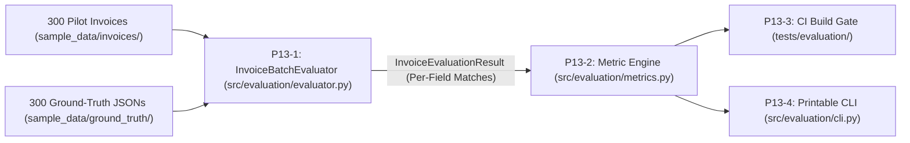

# Phase 13: Project System Design Evolution — Automated Evaluation Architecture

> **Document Scope:** Subtask-by-subtask architectural evolution of the automated evaluation framework across **Phase 13 (Automated Evaluation Suite — P13-1 through P13-4)**, establishing continuous accuracy benchmarking, metric calculation engines, CI/CD threshold build gates, and command-line reporting.  
> **Target Audience:** Lead ML Engineers, AI System Architects, Staff QA Engineers, and System Design Interviewers.

---

## 1. Phase 13 Mission & Architectural Mandate

In enterprise AI applications, **automated evaluations serve as the regression test suite** (DEV-001 §5, CLAUDE.md §13). Any prompt refinement, model gateway routing change, or regex adjustment risks silent performance regressions.

**The Design Mandate:**
1. **Mathematical Objectivity:** Programmatic field-by-field string and numeric matching against 300 human-verified ground-truth JSONs.
2. **Contractual Threshold Enforcement:** Automated evaluation gates enforcing:
   - Header Macro Accuracy $\ge 95\%$
   - Critical Field Floor $\ge 92\%$ (Vendor Tax ID, Invoice #, Date, Total)
   - Line-Item Accuracy $\ge 90\%$
   - Straight-Through Processing (STP) $\ge 65\%$
3. **Production Isolation (`CLAUDE.md §4.2`):** `src/evaluation/` must never be imported by runtime production code paths.

---

## 2. Progressive Evolution: Subtask-by-Subtask System Design

---

### 2.1 Stage 1 — P13-1: Batch Evaluator & Field Comparator (`src/evaluation/evaluator.py`, PR #50)
- **Field-by-Field Comparator:** Compares 10 header fields and line items between extracted JSON and ground-truth JSON:
  - Text fields: NFC normalized, trimmed, case-insensitive for vendor names.
  - Numbers / Currency: Compared using Python `Decimal` with rounding normalization.
  - Dates: Parsed to ISO `date` objects.
- **Line-Item Matching Algorithm:** Evaluates 1-to-1 description/quantity/price alignment, applying strict penalties for missing or hallucinated line items (`SEC-220`).
- **Crash Isolation:** Individual document extraction errors are trapped and recorded as failed slots rather than crashing the batch process (`SEC-221`).

---

### 2.2 Stage 2 — P13-2: Contractual Metric Reporting (`src/evaluation/metrics.py`, PR #51)
- **Mathematical Formulations:**
  - **Macro-Average Header Accuracy:**
    $$\text{Accuracy}_{\text{header}} = \frac{1}{N} \sum_{i=1}^{N} \left( \frac{\text{Correct Header Fields}_i}{10} \right) \ge 95\%$$
  - **Critical Field Hard Floor:**
    $$\text{Accuracy}_{\text{critical\_field}} = \frac{\text{Correct Occurrences}}{N} \ge 92\% \quad (\forall \text{ TaxID, Inv\#, Date, Total})$$
  - **Line-Item Extraction Accuracy:**
    $$\text{Accuracy}_{\text{line}} = \frac{\text{Total Correct Line Slots}}{\text{Total Ground-Truth Line Slots}} \ge 90\%$$
  - **Pilot Straight-Through Processing (STP):**
    $$\text{STP} = \frac{\text{Invoices Reaching VALIDATED Without Human Edits}}{300} \ge 65\%$$
- **Sanitization & Guardrails:** Strips ANSI escapes, BiDi unicode overrides, and host file paths from output scorecards (`SEC-224`, `SEC-225`).

---

### 2.3 Stage 3 — P13-3: Evaluation PyTest Threshold Gate (`tests/evaluation/`, PR #52)
- **CI Build Gate:** Created `tests/evaluation/test_pilot_evaluation_thresholds.py` wired into `.github/workflows/ci.yml` under a dedicated job: `evaluation-threshold-gates`.
- **Fail-Closed Gate:** If any single metric misses its threshold by even 0.01%, the pytest assertion fails, failing the CI pipeline and preventing PR merge into `development`.

---

### 2.4 Stage 4 — P13-4: Evaluation CLI Report (`src/evaluation/cli.py`, PR #53)
- **CLI Command:** `python -m src.evaluation.evaluator --report`
- **Architecture:** Implements PEP 562 lazy module loading in `src/evaluation/__init__.py` to keep import overhead under 50ms.
- **Exit Codes:**
  - `0`: All contractual thresholds passed `[PASS]`.
  - `1`: One or more threshold gates missed `[FAIL]`.
  - `2`: Invalid CLI arguments or unreadable input paths.

