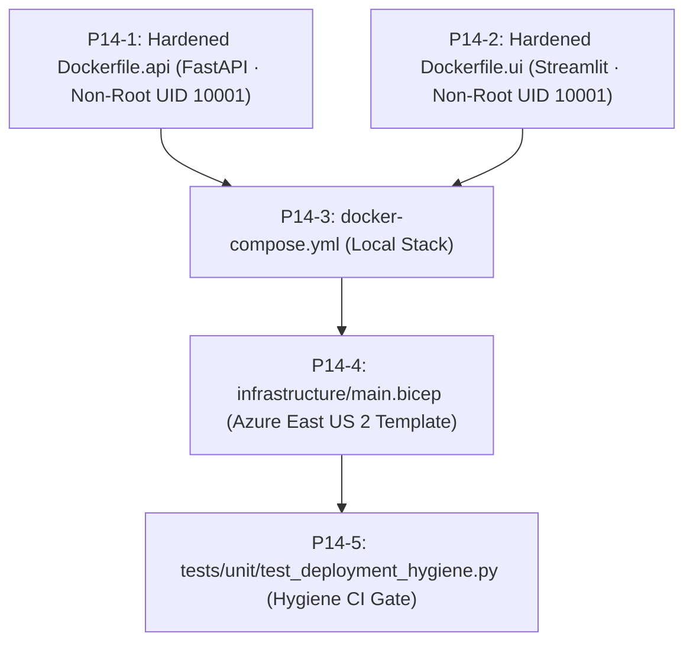

# Phase 14: Project System Design Evolution — Infrastructure as Code & Containerized Deployment

> **Document Scope:** Subtask-by-subtask architectural evolution of container images, local Docker Compose orchestration, Azure East US 2 Bicep infrastructure-as-code, and automated deployment hygiene verification across **Phase 14 (Infrastructure & Delivery — P14-1 through P14-5)**.  
> **Target Audience:** Principal Cloud Architects, Lead DevOps Engineers, Security Architects, and System Design Interviewers.

---

## 1. Phase 14 Mission & Architectural Baseline

Entering Phase 14, all application logic, validation rules, user interfaces, integration tests, and automated evaluation suites were 100% complete (**63 / 68 tasks · 93%**).

**The Operational Requirement:**
Package the platform into enterprise-grade production artifacts:
1. **Container Hardening:** Minimal attack surfaces, non-root execution, immutable runtime code.
2. **Local Developer Stack:** Parity between local developer machines and cloud deployment.
3. **Cloud Infrastructure Blueprint:** Declarative Azure Bicep template provisioning the complete East US 2 cloud infrastructure with zero static credentials.
4. **Automated Hygiene Verification:** Pre-deployment CI tests preventing secret leaks, insecure network configurations, or compliance violations.

---

## 2. Progressive Evolution: Subtask-by-Subtask System Design

---

### 2.1 Stage 1 & 2 — P14-1 & P14-2: Multi-Stage Hardened Container Images (PR #54, PR #55)

**Design Decisions:**
- **Base Image:** Pinned `python:3.11-slim-bookworm` (eliminates floating `:latest` tags).
- **Two-Stage Multi-Stage Build:**
  - `Stage 1 (Builder):` Installs build tools, compiles wheels into isolated `/opt/venv`.
  - `Stage 2 (Runtime):` Minimal production image copying only `/opt/venv` and `src/`. Zero dev dependencies (no pytest, no ruff).
- **Least-Privilege Non-Root Execution (`SEC-231`, `SEC-232`):**
  - Creates system group/user `appuser:appgroup` (UID/GID `10001`) with `/usr/sbin/nologin`.
  - Application source copied as `root:appgroup` with `chmod -R a-w /app/src` (read-only code prevents runtime script tampering).
- **Stdlib-Only Healthchecks:**
  - API uses `python -c "import urllib.request..."` against `http://127.0.0.1:8000/health`.
  - UI uses `python -c "import urllib.request..."` against `http://127.0.0.1:8501/_stcore/health`.
  - Eliminates the need to install `curl` or `wget` inside production containers.

---

### 2.2 Stage 3 — P14-3: Local Stack Orchestration (`docker-compose.yml`, PR #56)

**Design Decisions:**
- **4 Interdependent Services:** `api` (:8000), `ui` (:8501), `redis` (:6379), `azurite` (:10000).
- **Deterministic Dependency Graph:** Configures `depends_on` with `condition: service_healthy` so `redis` and `azurite` are healthy before `api` boots, and `api` is healthy before `ui` starts.
- **Strict Loopback Port Pinning (`SEC-233`):** All host ports are pinned strictly to `127.0.0.1:*` (e.g. `127.0.0.1:8000:8000`), blocking external access from local Wi-Fi or LAN networks.
- **Container Hardening Flags:** Enforces `security_opt: [no-new-privileges:true]`, `cap_drop: [ALL]`, `mem_limit`, and `pids_limit` across all services.

---

### 2.3 Stage 4 — P14-4: Azure East US 2 Bicep Blueprint (`infrastructure/main.bicep`, PR #56)

**Design Decisions:**
- **Regional Lockdown (ADR-001, N2):** Parameter `primaryRegion = 'eastus2'` strictly constrained by `@allowed(['eastus2'])`.
- **Network Security Group (NSG):**
  - Inbound: HTTPS :443 from Azure Front Door / WAF.
  - Outbound: Restricts cloud traffic to `AzureCloud.EastUS2` and internal `VirtualNetwork`.
  - **Explicit Deny Rule:** Rule `Deny-Internet-Outbound` denies all outbound internet (`0.0.0.0/0`), enforcing zero cross-region data egress.
- **7-Year WORM Storage (ADR-005, N6):** Container `raw-invoices-immutable` configured with `immutabilityPeriodSinceCreationInDays: 2557` (7 years including leap days) with `allowProtectedAppendWrites: true`.
- **Zero Static Secrets (ADR-007, N1, N8):**
  - Azure SQL logical server enforces `azureADOnlyAuthentication: true`.
  - Container Apps (`ca-api` and `ca-ui`) configure `identity: { type: 'SystemAssigned' }`.
  - Bicep assigns built-in RBAC role definitions directly to the container app's principal ID:
    - Key Vault Secrets User (`4633458b-17de-408a-b874-0445c86b69e6`)
    - Storage Blob Data Contributor (`ba92f5b4-2d11-453d-a403-e96b0029c9fe`)
    - Cognitive Services OpenAI User (`5e0dc982-0038-4745-9372-2f3b90048e9c`)

---

### 2.4 Stage 5 — P14-5: Deployment Hygiene CI Gate (`tests/unit/test_deployment_hygiene.py`, PR #57)

**Design Decisions:**
- **Git Index Audit:** Queries `git ls-files` to guarantee zero `.env` or `*.db` files are tracked in git.
- **Static Secret Scanner:** Scans all tracked code and templates with high-entropy regexes to prevent accidental check-in of private keys, account keys, or passwords (`SEC-235`).
- **Template Configuration Assertions:** Verifies Bicep regional restrictions, NSG deny rules, WORM periods, and container non-root settings on every build.

