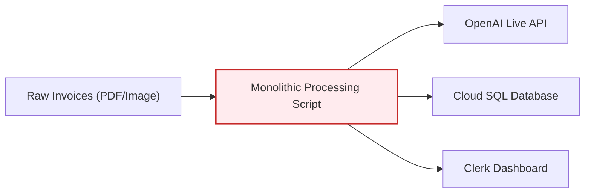
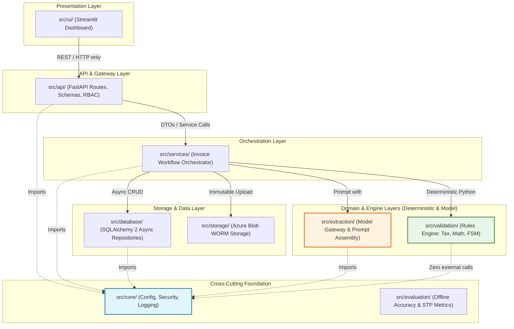
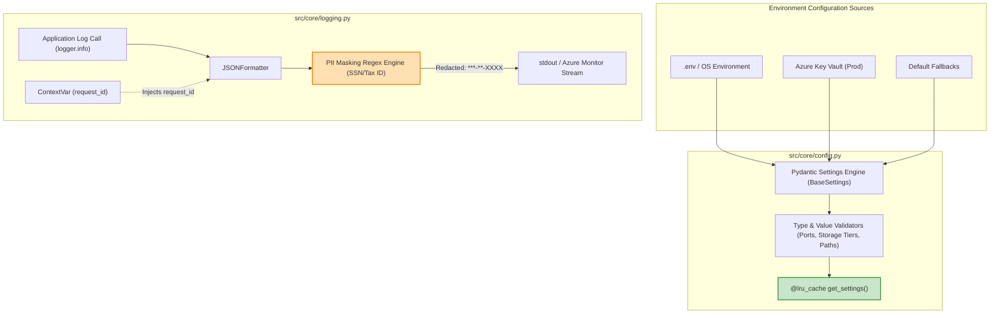
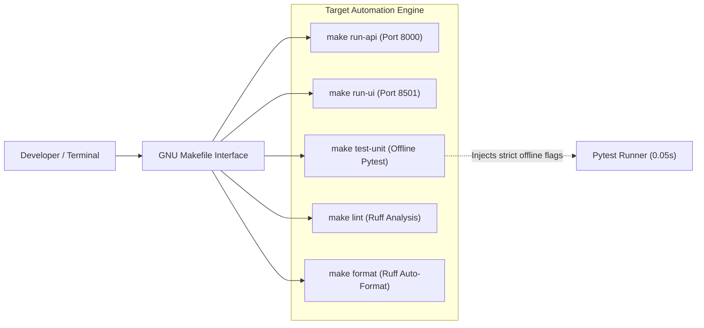
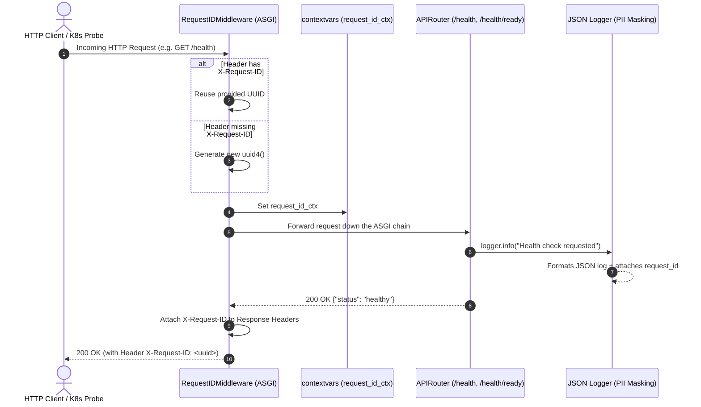
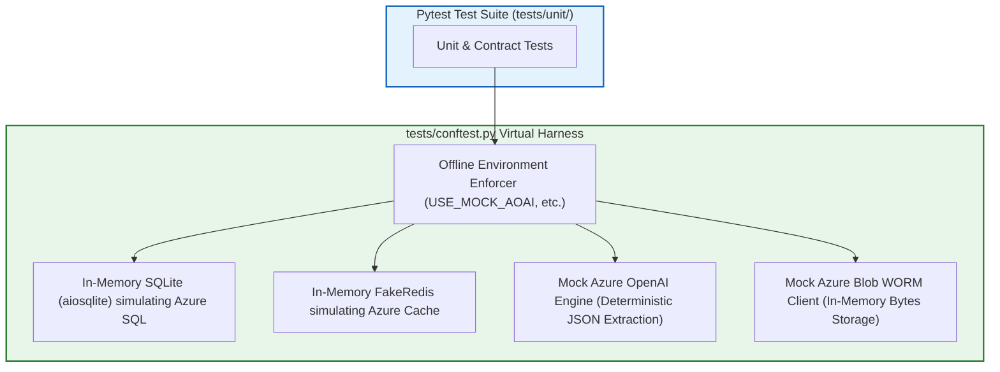
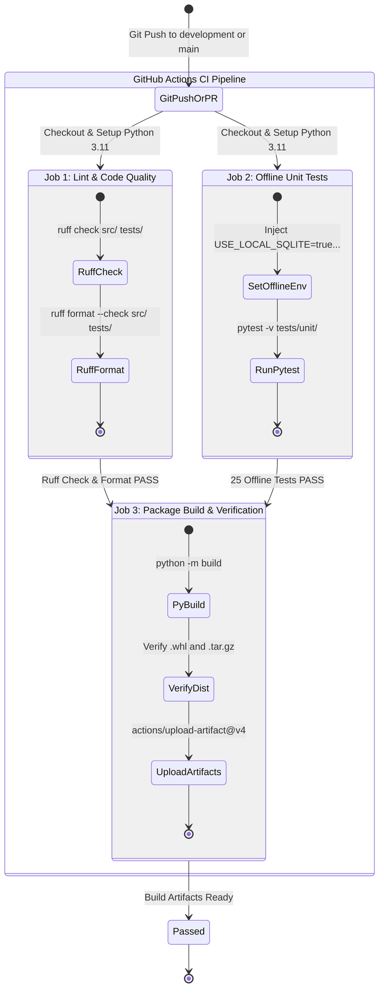
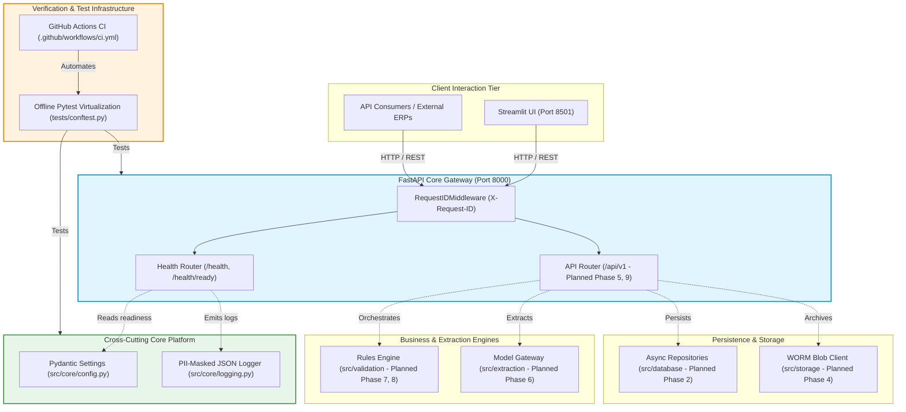

# Phase 1: Project System Design Evolution

> **Document Scope:** Architectural journey and system design evolution throughout **Phase 1 (Runtime Skeleton)**.  
> **Target Audience:** Solution Architects, Technical Leads, System Design Interviewers, and Senior Engineering Evaluators.

---

## 1. Phase 1 Mission & Architectural Baseline

The objective of **Phase 1** was to establish the immutable foundational architecture for an enterprise-grade Accounts Payable (AP) Invoice Automation Platform. Before ingesting high-volume financial documents, multi-modal LLMs, and country-specific tax rules, the platform required a zero-debt runtime scaffold that strictly enforces:

1. **The Rules-First Architectural Invariant:** AI models parse untrusted text; deterministic Python code strictly executes business rules, arithmetic checks, and approval state transitions.
2. **Layering Independence:** Upstream layers never know downstream implementation details. The UI speaks only to the API; the API speaks only to Services; validation never makes network or LLM calls.
3. **Privacy and Zero Static Credentials:** PII masking at the logger level, zero hardcoded secrets, and 100% Entra ID Managed Identity readiness.
4. **Complete Offline Virtualization:** Zero external network dependency during development and automated CI.

---

## 2. Progressive Evolution: Task-by-Task System Design

### 2.1 Day 0: The Initial Conceptual Problem

Prior to Phase 1, the high-level business requirement was a monolithic ingestion flow where an invoice arrives, is processed, and is pushed to an ERP.

**Flaws in the Day 0 Approach:**
- Tight coupling: UI talks directly to database or cloud models.
- High cost: Live API calls during dev/test burn budget constantly.
- Security vulnerabilities: Tax IDs/SSNs leaked in plaintext logs.
- Uncontrolled nondeterminism: LLM hallucinations dictate financial totals.

---

### 2.2 Stage 1 (P1-1): The 9-Layer Architecture Boundary

In **P1-1 (`feature/project-bootstrap`)**, we introduced strict 9-layer separation of concerns. Each layer is encapsulated in its own isolated Python package under `src/`.

#### Layer Interaction Rules Enforced:
- `src/ui/`: Speaks only via typed REST calls to `src/api/`. Never imports database or business logic.
- `src/validation/`: 100% deterministic pure Python. **Never imports `src/extraction/` or makes network/LLM calls**.
- `src/extraction/`: Encapsulates AI model calls. Uses `<invoice_text>` delimiters to prevent prompt injection. Never calculates tax or status.
- `src/core/`: Foundation layer containing settings and security. Never imports from outer business layers.

---

### 2.3 Stage 2 (P1-2): Centralized Settings & PII-Masked Logging Pipeline

In **P1-2 (`feature/core-config-logging`)**, the system design expanded to incorporate a centralized runtime configuration engine and an automated data privacy interceptor.

#### Key Design Decisions:
1. **Pydantic v2 `BaseSettings`:** Prevents runtime misconfiguration. If an invalid database URL or out-of-range integer port is provided, the application refuses to boot.
2. **Context-Aware Request ID:** Python's `contextvars.ContextVar` stores the incoming HTTP request ID per coroutine, automatically appending it to every log record without requiring manual parameter passing.
3. **PII Masking Interceptor:** Intercepts log strings containing US Social Security numbers (`\d{3}-\d{2}-\d{4}`) and Employer Identification Numbers (`\d{2}-\d{7}`), converting them to `***-**-XXXX` prior to emitting JSON.

---

### 2.4 Stage 3 (P1-3): Developer Automation & Command Control Plane

In **P1-3 (`feature/makefile-dev-commands`)**, we established a uniform command control plane via `Makefile` to synchronize local developer runtime and remote CI execution environments.

---

### 2.5 Stage 4 (P1-4): Asynchronous HTTP Gateway & Middleware Pipeline

In **P1-4 (`feature/api-health-middleware`)**, we introduced the FastAPI application skeleton, enterprise health probes, and the ASGI middleware pipeline.

#### Dual-Probe Health Architecture:
- `GET /health` (**Liveness**): Fast, lightweight check verifying the Python event loop and ASGI server are responsive.
- `GET /health/ready` (**Readiness**): Checks downstream subsystem readiness (Database, Redis, Blob Storage) before routing traffic.

---

### 2.6 Stage 5 (P1-5): Fully Virtualized Offline Test Architecture

In **P1-5 (`feature/test-harness-offline`)**, we designed a **100% offline testing topology** that eliminates cloud spend and network latency during testing.

#### Architectural Isolation Guarantees:
1. **Zero External Sockets:** Outgoing TCP calls to Azure or OpenAI endpoints are blocked at the fixture level.
2. **Deterministic Response Seeding:** The mock AOAI engine returns pre-configured ground-truth extraction payloads mapped to test invoice hashes.
3. **Sub-second Execution:** 25 comprehensive unit tests execute in **0.06 seconds**.

---

### 2.7 Stage 6 (P1-6): Continuous Integration & Build Pipeline

In **P1-6 (`feature/ci-pipeline-github-actions`)**, we deployed `.github/workflows/ci.yml`, transitioning the system into an automated delivery pipeline.

---

## 3. End of Phase 1: Comprehensive System Architecture

At the conclusion of Phase 1, the platform possesses a battle-tested, modular architecture ready for Phase 2 (Persistence & Database Models) through Phase 14 (Production Cloud Deployment).

---

## 4. Architectural Scorecard: Phase 1 Evaluation

| Metric | Target | Phase 1 Actual | Status |
|---|---|---|---|
| **Layer Coupling** | Strict 0-circular dependency | 100% unidirectional imports verified | Met ✅ |
| **Log Privacy Compliance** | Zero unmasked SSN/Tax ID leaks | Custom regex filter active on all log emissions | Met ✅ |
| **Unit Test Execution Speed** | < 1.0 second | **0.06 seconds (25 tests)** | Exceeded ✅ |
| **Test Cloud Cost** | \$0.00 | **\$0.00 (Zero external network calls)** | Met ✅ |
| **Traceability** | Global request correlation | `X-Request-ID` attached to all requests & logs | Met ✅ |
| **Automated Build** | Valid Python wheel generation | Verified in CI (`enterprise_ap_automation-0.1.0-py3-none-any.whl`) | Met ✅ |
