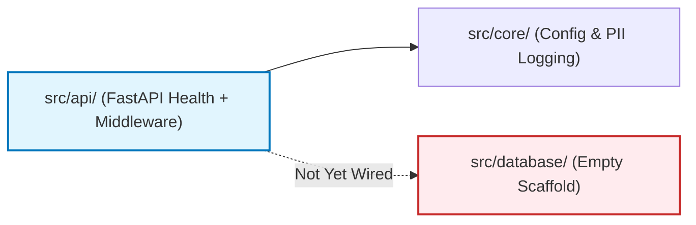
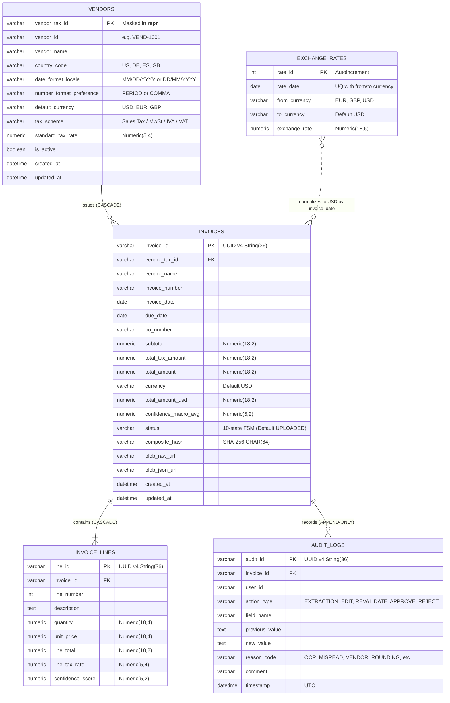
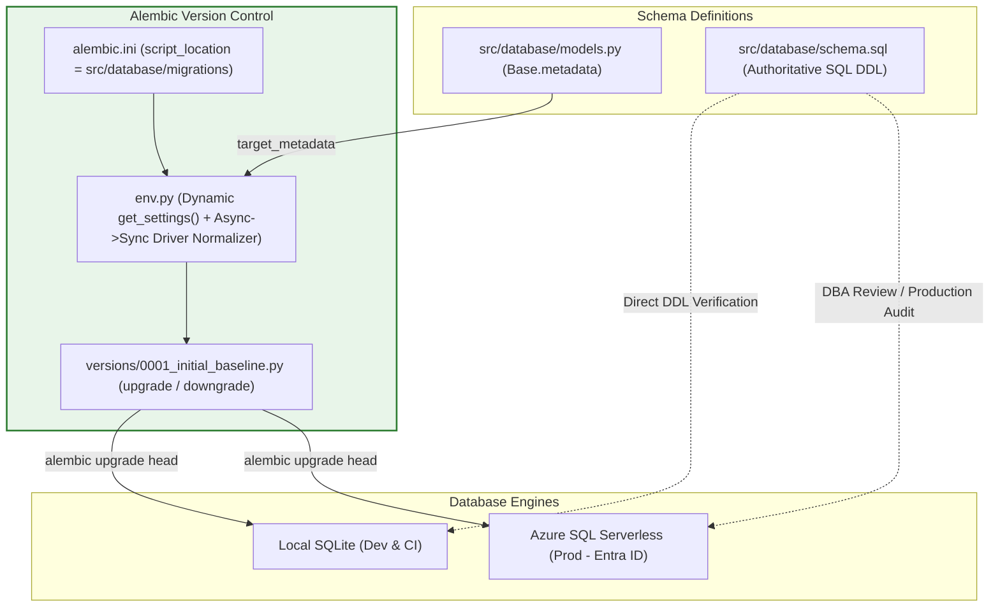
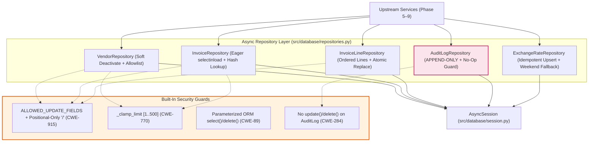
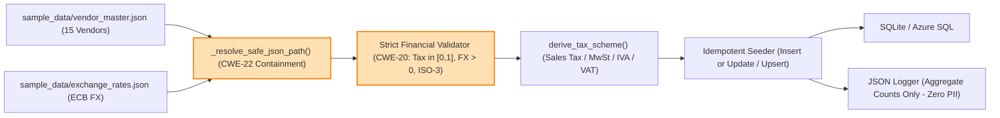
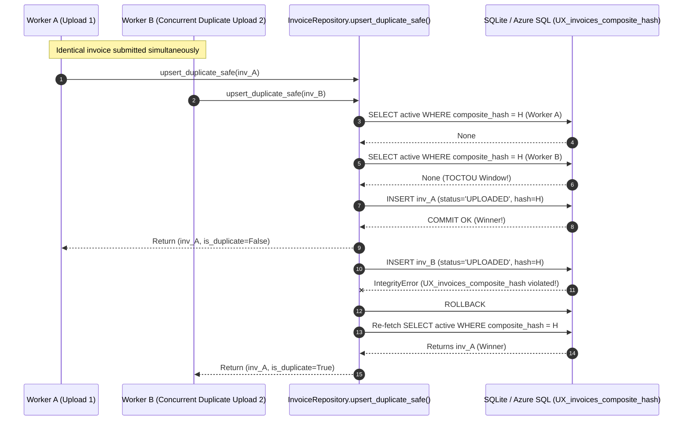
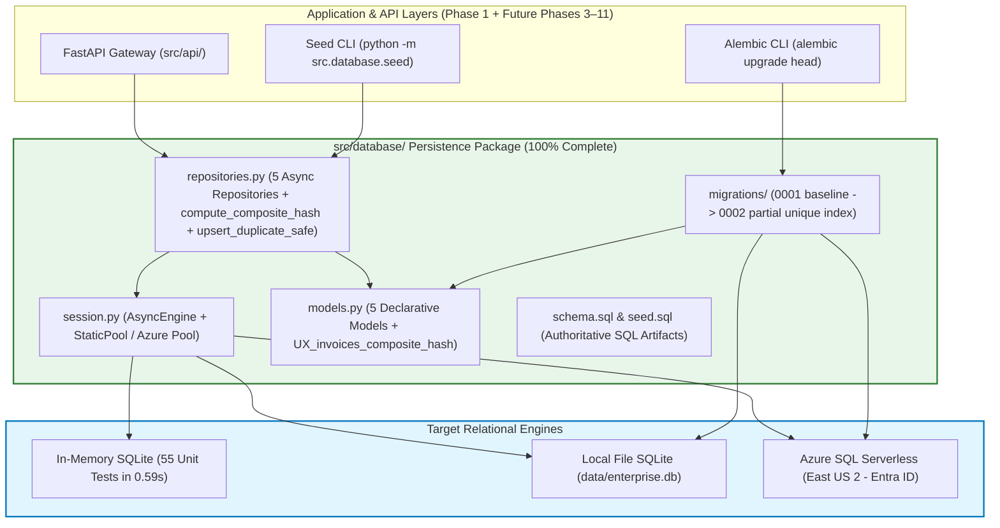

# Phase 2: Project System Design Evolution

> **Document Scope:** Architectural journey and system design evolution throughout **Phase 2 (Persistence and Vendor Master)**.  
> **Target Audience:** Solution Architects, Technical Leads, Database Engineers, and System Design Interviewers.

---

## 1. Phase 2 Mission & Architectural Baseline

At the conclusion of Phase 1, the platform possessed a resilient, observable, zero-cost runtime skeleton (`FastAPI`, PII-masked JSON logging, `RequestIDMiddleware`, offline test harness, and GitHub Actions CI), but lacked stateful financial persistence.

The mission of **Phase 2** was to introduce an enterprise-grade, dual-dialect asynchronous persistence tier that satisfies five strict invariants:

1. **Zero Floating-Point Money (CWE-682):** Every monetary amount, quantity, tax rate, and FX rate uses fixed-point SQL `DECIMAL`/`NUMERIC` mapped to Python `Decimal`.
2. **Dual-Engine Portability:** Identical SQLAlchemy 2.0 ORM models and ANSI/filtered DDL execute seamlessly across local SQLite (`aiosqlite`) and production Azure SQL Serverless (`aioodbc` + Entra ID).
3. **Immutable Financial Auditability (`CLAUDE.md §6`):** `AuditLogs` is strictly append-only at the repository interface boundary, rejecting mutations, deletions, and no-op edits (`previous_value == new_value`).
4. **Defensive Data Boundaries:** Parameterized ORM queries exclusively (CWE-89), explicit field allowlists on updates (CWE-915), bounded pagination limits (CWE-770), and seed path containment (CWE-22).
5. **Race-Safe Duplicate Elimination (CWE-362):** Database-enforced partial unique indexing on `composite_hash` (`WHERE status NOT IN ('REJECTED_DUPLICATE', 'VOID')`) paired with `IntegrityError` TOCTOU rollback recovery.

---

## 2. Progressive Evolution: Subtask-by-Subtask System Design

### 2.1 Stage 0: End of Phase 1 Baseline (Stateless Runtime)

Entering Phase 2, `src/database/` was an empty placeholder package with zero ORM entities, migrations, or repositories.

---

### 2.2 Stage 1 (P2-1): SQLAlchemy 2.0 Async Domain Models

In **P2-1 (`feature/sqlalchemy-models`)**, we introduced [`src/database/models.py`](file:///Users/lokeshrepaka/Desktop/untitled%20folder/src/database/models.py) defining all five core relational entities with SQLAlchemy 2.0 `DeclarativeBase`, typed `Mapped[...]` annotations, `Numeric` financial columns, bidirectional relationships, and PII-masked `Vendor.__repr__`.

#### Key Design Decisions in P2-1:
- **String(36) UUID Primary Keys:** Portable across SQLite and Azure SQL without driver-specific binary UUID conversion quirks.
- **ORM Privacy Guard (SEC-004):** `Vendor.__repr__()` renders `tax_id='***-**-6789'` so accidental debug logs never expose raw supplier Tax IDs.
- **Compatibility Properties:** `ExchangeRate` exposes `.currency` and `.rate_to_usd` properties alongside `.from_currency` and `.exchange_rate` to maintain seamless alignment with LLD §3.

---

### 2.3 Stage 2 (P2-2): Authoritative Schema DDL & Alembic Baseline

In **P2-2 (`feature/database-schema-migrations`)**, we separated **declarative code models** from **versioned production schema management** via [`src/database/schema.sql`](file:///Users/lokeshrepaka/Desktop/untitled%20folder/src/database/schema.sql), [`alembic.ini`](file:///Users/lokeshrepaka/Desktop/untitled%20folder/alembic.ini), [`src/database/migrations/env.py`](file:///Users/lokeshrepaka/Desktop/untitled%20folder/src/database/migrations/env.py), and baseline revision `0001_initial_baseline.py`.

#### Key Design Decisions in P2-2:
- **Zero Static Secrets in `alembic.ini`:** `env.py` overrides `sqlalchemy.url` dynamically using `get_settings().database_url` and automatically translates async drivers (`+aiosqlite` $\to$ `sqlite`, `+aioodbc` $\to$ `+pyodbc`) for Alembic's synchronous runner.
- **Verified Reversible Migrations:** Unit tests execute `command.upgrade(cfg, "head")` followed by `command.downgrade(cfg, "base")` to prove clean rollback order respects foreign-key dependencies.

---

### 2.4 Stage 3 (P2-3): Async Repository Layer & Security Boundaries

In **P2-3 (`feature/repository-layer`)**, we introduced [`src/database/session.py`](file:///Users/lokeshrepaka/Desktop/untitled%20folder/src/database/session.py) and [`src/database/repositories.py`](file:///Users/lokeshrepaka/Desktop/untitled%20folder/src/database/repositories.py), decoupling upstream services (`src/services/`) from raw SQLAlchemy session mechanics.

#### Key Design Decisions in P2-3:
- **Positional-Only `/` ID Parameters:** `update(self, vendor_tax_id: str, /, **fields)` prevents Python `TypeError: got multiple values for argument` when an untrusted payload includes a primary-key field, allowing `_validate_update_fields()` to cleanly raise `ValueError("Disallowed update fields")`.
- **ECB Weekend Fallback:** `get_latest_rate_on_or_before(invoice_date, currency)` queries `rate_date <= target_date ORDER BY rate_date DESC LIMIT 1`, honoring `CLAUDE.md §6` (conversion always uses invoice date, never upload date).
- **Atomic Line Replacement:** `InvoiceLineRepository.replace_for_invoice()` deletes existing lines and inserts edited lines inside a single transaction for clerk re-validation workflows.

---

### 2.5 Stage 4 (P2-4): Idempotent Seeding Pipeline

In **P2-4 (`feature/seed-vendor-master`)**, we built [`src/database/seed.py`](file:///Users/lokeshrepaka/Desktop/untitled%20folder/src/database/seed.py) (`python -m src.database.seed`) and [`src/database/seed.sql`](file:///Users/lokeshrepaka/Desktop/untitled%20folder/src/database/seed.sql) to populate all **15 vendors across 4 jurisdictions (`US`, `DE`, `ES`, `GB`)** and daily **ECB FX rates (`EUR`, `GBP`, `USD`)**.

---

### 2.6 Stage 5 (P2-5): Partial Unique Index & Race-Safe Duplicate Upsert

In **P2-5 (`feature/database-composite-hash`)**, we hardened duplicate invoice prevention from an application-level check into a **database-enforced, concurrency-safe invariant**:
- Added partial unique index `UX_invoices_composite_hash` (`WHERE status NOT IN ('REJECTED_DUPLICATE', 'VOID')`) across `models.py`, `schema.sql`, and additive Alembic migration `0002_composite_hash_unique_index.py` (never modifying `0001`).
- Added canonical `compute_composite_hash()` matching 100% of `sample_data/ground_truth/` SHA-256 digests.
- Added `InvoiceRepository.upsert_duplicate_safe()` defeating TOCTOU concurrent insert race conditions (CWE-362).

---

## 3. End of Phase 2: Complete Persistence Architecture

---

## 4. Phase 2 Architectural Scorecard

| Metric | Target | Phase 2 Actual | Status |
|---|---|---|---|
| **Core Domain Tables** | 5 normalized tables | `vendors`, `invoices`, `invoice_lines`, `audit_logs`, `exchange_rates` | Met ✅ |
| **Financial Precision** | 0 float money columns | 100% `Numeric` / `Decimal` across all monetary & rate columns | Met ✅ |
| **Audit Log Immutability** | Append-only | Zero `update`/`delete` methods + no-op edit guard enforced | Met ✅ |
| **Duplicate Race Protection** | DB-level filtered unique index | `UX_invoices_composite_hash` (`WHERE status NOT IN ('REJECTED_DUPLICATE','VOID')`) + TOCTOU recovery | Met ✅ |
| **Migration Reversibility** | Clean `base ↔ 0001 ↔ 0002` | Verified end-to-end in `test_schema_migrations.py` & `test_composite_hash.py` | Met ✅ |
| **Unit Test Suite** | 100% offline pass | **55 / 55 passing in 0.59s** (0 network calls, \$0 cloud spend) | Exceeded ✅ |
| **Security Controls Audited** | Threat modeled w/ CWE | **20 findings audited & mitigated (`SEC-001` to `SEC-020`)** | Met ✅ |

