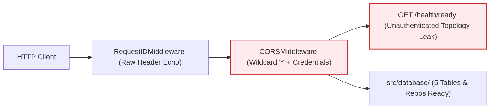
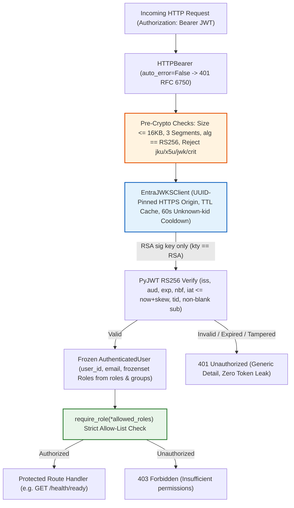
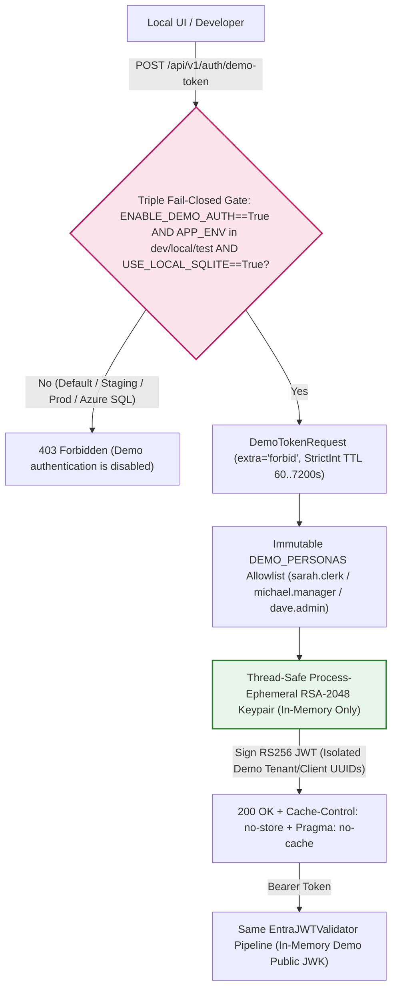
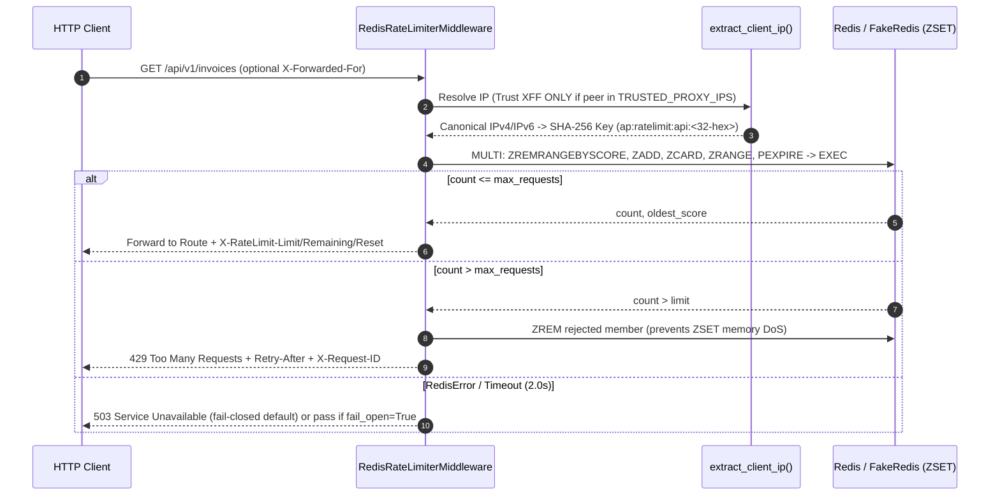
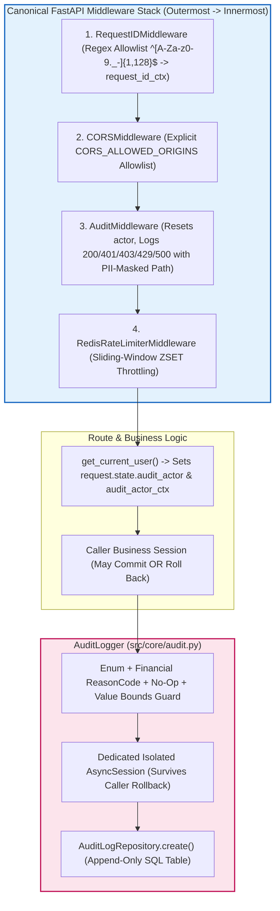
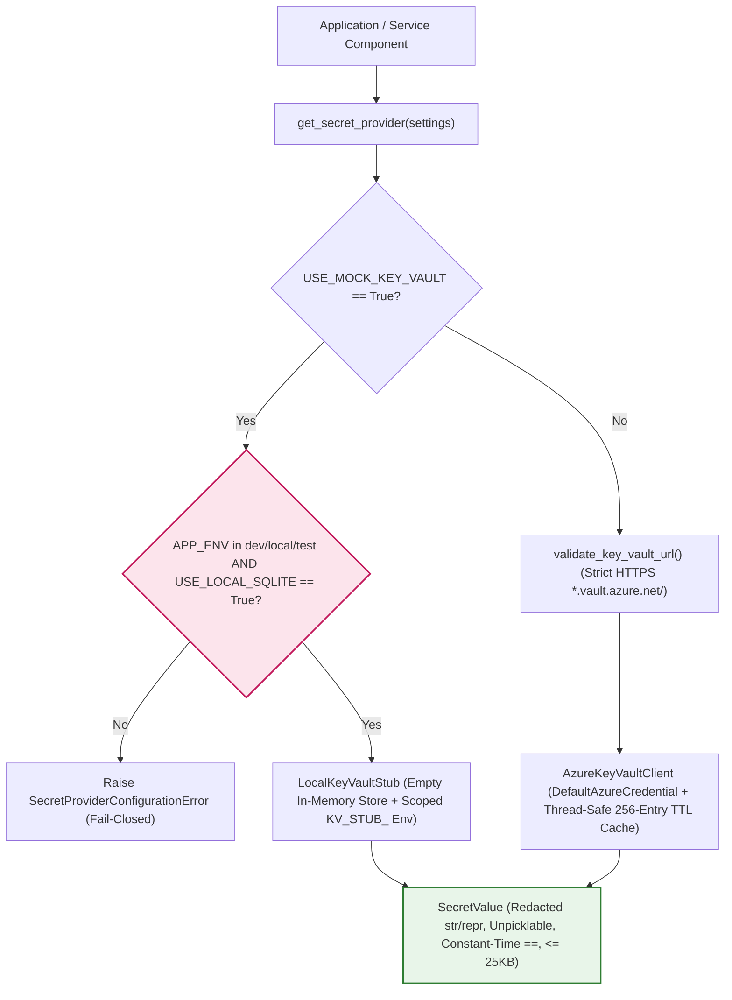
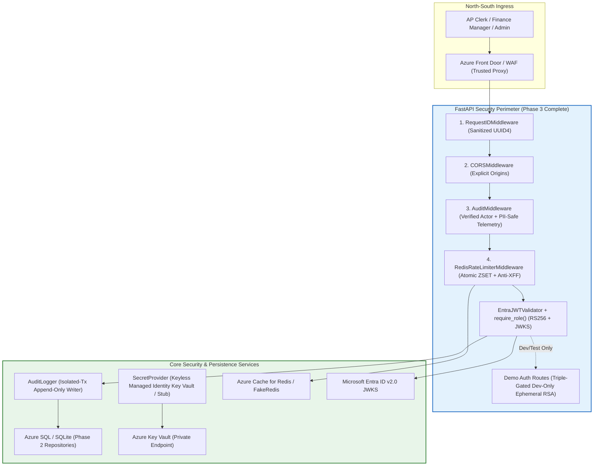

# Phase 3: Project System Design Evolution

> **Document Scope:** Architectural journey and system design evolution throughout **Phase 3 (Identity and Security — P3-1 through P3-5)**.  
> **Target Audience:** Solution Architects, Security Engineers, Backend Leads, and System Design Interviewers.

---

## 1. Phase 3 Mission & Architectural Baseline

At the end of Phase 2, the platform had a stateless FastAPI runtime skeleton (Phase 1) and a dual-dialect, race-safe async SQL persistence tier with 5 domain tables and 55 passing tests (Phase 2). However, the API lacked authentication, role-based access control, abuse throttling, request-to-audit correlation, and keyless secret management.

The mission of **Phase 3** was to wrap the platform in a defense-in-depth **Identity, Security, and Observability Perimeter** enforcing six non-negotiable invariants:

1. **Asymmetric Keyless Authentication (`ADR-007`, `N1`):** Strict RS256 Microsoft Entra ID v2.0 JWT verification with JWKS caching, rotation cooldown, and fail-closed defaults—zero `HS256` shared secrets.
2. **Explicit Allow-List RBAC (`CLAUDE.md §2, §8, §9`):** Route-level `require_role()` guards returning RFC 6750 `401 Unauthorized` on identity failure and `403 Forbidden` on authorization denial.
3. **Triple-Gated Zero-Secret Local Demo Auth (`P3-2`, `CWE-489`):** Ephemeral runtime RSA-2048 keypair exercising the identical RS256 validator path, strictly blocked outside `dev`/`local`/`test` or whenever `USE_LOCAL_SQLITE=false`.
4. **Atomic Sliding-Window Rate Limiting (`P3-3`, `CWE-770`):** Redis `MULTI/EXEC` ZSET sliding window with trusted-proxy-only `X-Forwarded-For` parsing, IPv6 canonicalization, SHA-256 hashed keys, and fail-closed `503` default.
5. **Isolated-Transaction Immutable Auditing & Canonical Middleware Order (`P3-4`, `CLAUDE.md §16`):** Dedicated `AsyncSession` per `AuditLogger.record()` call (survives caller rollbacks) and locked 4-layer middleware execution order capturing `200`, `401`, `403`, `429`, and `500` events.
6. **Keyless Secret Management & Zero Static Credentials (`P3-5`, `N8`, `BR-030`):** HTTPS host-pinned Azure Key Vault client with `DefaultAzureCredential`, redacted `SecretValue` wrappers, offline `LocalKeyVaultStub`, and automated CI static-secret scanning.

---

## 2. Progressive Evolution: Subtask-by-Subtask System Design

### 2.1 Stage 0: End of Phase 2 Baseline (Open API Surface)

Entering Phase 3, `src/api/main.py` exposed `/health` and `/health/ready` with permissive wildcard CORS (`allow_origins=["*"]` + `allow_credentials=True`), unsanitized `X-Request-ID`, no JWT authentication, no rate limiting, and no `AuditLogger`.

---

### 2.2 Stage 1 (P3-1): Entra ID RS256 JWT Validator, JWKS Cache & `require_role()` RBAC

In **P3-1 (`feature/entra-id-jwt-rbac`, PR #6)**, we built [`src/core/security.py`](file:///Users/lokeshrepaka/Desktop/untitled%20folder/src/core/security.py), guarded `GET /health/ready` with `require_role(Role.SYSTEM_ADMIN)`, and replaced wildcard CORS with explicit `CORS_ALLOWED_ORIGINS`.

#### Key Design Decisions in P3-1:
- **Zero Algorithm Confusion (SEC-021):** Rejects `alg: none`, `HS256`, and non-`RSA` JWKs before cryptographic verification.
- **JWKS DoS & Cache-Poisoning Immunity (SEC-023):** Bounds JWKS responses to 256 KB / 64 keys, enforces a 60s refresh cooldown against unknown-`kid` floods, and rejects empty RSA keysets without wiping valid cached keys.
- **Explicit Allow-List RBAC:** `require_role()` validates role names at route registration time (`ValueError` on typos) and requires explicit membership—preventing accidental implicit privilege escalation.

---

### 2.3 Stage 2 (P3-2): Ephemeral RS256 Demo Persona Tokens

In **P3-2 (`feature/auth-demo-tokens`, PR #7)**, we added [`src/core/demo_auth.py`](file:///Users/lokeshrepaka/Desktop/untitled%20folder/src/core/demo_auth.py) and [`src/api/auth.py`](file:///Users/lokeshrepaka/Desktop/untitled%20folder/src/api/auth.py) for `sarah.clerk`, `michael.manager`, and `dave.admin`—without adding a single static secret or weakening JWT verification.

#### Key Design Decisions in P3-2:
- **Identical Cryptographic Pipeline:** Demo tokens use real RS256 signatures and flow through `EntraJWTValidator`, ensuring local testing exercises the exact same verification logic as production.
- **Complete Tenant Domain Separation:** Dedicated non-routable demo tenant/client UUIDs (`00000000-0000-4000-8000-000000000001` / `...002`) make it mathematically impossible for a demo token to validate against a real Microsoft Entra ID validator.

---

### 2.4 Stage 3 (P3-3): Atomic Redis Sliding-Window Rate Limiter Middleware

In **P3-3 (`feature/rate-limit-redis`, PR #8)**, we built [`src/api/rate_limit.py`](file:///Users/lokeshrepaka/Desktop/untitled%20folder/src/api/rate_limit.py) using atomic Redis Sorted Set (`ZSET`) transactions (`MULTI/EXEC`) compatible with both `fakeredis.aioredis` and `redis.asyncio` (zero Lua/`lupa` dependency).

#### Key Design Decisions in P3-3:
- **Anti-Spoofing IP Resolution (SEC-034, SEC-035):** Ignores `X-Forwarded-For` from untrusted peers, walks right-to-left skipping trusted proxies, and canonicalizes IPv6 & IPv4-mapped IPv6 (`::ffff:198.51.100.10` -> `198.51.100.10`) so alternate notations cannot split rate-limit buckets.
- **Bounded ZSET Memory (SEC-036):** Evicting rejected attempts via `ZREM` prevents flood attackers from bloating Redis memory or extending lockouts past the true sliding window.

---

### 2.5 Stage 4 (P3-4): Isolated-Transaction `AuditLogger`, `AuditMiddleware` & Canonical Middleware Order

In **P3-4 (`feature/audit-middleware`, PR #9)**, we created [`src/core/audit.py`](file:///Users/lokeshrepaka/Desktop/untitled%20folder/src/core/audit.py) and [`src/api/audit_middleware.py`](file:///Users/lokeshrepaka/Desktop/untitled%20folder/src/api/audit_middleware.py), hardened `RequestIDMiddleware` against CRLF injection, and locked the canonical middleware order in `src/api/main.py`.

#### Key Design Decisions in P3-4:
- **Surviving Caller Rollbacks (SEC-040):** `AuditLogger` accepts `session_factory` rather than an open `AsyncSession`, committing each `AuditLog` row in its own independent transaction per `CLAUDE.md §16 rule 9`.
- **Solving Starlette `BaseHTTPMiddleware` Async Context Boundaries (SEC-044):** Because Starlette runs `call_next` inside a child `anyio` task group where child `ContextVar` mutations do not propagate back to the parent task, `get_current_user()` populates both `request.state.audit_actor` (readable by outer `AuditMiddleware`) and `audit_actor_ctx` (readable by downstream route/service calls), with both strictly reset to `"anonymous"` on every request.
- **Mask-Before-Strip Path Sanitization (SEC-042):** `_sanitize_audit_path()` runs `mask_pii()` *before* stripping control characters so `\r\n` separators don't fuse Tax IDs onto adjacent words and evade regex word boundaries.

---

### 2.6 Stage 5 (P3-5): Keyless Azure Key Vault Client, Offline Stub & Zero-Secret Gate

In **P3-5 (`feature/core-keyvault-stub`, PR #10)**, we delivered [`src/core/secrets.py`](file:///Users/lokeshrepaka/Desktop/untitled%20folder/src/core/secrets.py) completing the keyless security foundation.

---

## 3. End of Phase 3: Complete Identity & Security Architecture

---

## 4. Phase 3 Architectural Scorecard

| Metric | Target | Phase 3 Actual | Status |
|---|---|---|---|
| **Entra ID Auth & RBAC** | RS256 JWKS + `require_role()` | Strict RS256, 3 roles + Entra group mapping, `/health/ready` protected | Met ✅ |
| **Demo Personas** | 3 personas, zero static secrets | `sarah.clerk`, `michael.manager`, `dave.admin` via ephemeral RSA-2048 + triple prod gate | Exceeded ✅ |
| **Rate Limiting** | Redis middleware | Atomic ZSET sliding window, anti-XFF spoofing, IPv6 canonicalization, fail-closed `503` | Exceeded ✅ |
| **Audit Middleware & Writer** | `request_id` + immutable `AuditLog` | Isolated-tx `AuditLogger`, sanitized `X-Request-ID`, locked 4-layer middleware order | Met ✅ |
| **Keyless Secrets** | `src/core/secrets.py` + 0 static secrets | `AzureKeyVaultClient` + `LocalKeyVaultStub` + `SecretValue` + automated CI secret scanner | Exceeded ✅ |
| **Unit Test Suite** | 100% offline pass | **110 / 110 passing in 2.45s** (0 warnings, 0 network calls, \$0 cloud spend) | Exceeded ✅ |
| **Security Findings Audited** | Threat modeled w/ CWE | **51 total findings mitigated (`SEC-001` to `SEC-051`; 31 new in Phase 3)** | Exceeded ✅ |

