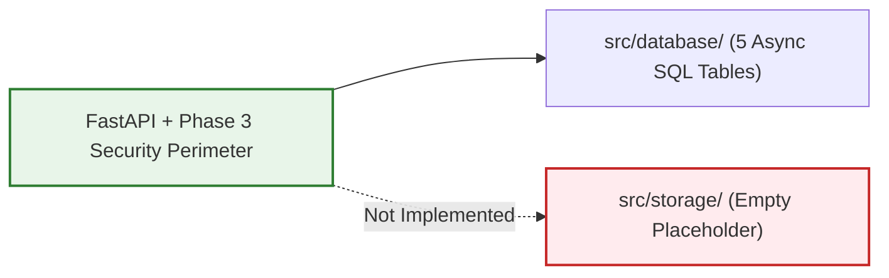
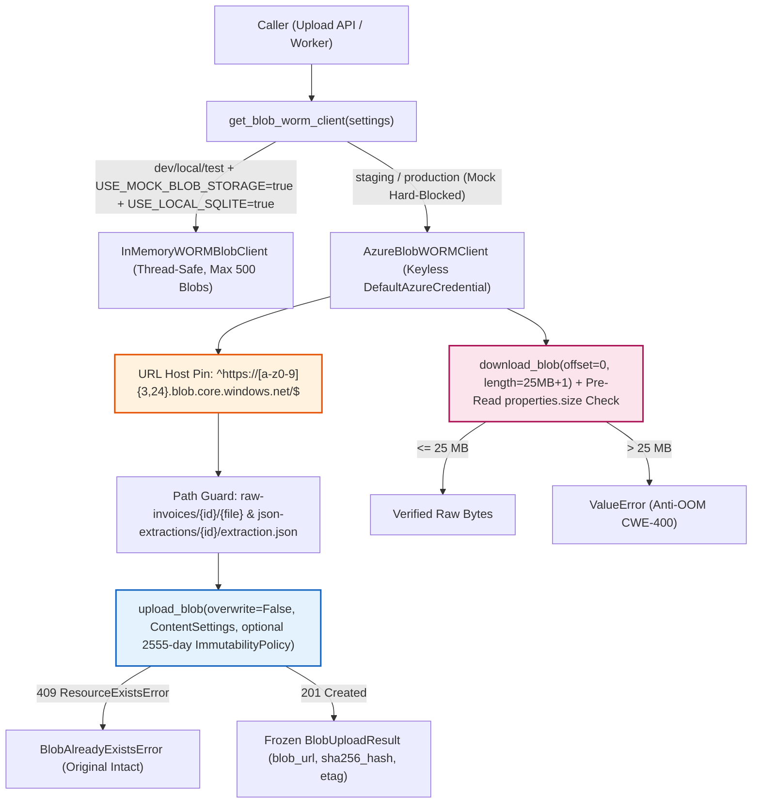
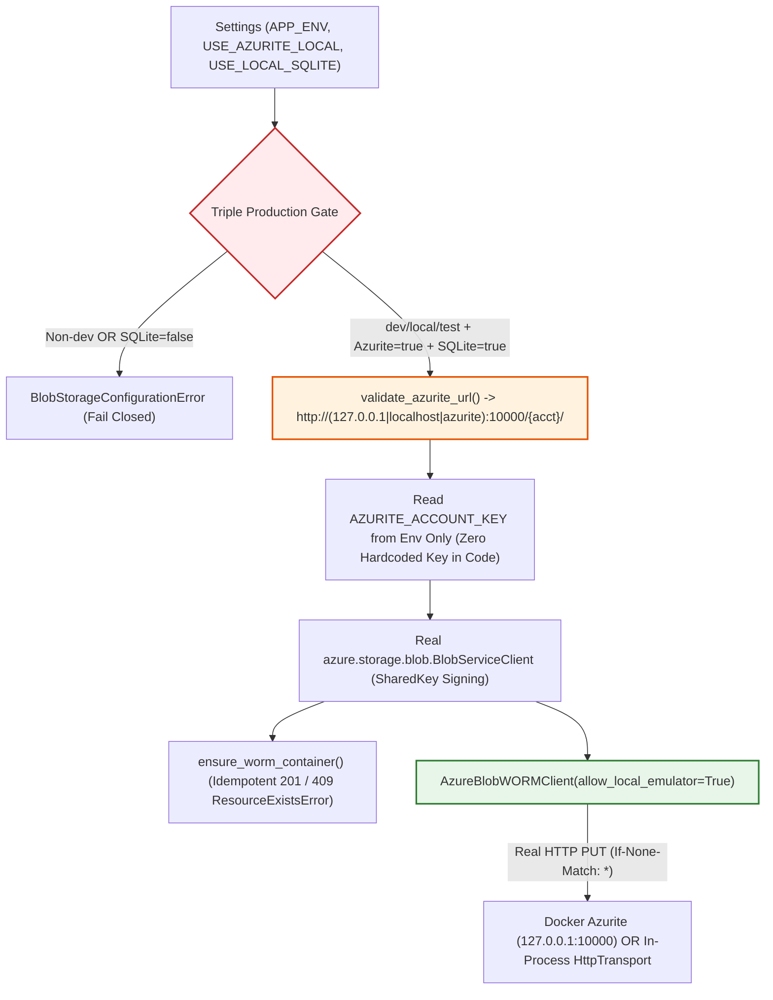
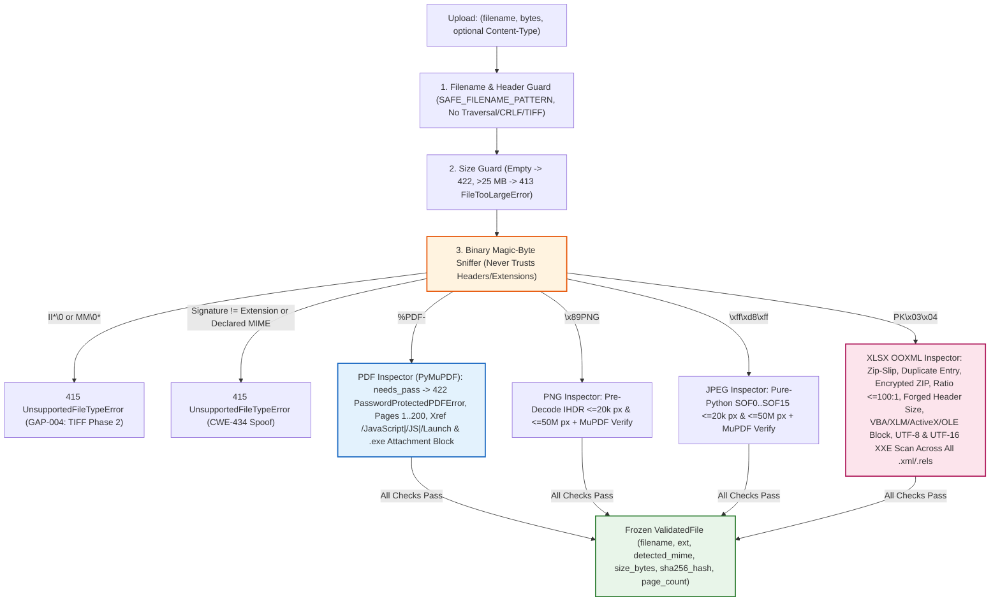
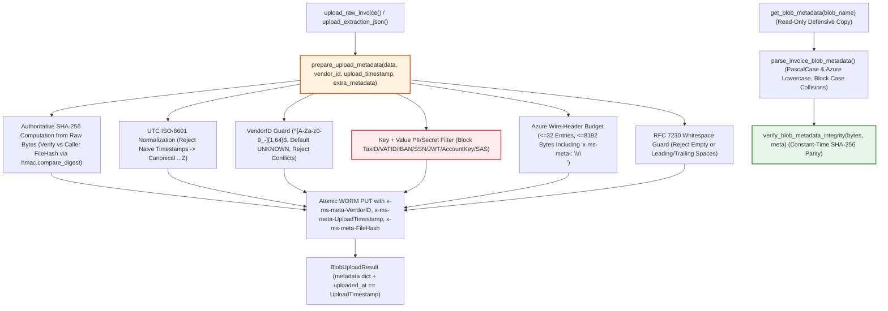
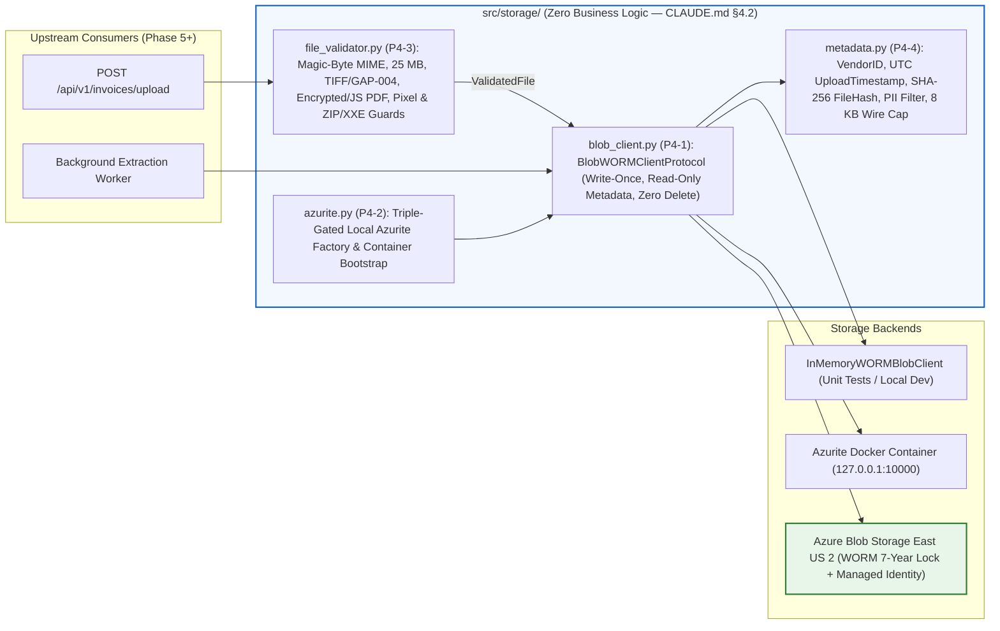

# Phase 4: Project System Design Evolution

> **Document Scope:** Architectural journey and system design evolution throughout **Phase 4 (Azure Storage Layer — P4-1 through P4-4)**.  
> **Target Audience:** Solution Architects, Security Engineers, Backend Leads, and System Design Interviewers.

---

## 1. Phase 4 Mission & Architectural Baseline

At the end of Phase 3, the platform had a stateless FastAPI runtime skeleton (Phase 1), a dual-dialect async SQL persistence tier with 5 tables and race-safe duplicate guards (Phase 2), and a complete Entra ID RBAC + Redis sliding-window rate limiter + isolated-transaction audit + keyless Key Vault security perimeter (Phase 3), backed by **110 passing offline tests**.

However, `src/storage/` was still an empty placeholder package. There was no immutable object storage client for raw invoices or extraction snapshots, no local storage emulator parity, no pre-storage file intake security scanner, and no standardized blob metadata tagging or tamper-evidence verification.

The mission of **Phase 4** was to construct an enterprise-grade, zero-business-logic **Immutable Document Storage Layer (`src/storage/`)** enforcing six architectural invariants:

1. **Strict Layer Isolation (`CLAUDE.md §4.2`):** `src/storage/` owns WORM blob I/O, intake file validation, and metadata tagging ONLY—**zero imports** from `src/database/`, `src/extraction/`, `src/validation/`, or `src/api/`.
2. **Defense-in-Depth WORM Immutability (`ADR-005`, `N6`, `BR-026`):** Every write enforces `overwrite=False` (`If-None-Match: *`) alongside optional Azure 7-year `ImmutabilityPolicy` (`2555` days), while **omitting all delete, overwrite, and metadata-mutation methods** from the client protocol and implementations.
3. **Keyless Cloud Authentication (`ADR-007`, `N1`, `N8`):** Production storage authenticates exclusively via `DefaultAzureCredential` pinned strictly to `https://<account>.blob.core.windows.net/` (blocking SSRF and Managed Identity Bearer token exfiltration).
4. **Triple-Gated Zero-Cost Local Parity (`GAP-002`):** Local development supports both `InMemoryWORMBlobClient` and an official loopback-hardened **Azurite** emulator (`127.0.0.1:10000`), hard-blocked outside `dev`/`local`/`test` or whenever `USE_LOCAL_SQLITE=false`.
5. **Pre-Storage Deep File Security (`FR-01`, `BR-001`, `GAP-004`):** Binary magic-byte sniffing, 25 MB size enforcement, explicit TIFF blocking, password-protected & active-script PDF rejection, pre-decode image pixel-bomb guards, and deep OOXML XLSX inspection (Zip-Slip, ZIP bombs, forged headers, macros, UTF-8/UTF-16 XXE).
6. **Authoritative Canonical Metadata Tagging (`CLAUDE.md §7.3`):** Every upload is atomically tagged with `VendorID`, UTC ISO-8601 `UploadTimestamp`, and authoritative SHA-256 `FileHash` with key-and-value PII filtering, Azure 8 KB wire-header budget enforcement, and constant-time read verification.

---

## 2. Progressive Evolution: Subtask-by-Subtask System Design

### 2.1 Stage 0: End of Phase 3 Baseline (Empty Storage Tier)

Entering Phase 4, the API and security middleware were operational, and SQL tables (`Invoices.blob_url`, `Invoices.file_hash`) were ready—but `src/storage/` had no client, no intake guard, and no blob metadata contract.

---

### 2.2 Stage 1 (P4-1): Keyless Azure Blob WORM Client (`src/storage/blob_client.py`)

In **P4-1 (`feature/storage-blob-worm-client`, PR #11)**, we designed the dual-mode `BlobWORMClientProtocol` with two strictly write-once implementations (`AzureBlobWORMClient` and `InMemoryWORMBlobClient`) resolved via a cached factory `get_blob_worm_client(settings)`.

**Key Architectural Decisions in P4-1:**
- **Zero Delete/Overwrite API Surface (`SEC-052`):** Neither `AzureBlobWORMClient` nor `InMemoryWORMBlobClient` exposes `delete`, `delete_blob`, `overwrite`, or `update` methods—verified by negative reflection tests.
- **SSRF & Token Exfiltration Pin (`SEC-053`):** `validate_blob_account_url()` blocks HTTP, userinfo (`user:pass@`), SAS query strings (`?sig=`), and foreign domains so `DefaultAzureCredential` can never transmit an Entra ID Bearer token to an attacker-controlled host.
- **Bounded Download Read (`SEC-054`):** Passes `offset=0, length=MAX_BLOB_SIZE_BYTES + 1` AND checks `downloader.properties.size` *before* calling `readall()`—eliminating worker OOM DoS from oversized blobs.

---

### 2.3 Stage 2 (P4-2): Hardened Local Azurite Emulator & Wire-Protocol Smoke (`src/storage/azurite.py`)

In **P4-2 (`feature/storage-azurite-local`, PR #12)**, we added local Azure Blob REST protocol parity without compromising the zero-static-secret or production-safety invariants.

**Key Architectural Decisions in P4-2:**
- **Real SDK Wire-Protocol Verification Offline:** Instead of mocking `BlobServiceClient` methods alone, `tests/integration/test_azurite_smoke.py` injects a custom `azure.core.pipeline.transport.HttpTransport` into the **real** `BlobServiceClient`, exercising genuine SharedKey signing, `If-None-Match: *` WORM header emission, XML `409 BlobAlreadyExists` deserialization, and HTTP `206` range downloads with **zero TCP sockets** in offline CI.
- **Account Name Derived from URL (`SEC-063`):** Rather than accepting a separate `AZURITE_ACCOUNT_NAME` that could drift from the URL path, the account name is derived canonically from the validated Azurite URL segment.

---

### 2.4 Stage 3 (P4-3): Multi-Stage Deep File Intake Validator (`src/storage/file_validator.py`)

In **P4-3 (`feature/storage-file-validator`, PR #13)**, we placed a deterministic, zero-network security inspection gate directly upstream of WORM blob ingestion.

**Key Architectural Decisions in P4-3:**
- **Structured HTTP Error Semantics:** Every exception subclass (`FileTooLargeError -> 413`, `UnsupportedFileTypeError -> 415`, `PasswordProtectedPDFError -> 422`, `CorruptedOrMaliciousFileError -> 422`) carries typed `error_code` and `http_status` attributes so Phase 5 (`POST /api/v1/invoices/upload`) can map failures cleanly without leaking internals.
- **Zero False Positives on Legitimate Vendor Excel Invoices:** Rather than banning all `.bin` files inside `.xlsx` (which would break legitimate Microsoft Excel exports containing `xl/printerSettings/printerSettings1.bin`), macro blocking targets `vbaProject.bin`, `xl/macrosheets/`, `xl/dialogsheets/`, `xl/activeX/`, `xl/embeddings/`, and `macroEnabled` content types.
- **Pre-Decode Decompression Bomb Defense:** Both PNG (`IHDR`) and JPEG (`SOF0..SOF15`) dimensions are parsed directly in pure Python *before* MuPDF allocates pixel buffers.

---

### 2.5 Stage 4 (P4-4): Canonical Blob Metadata Tagging & Integrity Layer (`src/storage/metadata.py`)

In **P4-4 (`feature/storage-blob-metadata`, PR #14)**, we unified all metadata validation into a single authoritative module and wired it directly into both WORM clients.

---

## 3. Complete End-of-Phase 4 Architecture

---

## 4. Key Architectural Trade-Offs Made in Phase 4

| Design Decision | Alternative Considered | Why We Chose Our Approach |
|---|---|---|
| **Dedicated `src/storage/metadata.py` integrated into `blob_client.py`** | Leaving loose `dict[str, str]` metadata in `blob_client.py` | Prevents drift between two validators, guarantees every WORM upload automatically receives `VendorID`/`UploadTimestamp`/`FileHash`, and enables case-insensitive Azure REST parsing + constant-time integrity checks. |
| **Pure-Python PNG `IHDR` & JPEG `SOF` parsing before PyMuPDF** | Letting `fitz.open()` or Pillow decode first | Blocks decompression bombs in O(KB) bytes before any C-level raster buffer is allocated (`SEC-066`). |
| **In-process `HttpTransport` wire-protocol smoke test** | Requiring Docker daemon in GitHub Actions CI | Runs real `azure-storage-blob` SharedKey signing, `If-None-Match: *`, `x-ms-meta-*`, and `206` range parsing in **0.07s** with zero sockets, while keeping optional `RUN_LIVE_AZURITE_SMOKE=true` for local Docker verification. |
| **Allowing `xl/printerSettings/*.bin` while banning VBA/XLM/ActiveX/OLE** | Blanket rejection of all `.bin` ZIP entries | Blanket `.bin` bans break real Microsoft Excel `.xlsx` exports from enterprise vendors; targeted OOXML path + `macroEnabled` Content-Type inspection eliminates false positives without lowering security. |
| **Zero `set_blob_metadata()` method on WORM clients** | Allowing post-upload metadata updates (e.g., updating `VendorID` after OCR) | Preserves true WORM immutability (`ADR-005`). Once OCR resolves a vendor, the authoritative vendor link lives in Azure SQL (`Invoices.vendor_id`), while the raw blob's original intake tags remain permanently unaltered. |

---

## 5. Verification & Security Evolution Across Phase 4

| Subtask | PR | New Tests | Cumulative Offline Tests | Security Findings Mitigated |
|---|---|---|---|---|
| Phase 3 Baseline | #6–#10 | — | 110 | 51 (`SEC-001`–`SEC-051`) |
| **P4-1** Blob WORM Client | #11 | +10 | 120 | +7 (`SEC-052`–`SEC-058`: 2 Critical, 3 High, 2 Medium) |
| **P4-2** Azurite Local Emulator | #12 | +7 (+1 live skip) | 127 | +5 (`SEC-059`–`SEC-063`: 3 High, 1 Medium, 1 Low) |
| **P4-3** File Validator | #13 | +13 | 140 | +7 (`SEC-064`–`SEC-070`: 6 High, 1 Medium) |
| **P4-4** Blob Metadata Tagging | #14 | +10 | **150** | +6 (`SEC-071`–`SEC-076`: 2 High, 4 Medium) |
| **Phase 4 Total** | **#11–#14** | **+40 tests** | **150 passing (3.04s)** | **+25 findings (76 total, 0 open)** |

