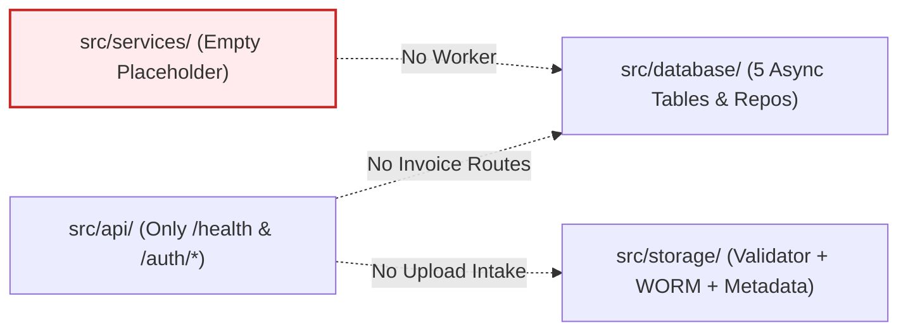
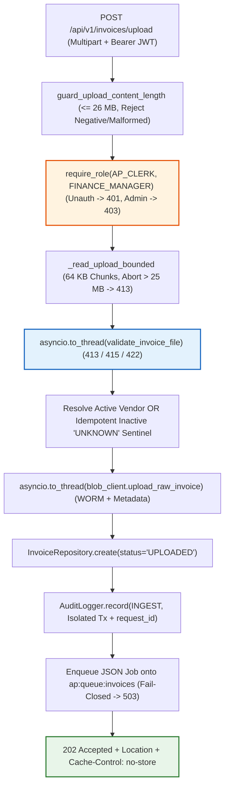
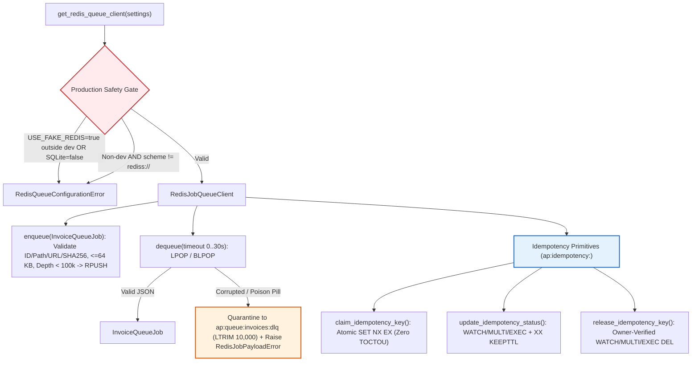
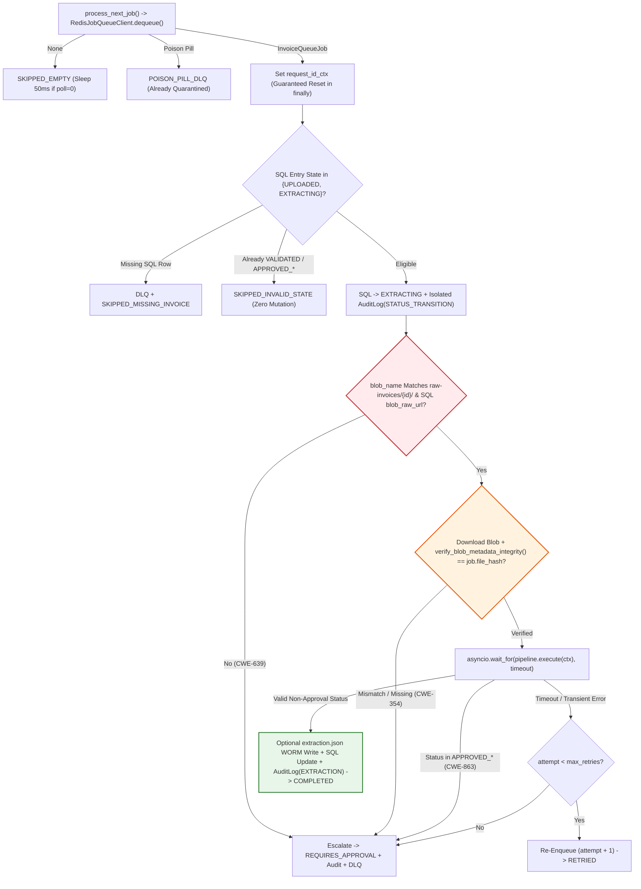
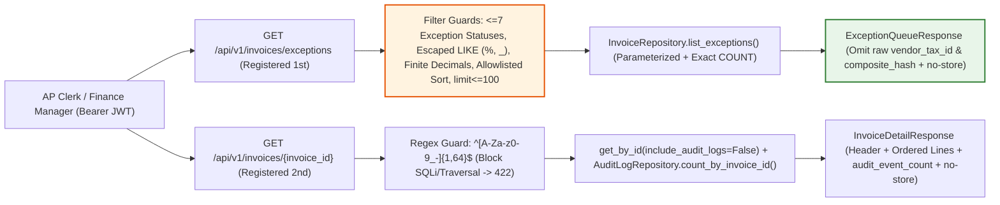
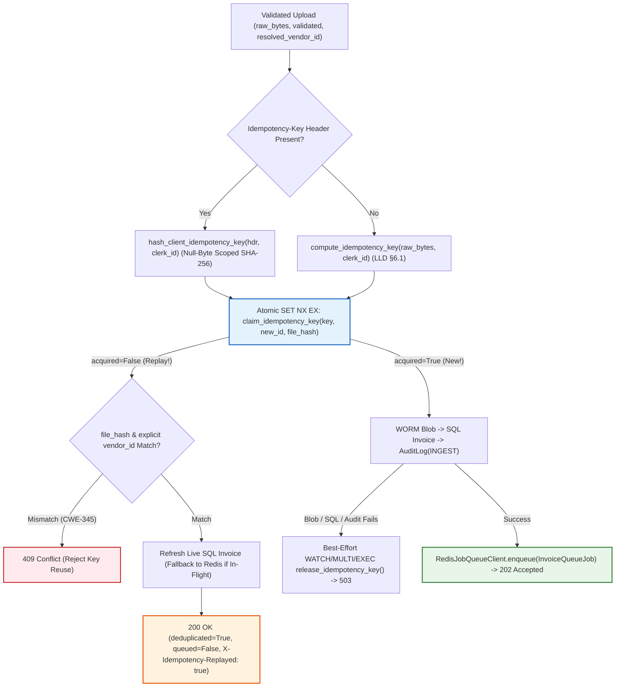

# Phase 5: Project System Design Evolution

> **Document Scope:** Architectural journey and system design evolution throughout **Phase 5 (Invoice Upload API and Job Queue — P5-1 through P5-5)**.  
> **Target Audience:** Solution Architects, Backend Leads, Distributed Systems Engineers, and System Design Interviewers.

---

## 1. Phase 5 Mission & Architectural Baseline

Entering Phase 5, the platform had all four foundational infrastructure layers verified with **150 passing tests** and **76 mitigated security findings**:
- **Phase 1:** FastAPI runtime skeleton, JSON PII-masked logging, offline test harness, CI pipeline.
- **Phase 2:** Dual-dialect async SQLAlchemy 2.0 persistence tier (5 tables, repositories, composite-hash uniqueness).
- **Phase 3:** Entra ID RS256 RBAC, ephemeral demo tokens, Redis sliding-window rate limiter, isolated-tx `AuditLogger`, keyless Key Vault stub.
- **Phase 4:** Keyless Azure Blob WORM client, hardened local Azurite emulator, deep magic-byte file validator, and canonical `VendorID`/`UploadTimestamp`/`FileHash` metadata tagging.

The mission of **Phase 5** was to orchestrate those layers into a **decoupled, idempotent, asynchronous invoice ingestion, queueing, background processing, and read/filter API tier** enforcing six invariants:

1. **Non-Blocking Async Ingestion (`P5-1`, `CWE-400`):** Bounded 64 KB multipart streaming (`<= 25 MB`), pre-parse `Content-Length` DoS guard, and `asyncio.to_thread` offloading for CPU-bound validation and synchronous storage I/O.
2. **Fail-Closed Distributed Reliability (`P5-1`, `P5-2`, `CWE-636`):** Never return a false `202 Accepted` when Blob, SQL, Audit, or Redis fails; enforce TLS `rediss://` in production and hard-block `USE_FAKE_REDIS` outside local dev/SQLite.
3. **Poison-Pill Resilience & Backpressure (`P5-2`, `CWE-400`):** Quarantine malformed queue payloads into a `LTRIM`-bounded Dead-Letter Queue (`10,000` max) and enforce `64 KB` job / `100,000` depth limits to protect Azure Cache for Redis Basic B0 (`250 MB`).
4. **Zero-Trust Background Execution (`P5-3`, `CLAUDE.md §8`, `CWE-863` / `CWE-639` / `CWE-354`):** Pluggable `InvoicePipelineProtocol` wrapped by a strict non-approval status allowlist (hard-blocking `APPROVED_*`), cross-invoice blob-swap guard, constant-time `FileHash` verification, per-job timeout, and bounded retry -> DLQ escalation.
5. **Data-Minimized, Injection-Proof Read & Exception Queries (`P5-4`, `CWE-89` / `CWE-200`):** Parameterized SQLAlchemy filters with escaped `LIKE` wildcards, explicit sort-column allowlist, `COUNT(*)` audit counts (no unbounded ORM hydration), and omitted `vendor_tax_id` on bulk exception lists.
6. **Atomic Race-Safe Idempotency Deduplication (`P5-5`, `LLD §6.1`, `CWE-362` / `CWE-345`):** Atomic Redis `SET NX EX` claims (`SHA256(file_bytes + clerk_id)` or actor-scoped `Idempotency-Key` header), `200 OK` live-status replays, `409 Conflict` on payload/`vendor_id` mismatch, and `WATCH/MULTI/EXEC` lock rollback on downstream failure.

---

## 2. Progressive Evolution: Subtask-by-Subtask System Design

### 2.1 Stage 0: End of Phase 4 Baseline (Unconnected Building Blocks)

At the end of Phase 4, the storage validator, WORM client, SQL repositories, and RBAC guards existed independently—with no invoice HTTP routes, no Redis job queue client, and no background worker.

---

### 2.2 Stage 1 (P5-1): Multipart Invoice Upload API (`src/api/invoices.py`, PR #15)

In **P5-1 (`feature/api-invoice-upload`)**, we built `POST /api/v1/invoices/upload` and created the typed schema package `src/api/schemas/invoices.py`.

---

### 2.3 Stage 2 (P5-2): Redis Job Queue & Atomic Idempotency Client (`src/core/redis_client.py`, PR #16)

In **P5-2 (`feature/core-redis-job-queue`)**, we extracted a dedicated, production-hardened async Redis client in `src/core/redis_client.py` supporting FIFO job operations, DLQ poison-pill quarantine, and atomic idempotency primitives.

---

### 2.4 Stage 3 (P5-3): Background Worker Skeleton (`src/services/worker.py`, PR #17)

In **P5-3 (`feature/worker-pipeline-skeleton`)**, we built `InvoiceBackgroundWorker` in `src/services/` (strictly zero direct HTTP imports per `CLAUDE.md §4.2`) with a pluggable `InvoicePipelineProtocol` ready for Phases 6–8.

---

### 2.5 Stage 4 (P5-4): Invoice Detail & Exception Queue Read Routes (`src/api/invoices.py` & `repositories.py`, PR #18)

In **P5-4 (`feature/api-invoice-read-routes`)**, we added `GET /api/v1/invoices/exceptions` (registered strictly *before* `/{invoice_id}`!) and `GET /api/v1/invoices/{invoice_id}`.

---

### 2.6 Stage 5 (P5-5): Atomic Upload Idempotency Key Deduplication (`src/api/invoices.py`, PR #19)

In **P5-5 (`feature/api-idempotency-dedup`)**, we closed the loop by wiring atomic `SET NX EX` idempotency claims, live SQL status replays, `409 Conflict` payload/`vendor_id` guards, and owner-verified rollback release directly into `POST /api/v1/invoices/upload`—and unified upload enqueueing through `RedisJobQueueClient.enqueue()`.

---

## 3. Key Architectural Trade-Offs Made in Phase 5

| Design Decision | Alternative Considered | Why We Chose Our Approach |
|---|---|---|
| **Inactive `UNKNOWN` sentinel vendor in `vendors` table for pre-OCR uploads** | Dropping the `NOT NULL` / FK constraint on `invoices.vendor_tax_id` | Preserves Phase 2 DDL & foreign-key integrity on both SQLite and Azure SQL with zero schema breakage, while `is_active=False` keeps `VendorRepository.list_all(active_only=True)` strictly limited to the 15 real vendors. |
| **Redis `RPUSH` + `LPOP`/`BLPOP` + `WATCH/MULTI/EXEC` inside `RedisJobQueueClient`** | Introducing Celery + RabbitMQ right away | Keeps Phase 5 100% pure-Python async, zero extra broker containers, `fakeredis` offline parity in 0.04s, and fits Azure Cache for Redis Basic B0 (\$16/mo per HLD §256) with explicit `64 KB` / `100k` / `10k DLQ` memory ceilings. |
| **Pluggable `InvoicePipelineProtocol` with conservative `DefaultSkeletonPipeline`** | Hardcoding mock extraction directly inside the worker | Cleanly decouples queue orchestration & security invariants (`P5-3`) from Azure OpenAI extraction (`Phase 6`) and deterministic rules (`Phase 7`), while ensuring unextracted invoices default to `REQUIRES_REVIEW` rather than false `VALIDATED`. |
| **SQL `COUNT(*)` for `audit_event_count` instead of eager-loading `Invoice.audit_logs`** | `len(invoice.audit_logs)` with `selectinload(Invoice.audit_logs)` | Prevents hydrating hundreds of historical audit rows on every Streamlit detail poll (`SEC-098`, `CWE-400`), leaving full audit timeline fetching cleanly to `GET /api/v1/invoices/{id}/audit` (P9-3). |
| **Returning `409 Conflict` when an explicit `Idempotency-Key` is reused with different bytes or `vendor_id`** | Silently returning the cached first invoice | Follows IETF `Idempotency-Key` draft spec and blocks subtle client bugs where a clerk's retry sends Invoice B under Invoice A's key (`SEC-101`, `CWE-345`). |

---

## 4. Verification & Security Evolution Across Phase 5

| Subtask | PR | New Tests | Cumulative Offline Tests | Security Findings Mitigated |
|---|---|---|---|---|
| Phase 4 Baseline | #11–#14 | — | 150 | 76 (`SEC-001`–`SEC-076`) |
| **P5-1** `POST /api/v1/invoices/upload` | #15 | +11 | 161 | +6 (`SEC-077`–`SEC-082`: 4 High, 2 Medium) |
| **P5-2** `src/core/redis_client.py` | #16 | +9 | 170 | +6 (`SEC-083`–`SEC-088`: 4 High, 2 Medium) |
| **P5-3** `src/services/worker.py` | #17 | +9 | 179 | +6 (`SEC-089`–`SEC-094`: 1 Critical, 4 High, 1 Medium) |
| **P5-4** `GET /invoices/{id}` & `/exceptions` | #18 | +7 | 186 | +6 (`SEC-095`–`SEC-100`: 3 High, 3 Medium) |
| **P5-5** Idempotency Key Deduplication | #19 | +7 | **193** | +5 (`SEC-101`–`SEC-105`: 3 High, 2 Medium) |
| **Phase 5 Total** | **#15–#19** | **+43 tests** | **193 passing (5.34s)** | **+29 findings (105 total, 0 open)** |

