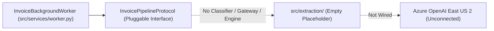
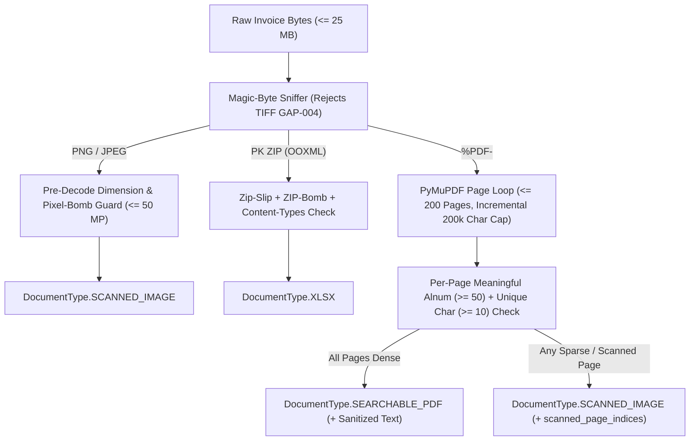
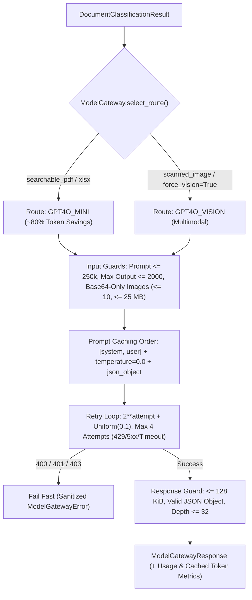
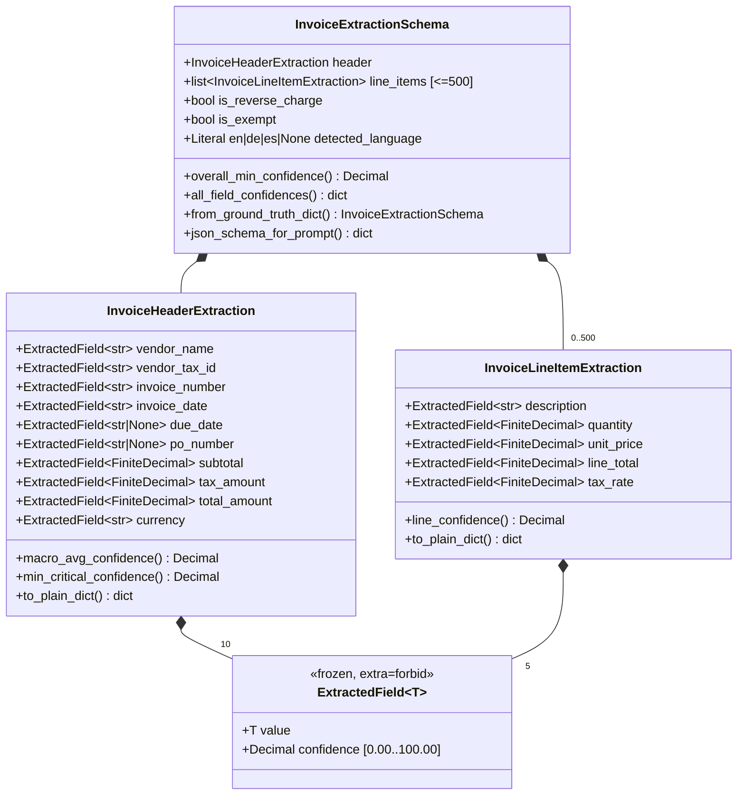
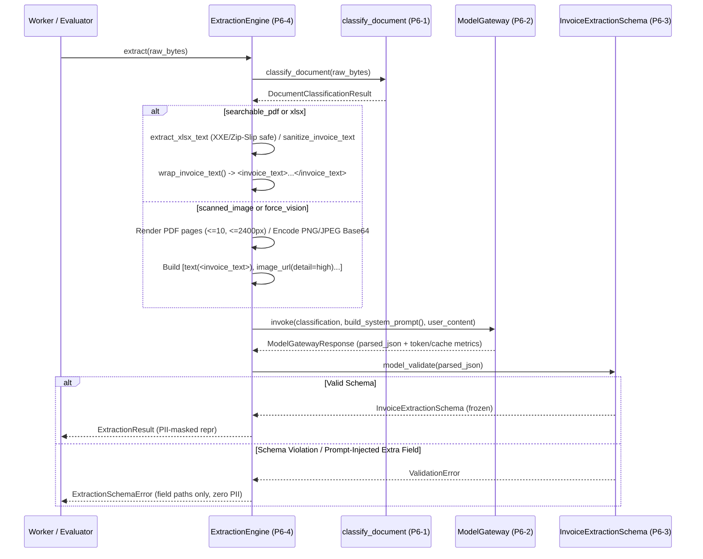
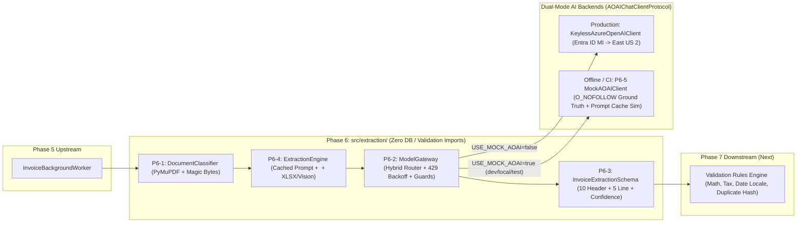

# Phase 6: Project System Design Evolution

> **Document Scope:** Architectural journey and system design evolution throughout **Phase 6 (Extraction Engine and Model Gateway — P6-1 through P6-5)**.  
> **Target Audience:** Solution Architects, AI/ML Platform Engineers, Backend Leads, and System Design Interviewers.

---

## 1. Phase 6 Mission & Architectural Baseline

Entering Phase 6, the platform had Phases 1–5 complete with **193 passing offline tests** and **104 mitigated security findings**:
- **Phases 1–4:** FastAPI runtime, 5-table async SQLAlchemy persistence, Entra ID RS256 RBAC, Redis rate limiting, immutable `AuditLogger`, keyless Key Vault stub, WORM Blob storage, magic-byte file validator, and canonical Blob metadata tagging.
- **Phase 5:** Non-blocking `POST /api/v1/invoices/upload` (`202 Accepted`), Redis FIFO job queue + DLQ, stateless `InvoiceBackgroundWorker` skeleton (`InvoicePipelineProtocol`), `GET /api/v1/invoices/{id}` & `/exceptions`, and race-safe idempotency deduplication.

The mission of **Phase 6** was to build the entire **AI Extraction & Model Gateway Layer (`src/extraction/`)** enforcing six core architectural invariants:

1. **Cost-Optimal Hybrid Routing (`P6-1`, `P6-2`, `ADR-004`):** Classify raw binary bytes via PyMuPDF text-layer density so clean `searchable_pdf` & `xlsx` invoices route to **GPT-4o-mini** (~80% token savings), while `scanned_image` / hybrid-scanned PDFs (or `force_vision=True`) route to **GPT-4o Vision**.
2. **100% Keyless Managed Identity & Zero SSRF (`P6-2`, `ADR-007`, `CWE-918` / `CWE-522`):** Authenticate exclusively via `DefaultAzureCredential` + `get_bearer_token_provider` pinned strictly to `https://<resource>.openai.azure.com/` with validated `AZURE_OPENAI_API_VERSION` and base64-only Vision data URIs.
3. **Deterministic Prompt Caching & Bounded Retry Resilience (`P6-2`, `P6-4`, `HLD §7.1`, `LLD §6.2`):** Byte-identical `@lru_cache` static system prompt + JSON schema first, `temperature=0.0`, `response_format={"type": "json_object"}`, hard `<= 2,000` output token ceiling, and `2**attempt + Uniform(0, 1)` backoff (max 4 attempts) on HTTP 429 / transient 5xx.
4. **Prompt-Injection Defense in Depth (`P6-3`, `P6-4`, `N4`, `CLAUDE.md §7.2–§7.3`, `CWE-74` / `CWE-915`):** Wrap all untrusted invoice text in `<invoice_text>...</invoice_text>` with literal/unclosed/fullwidth delimiter breakout neutralization, and validate every LLM output through immutable `extra="forbid"` Pydantic v2 schemas (`InvoiceExtractionSchema`) carrying all 10 header + 5 line-item fields with strict `[0.00, 100.00]` per-field confidence scores.
5. **Strict Layer Isolation (`CLAUDE.md §4.2`):** `src/extraction/` has **zero imports** from `src/database/` or `src/validation/` and executes **zero business rules** (no arithmetic checks, tax lookups, or approval transitions).
6. **Zero-Network Offline Parity (`P6-5`, `CLAUDE.md §13`, `CWE-489`):** Replace temporary stubs with `MockAOAIClient` wired directly into `get_model_gateway()` so the full P6-1..P6-5 pipeline runs offline against real `sample_data/ground_truth/` fixtures while failing closed in staging/production.

---

## 2. Progressive Evolution: Subtask-by-Subtask System Design

### 2.1 Stage 0: End of Phase 5 Baseline (Worker Ready, Extraction Layer Empty)

At the end of Phase 5, `InvoiceBackgroundWorker` (`src/services/worker.py`) accepted an injectable `InvoicePipelineProtocol`, but `src/extraction/` was still an empty placeholder package.

---

### 2.2 Stage 1 — P6-1: Document Classifier (`src/extraction/document_classifier.py`)

We added deterministic binary magic-byte detection and PyMuPDF per-page text-layer density analysis—defeating filename spoofing, whitespace/repeated-character padding (`'A'*400`), hybrid PDFs (mixed digital + scanned pages), raster pixel bombs, and XLSX Zip-Slip/ZIP bombs.

---

### 2.3 Stage 2 — P6-2: Hybrid Model Gateway (`src/extraction/model_gateway.py`)

We introduced `ModelGateway`, `KeylessAzureOpenAIClient`, and `AOAIChatClientProtocol`—decoupling routing, resilience, and security guardrails from prompt logic.

---

### 2.4 Stage 3 — P6-3: Pydantic Extraction Schemas (`src/extraction/schemas.py`)

We locked down the exact typed output contract (`FR-03`, `BR-004`, `BR-005`) with `extra="forbid"`, `frozen=True`, `FiniteDecimal` bomb protection, Unicode bidi/zero-width blocking, and deterministic confidence aggregations.

---

### 2.5 Stage 4 — P6-4: Extraction Engine (`src/extraction/extract_engine.py`)

We bridged P6-1, P6-2, and P6-3 into `ExtractionEngine`, adding cached static system prompt assembly, `<invoice_text>` delimiter wrapping + breakout neutralization, XXE-safe OOXML XLSX parsing, MediaBox-clamped Vision rendering, and PII-safe schema enforcement.

---

### 2.6 Stage 5 — P6-5: End-of-Phase 6 Complete Architecture (`src/extraction/mock_aoai_client.py`)

In P6-5, we replaced the temporary P6-2 stub with `MockAOAIClient` wired into `get_model_gateway()`, completing a **100% end-to-end testable, dual-mode extraction architecture** ready to hand clean `ExtractionResult` payloads into Phase 7's deterministic Validation Rules Engine.

---

## 3. Phase 6 Architectural Metrics & Design Trade-offs

| Dimension | Baseline (End of Phase 5) | End of Phase 6 (PR #24) |
|---|---|---|
| **Extraction Modules** | 0 (`src/extraction/` empty) | 5 cohesive modules (`document_classifier`, `model_gateway`, `schemas`, `extract_engine`, `mock_aoai_client`) |
| **Test Suite Count** | 193 passing | **242 passing** (+49 Phase 6 tests; 6.66s total offline) |
| **Security Findings Mitigated** | 104 | **136** (+32 Phase 6 findings: `SEC-105`–`SEC-136`) |
| **AI Cost Optimization** | None | ~80% savings via GPT-4o-mini routing + up to 50% input savings via byte-identical Prompt Caching + 2,000-token output cap |
| **Keyless Compliance** | Key Vault + Blob | Extended to Azure OpenAI (`DefaultAzureCredential` + Cognitive Services Bearer scope, zero `api_key=`) |
| **Offline Determinism** | Mock stubs only | Full end-to-end P6-1..P6-5 pipeline executes offline against `sample_data/ground_truth/` at \$0 |

