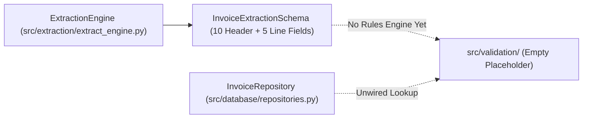
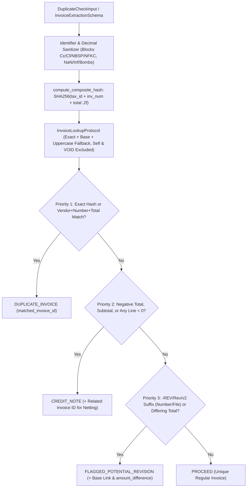
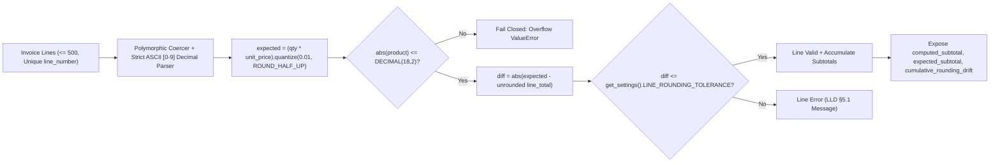
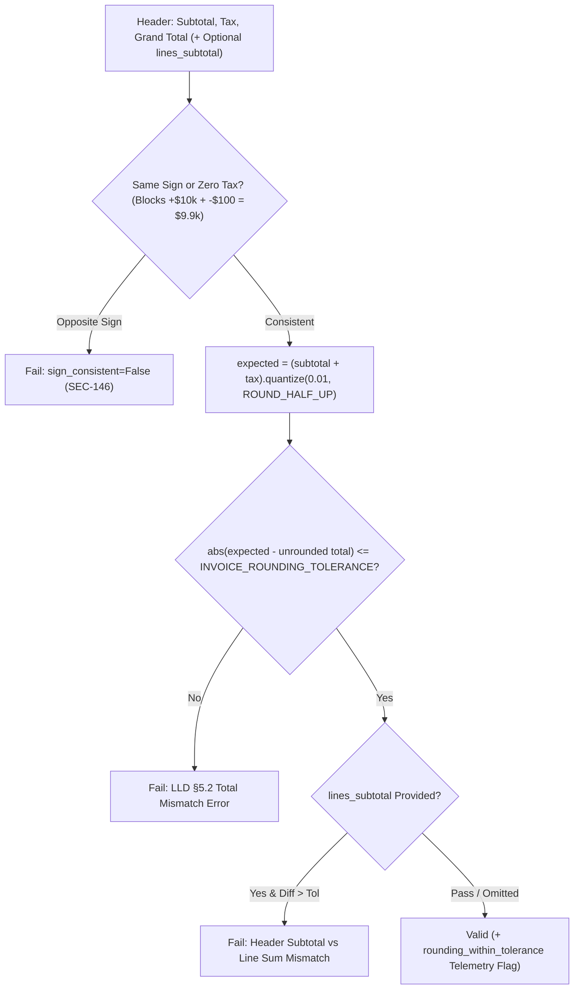
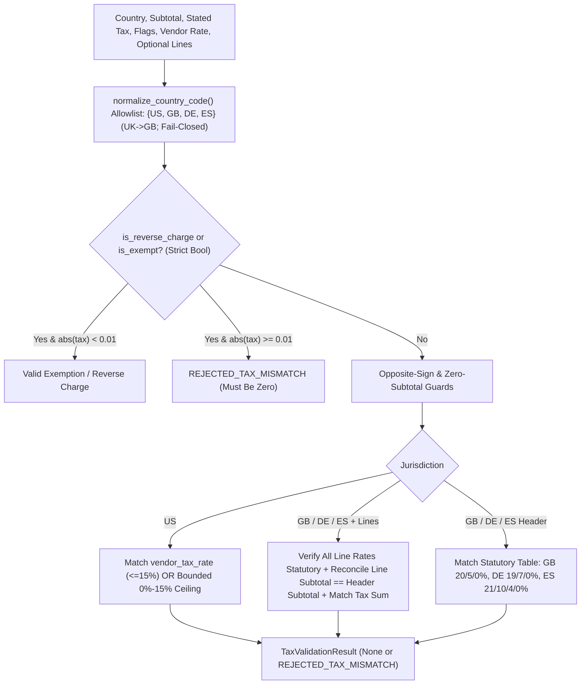
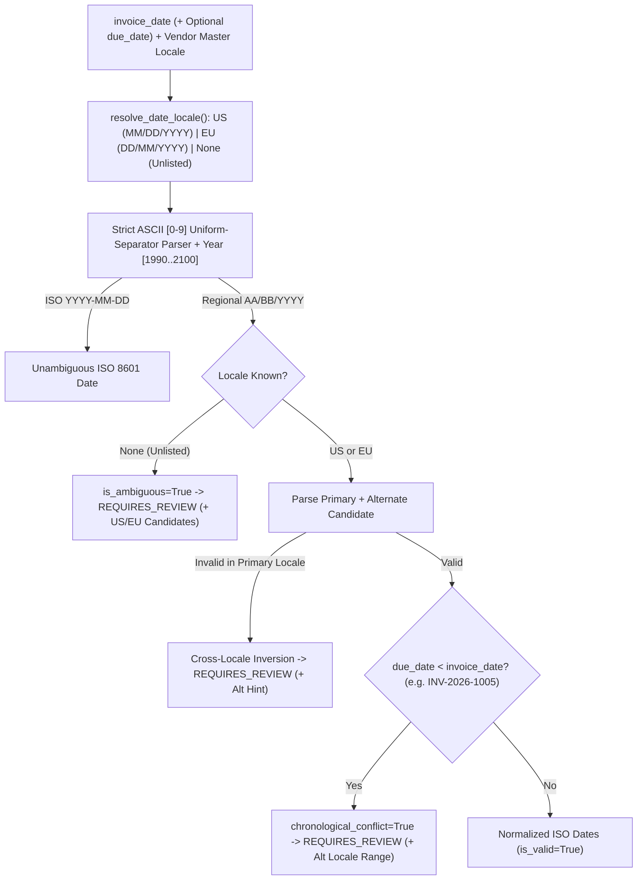
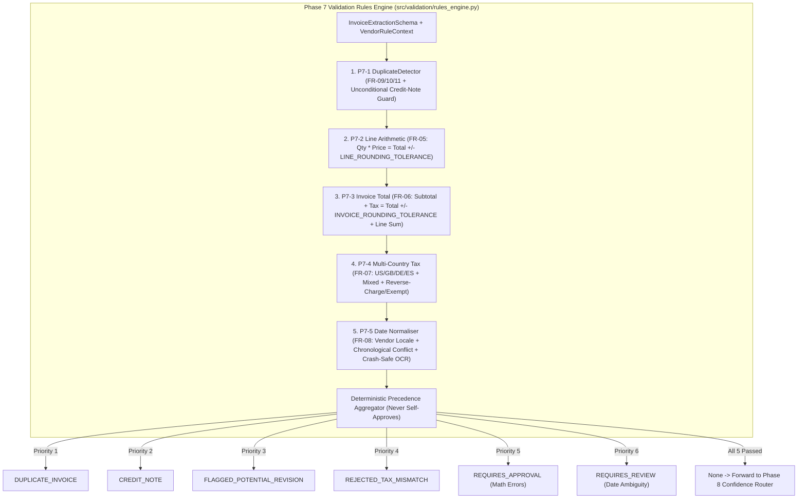

# Phase 7: Project System Design Evolution

> **Document Scope:** Architectural journey and system design evolution throughout **Phase 7 (Validation Rules Engine — P7-1 through P7-6)**.  
> **Target Audience:** Solution Architects, Backend Leads, Staff Engineers, Financial Systems Engineers, and System Design Interviewers.

---

## 1. Phase 7 Mission & Architectural Baseline

Entering Phase 7, Phases 1–6 and Phase 10 were complete (**34 / 68 tasks · 50%**, **242 passing offline tests**, **136 mitigated security findings**):
- **Phases 1–5:** FastAPI runtime, 5-table async SQLAlchemy persistence (`InvoiceRepository`, `compute_composite_hash`, `UX_invoices_composite_hash`), Entra ID RS256 RBAC, Redis rate limiting & FIFO job queue, immutable `AuditLogger`, keyless Key Vault stub, WORM Blob storage, and `InvoiceBackgroundWorker`.
- **Phase 6:** Complete `src/extraction/` pipeline (`classify_document`, `ModelGateway`, `InvoiceExtractionSchema`, `ExtractionEngine`, `MockAOAIClient`) producing strictly typed 10-header + 5-line extraction outputs with per-field `[0.00, 100.00]` confidence scores and zero business-rule coupling.

The mission of **Phase 7** was to build the entire **Deterministic Validation Rules Engine (`src/validation/`)** honoring **ADR-002 (Rules-First, Model-Second)** and six non-negotiable architectural invariants:

1. **100% Deterministic Python (`CLAUDE.md §4.2, §7.2`):** Zero LLM calls, zero `openai` imports, and zero direct `sqlalchemy` imports anywhere in `src/validation/`—database reads occur strictly through the read-only `InvoiceLookupProtocol` (satisfied directly by `InvoiceRepository`).
2. **Exact Financial `Decimal` Precision (`BR-009`, `BR-010`, `BR-011`):** Every arithmetic, tax, and hash calculation uses bounded finite `Decimal` with explicit `ROUND_HALF_UP` quantization, preserving unrounded stated totals for boundary comparisons so `+0.021 > 0.02` and `+0.051 > 0.05` never round into false passes.
3. **Zero Hardcoded Thresholds (`CLAUDE.md §16 Rule 8`):** All rounding tolerances (`LINE_ROUNDING_TOLERANCE`, `INVOICE_ROUNDING_TOLERANCE`) are resolved dynamically from `get_settings()` and fail-closed bounded to `[0.00, 100.00]`.
4. **Non-Negotiable Credit-Note & Non-Approval Invariants (`CLAUDE.md §16.1`):** Negative-balance documents (negative total, subtotal, or any negative line item) are **always** classified as `CREDIT_NOTE` (unless an identical duplicate credit note already exists → `DUPLICATE_INVOICE`), and no validation module can ever emit `APPROVED_CLERK`, `APPROVED_MANAGER`, or `STAGED_FOR_EXPORT`.
5. **Fail-Closed Financial Fraud Defense:** Blocks Unicode soft-hyphen/NFKC hash bypasses, SQLite mixed-case duplicate bypasses, opposite-sign negative-tax `\$10,000` threshold evasion, partial-line VAT subtotal evasion, unsupported/homograph country fallbacks, partial line-tax omissions, and chronological locale inversions.
6. **Zero-Crash 300-Invoice Batch Stability (`AC-005`, `CLAUDE.md §10`):** Full 5-rule orchestration handles malformed OCR dates gracefully and routes all 300 pilot ground-truth invoices deterministically with zero unhandled exceptions.

---

## 2. Progressive Evolution: Subtask-by-Subtask System Design

### 2.1 Stage 0: End of Phase 6 Baseline (Extraction Ready, Validation Package Empty)

At the end of Phase 6, `ExtractionEngine` emitted validated `InvoiceExtractionSchema` payloads, and `InvoiceRepository` provided async DB lookups, while `src/validation/` contained only a placeholder `__init__.py`.

---

### 2.2 Stage 1 — P7-1: Duplicate, Revision & Credit-Note Detector (`src/validation/duplicate_detector.py`)

We built a protocol-decoupled `DuplicateDetector` enforcing a strict 4-tier decision precedence (`FR-09`, `FR-10`, `FR-11`, `ADR-006`) with 100% SHA-256 parity across all 300 ground-truth files and `InvoiceRepository`.

**Key Design Decisions:**
- **Exact Duplicate Beats Credit Note:** Prevents double-crediting when the identical negative-balance credit note is uploaded twice.
- **Credit Note Beats Revision:** Ensures negative adjustments referencing an earlier positive invoice number (like `INV-2026-500` → `-\$1,000`) always route to `CREDIT_NOTE` (with `matched_invoice_id` attached for netting).
- **Decoupled Protocol:** `InvoiceLookupProtocol` matches `InvoiceRepository` directly without importing SQLAlchemy inside `src/validation/`.

---

### 2.3 Stage 2 — P7-2: Line-Item Arithmetic Validator (`src/validation/line_arithmetic.py`)

We implemented `validate_line_items()` (LLD §5.1 signature) and `evaluate_line_items()` (`FR-05`, `BR-009`), supporting `LineItemArithmeticInput`, P6-3 `InvoiceLineItemExtraction`, duck-typed SQLAlchemy `InvoiceLine`, and `/revalidate` dicts.

**Key Design Decisions:**
- **Unrounded `line_total` Diff:** Compares `abs(expected_total - line.line_total)` without pre-rounding `line_total`, preventing `+0.021` from rounding down to `0.02`.
- **Salami-Slicing Visibility (`SEC-145`):** Exposes `cumulative_rounding_drift = abs(computed_subtotal - expected_subtotal)` so 100 lines each inflated by `+0.02` (`\$2.00` total drift) are visible to downstream auditors.

---

### 2.4 Stage 3 — P7-3: Invoice Total Arithmetic Validator (`src/validation/invoice_total.py`)

We implemented `validate_invoice_total()` (LLD §5.2 signature), `evaluate_invoice_total()`, `validate_extraction_invoice_total()`, and `evaluate_invoice_record()` (`FR-06`, `BR-010`).

---

### 2.5 Stage 4 — P7-4: Multi-Country Tax Validator (`src/validation/tax_validator.py`)

We built `validate_tax_rate()` (LLD §5.3 signature), `evaluate_tax_rate()`, and `validate_extraction_tax()` (`FR-07`, `BR-011`, `PRD Journey 5`) covering US, UK (`GB`/`UK`), DE, and ES.

---

### 2.6 Stage 5 — P7-5: Date Normaliser & Locale Disambiguator (`src/validation/date_normalizer.py`)

We built `resolve_date_locale()`, `parse_invoice_date()` (LLD §5.4 signature), `normalize_invoice_date()`, and `normalize_invoice_dates()` (`FR-08`, `BR-012`).

---

### 2.7 Stage 6 — P7-6: Rules Engine Orchestrator (`src/validation/rules_engine.py`) — Final Phase 7 Architecture

Finally, `RulesEngine` chained all 5 validators into two deterministic pipelines—`validate_extraction()` (async, full 5-rule intake) and `validate_revalidation()` (sync, clerk edit loop)—and directly re-exported `validate_line_items`, `validate_invoice_total`, `validate_tax_rate`, and `parse_invoice_date` per `CLAUDE.md §3 & §7.4`.

---

## 3. Architecture Evolution Summary Table (P7-1 → P7-6)

| Subtask | PR | New Module | Functional Req | Key Architectural Upgrade | Security Findings Closed |
|---|---|---|---|---|---|
| **P7-1** | #25 | `src/validation/duplicate_detector.py` | FR-09, FR-10, FR-11 | SHA-256 composite key (300/300 GT parity), `-REV`/`v2` base-invoice linking, negative total/line `CREDIT_NOTE`, protocol-decoupled DB lookup | `SEC-137`–`SEC-141` |
| **P7-2** | #26 | `src/validation/line_arithmetic.py` | FR-05 | Exact `Decimal` `ROUND_HALF_UP`, settings-driven `±0.02`, polymorphic ORM/Schema/Dict inputs, `cumulative_rounding_drift` | `SEC-142`–`SEC-145` |
| **P7-3** | #27 | `src/validation/invoice_total.py` | FR-06 | Settings-driven `±0.05`, `rounding_within_tolerance` telemetry (`INV-2026-1030`), optional `lines_subtotal` cross-check, sign-consistency check | `SEC-146`–`SEC-149` |
| **P7-4** | #28 | `src/validation/tax_validator.py` | FR-07 | US Vendor Master / bounded 15% cap, UK/DE/ES statutory rate tables, mixed-rate line reconciliation, reverse-charge/exemption zero-tax enforcement | `SEC-150`–`SEC-153` |
| **P7-5** | #29 | `src/validation/date_normalizer.py` | FR-08 | Vendor Master US/EU locale resolution, unlisted ambiguity flagging, chronological conflict detection (`INV-2026-1005`) | `SEC-154`–`SEC-156` |
| **P7-6** | #30 | `src/validation/rules_engine.py` | FR-05–FR-11, FR-12 | Unified 5-rule orchestrator (`validate_extraction` + `validate_revalidation`), deterministic precedence, LLD §2.2 summary, 300-invoice zero-crash stability | `SEC-157`–`SEC-160` |

**Phase 7 Exit State:** **40 / 68 tasks (59%)** · **360 / 360 offline tests passing (7.10s)** · **160 cumulative security findings mitigated** · **Ready for Phase 8 (Confidence Routing & 10-State FSM)**.

