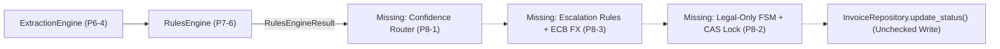
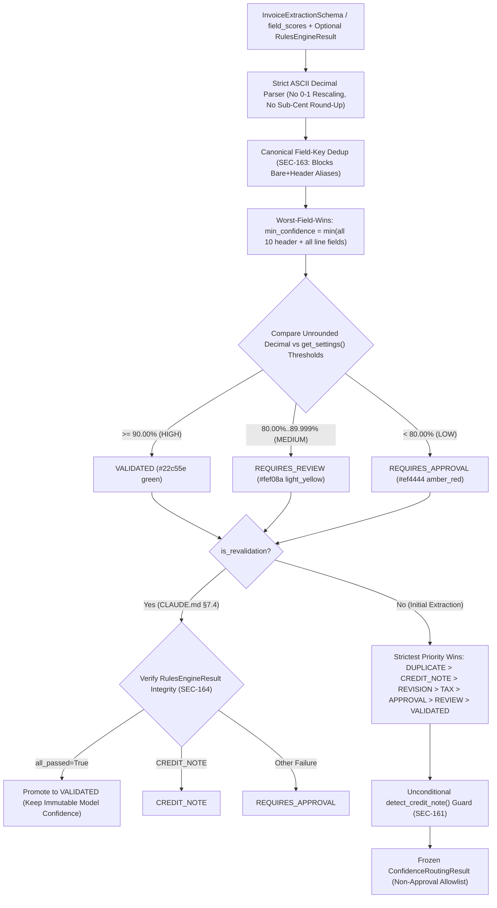
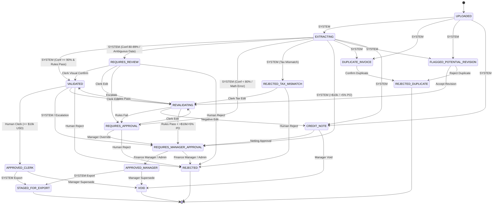
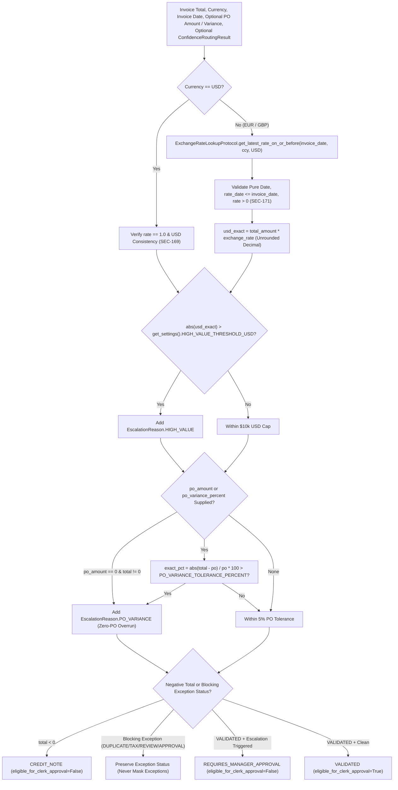
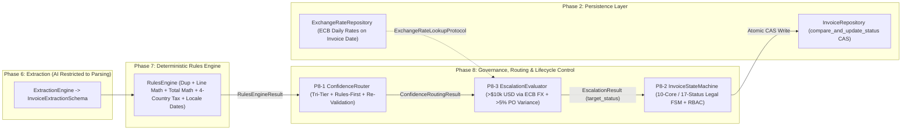

# Phase 8: Project System Design Evolution

> **Document Scope:** Architectural journey and system design evolution throughout **Phase 8 (Confidence Routing and State Machine — P8-1 through P8-3)**.  
> **Target Audience:** Solution Architects, Backend Leads, Staff Engineers, Financial Systems Engineers, and System Design Interviewers.

---

## 1. Phase 8 Mission & Architectural Baseline

Entering Phase 8, Phases 1–7 and Phase 10 were complete (**40 / 68 tasks · 59%**, **360 passing offline tests**, **160 mitigated security findings**):
- **Phase 6 (`src/extraction/`):** Produces strictly validated `InvoiceExtractionSchema` payloads with 10 header fields, 5 line-item fields per line, and `[0.00, 100.00]` per-field confidence scores.
- **Phase 7 (`src/validation/`):** Chains all 5 deterministic validators (`duplicate_detector.py`, `line_arithmetic.py`, `invoice_total.py`, `tax_validator.py`, `date_normalizer.py`) inside `RulesEngine`, returning an immutable `RulesEngineResult` with `all_passed`, `failed_rules`, `errors`, and `recommended_status`.

However, three critical orchestration and governance layers remained unbuilt at the end of Phase 7:
1. **Confidence Triage (`FR-04`, `BR-007`):** Translating per-field AI confidence scores + `RulesEngineResult` into tri-tier workflow routing (`VALIDATED` / `REQUIRES_REVIEW` / `REQUIRES_APPROVAL`) with UI colour metadata and re-validation promotion semantics.
2. **Lifecycle Integrity (`LLD §4`, `CLAUDE.md §5 & §16.1`):** Enforcing legal state transitions exclusively, preventing RBAC privilege escalation or worker self-approval, and persisting transitions atomically through `InvoiceRepository` without TOCTOU races (`CWE-362`).
3. **Financial Escalation (`FR-13`, `BR-012a`, `BR-014`):** Normalizing multi-currency totals to USD via invoice-date ECB daily exchange rates and enforcing configurable `HIGH_VALUE_THRESHOLD_USD` (`>\$10,000`) and `PO_VARIANCE_TOLERANCE_PERCENT` (`>5%`) Finance Manager escalation.

The mission of **Phase 8** was to close all three gaps while maintaining **100% deterministic Python**, **zero LLM or SQLAlchemy imports inside `src/validation/`**, and **all thresholds loaded dynamically from `get_settings()`**.

---

## 2. Progressive Evolution: Subtask-by-Subtask System Design

### 2.1 Stage 0: End of Phase 7 Baseline (Rules Pass/Fail Ready, No Routing / FSM / Escalation)

At the end of Phase 7, `RulesEngine` emitted pass/fail outcomes, and `InvoiceRepository` exposed raw `update_status()` without FSM legality checks or optimistic locking.

---

### 2.2 Stage 1 — P8-1: Tri-Tier Confidence Router (`src/validation/confidence_router.py`)

We designed `ConfidenceRouter`, `route_confidence_scores()`, and `route_extraction_confidence()` to combine worst-field-wins per-field confidence triage with Rules-First precedence and clerk re-validation semantics.

**Key Architectural Decisions in P8-1:**
- **Worst-Field-Wins vs. Macro Average:** `min_confidence` drives routing per `BR-007` and `PRD Journeys 2–4` (preventing a `97%` macro-average from masking a `74%` `total_amount`), while `macro_avg_confidence` and `header_macro_avg_confidence` are computed alongside for SQL persistence (`dbo.Invoices.confidence_macro_avg`).
- **Percentage-Scale Safety Floors (`SEC-162`):** `CONFIDENCE_HIGH_THRESHOLD` (`ge=60.0, le=100.0`) and `CONFIDENCE_MEDIUM_THRESHOLD` (`ge=50.0, lt=100.0`) live in `src/core/config.py` + `.env.example` and are double-checked inside `_resolve_thresholds()`, preventing `0.90`/`0.80` fraction-scale typos from auto-validating low-confidence OCR.
- **Re-Validation Promotion Without Altering Model Scores:** Honors `CLAUDE.md §7.4`—clerk edits do not mutate immutable AI confidence scores, yet passing deterministic rules promote the invoice from `REVALIDATING → VALIDATED` instead of trapping it in an infinite `REQUIRES_APPROVAL` loop.

---

### 2.3 Stage 2 — P8-2: Invoice Lifecycle Finite State Machine (`src/validation/state_machine.py` + Atomic Repository CAS)

We built the full 10-core / 17-status `InvoiceStateMachine` enforcing `LLD §4` through a deeply immutable `MappingProxyType` graph, strict RBAC transition guards, and atomic SQL compare-and-swap (`InvoiceRepository.compare_and_update_status()`).

**Key Architectural Decisions in P8-2:**
- **Zero SQLAlchemy Imports via Protocol (`CLAUDE.md §4.2`):** `InvoiceStateMachine` depends solely on `InvoiceStatusRepositoryProtocol` (satisfied directly by `InvoiceRepository`).
- **Optimistic-Locking CAS (`CWE-362`):** `InvoiceRepository.compare_and_update_status()` executes a single atomic conditional `UPDATE invoices SET status = :new WHERE invoice_id = :id AND status = :expected`, eliminating read-modify-write races and raising `ConcurrentStateTransitionError` (`HTTP 409`) if another worker/user changed the row concurrently.
- **Defense-in-Depth Business & RBAC Guards (`SEC-165`–`SEC-167`):** Even if an upstream API route forgets to enforce authorization, `InvoiceStateMachine` itself blocks `ap_clerk` approval on invoices `> HIGH_VALUE_THRESHOLD_USD` or unconverted non-USD invoices, blocks negative-balance promotion to regular states, and confines `ActorRole.SYSTEM` to an explicit `_SYSTEM_ALLOWED_TRANSITIONS` allowlist.

---

### 2.4 Stage 3 — P8-3: High-Value & PO-Variance Escalation Engine (`src/validation/escalation_rules.py`)

We built `EscalationEvaluator`, `evaluate_escalation()`, and `evaluate_extraction_escalation()` to execute `FR-13` / `BR-014` / `BR-012a` using dynamic `get_settings()` thresholds and invoice-date ECB daily exchange rates.

---

## 3. End-of-Phase 8 Complete Deterministic Validation & Governance Architecture

By the end of Phase 8, Phases 6, 7, and 8 connect into a seamless, zero-LLM-decision deterministic pipeline tested end-to-end across all **300 pilot ground-truth invoices** with zero crashes:

---

## 4. Evolution Metrics & Security Ledger Delta (Phase 7 → Phase 8)

| Dimension | End of Phase 7 | End of Phase 8 | Delta |
|---|---|---|---|
| **Completed Tasks** | 40 / 68 (59%) | **43 / 68 (63%)** | **+3 tasks (Phase 8 100% ✅)** |
| **Offline Passing Tests** | 360 tests (7.10s) | **538 tests (7.90s)** | **+178 new deterministic & pentest cases** |
| **Audited & Mitigated Findings** | 160 (`SEC-001`–`SEC-160`) | **172 (`SEC-001`–`SEC-172`)** | **+12 governance & CAS security controls** |
| **Formatted Python Files (Ruff)** | 90 files (0 errors) | **96 files (0 errors)** | **+6 files (`confidence_router`, `state_machine`, `escalation_rules` + 3 test suites)** |
| **External Dependencies Added** | 0 | **0** | Pure Python stdlib + Pydantic v2 + existing protocols |

