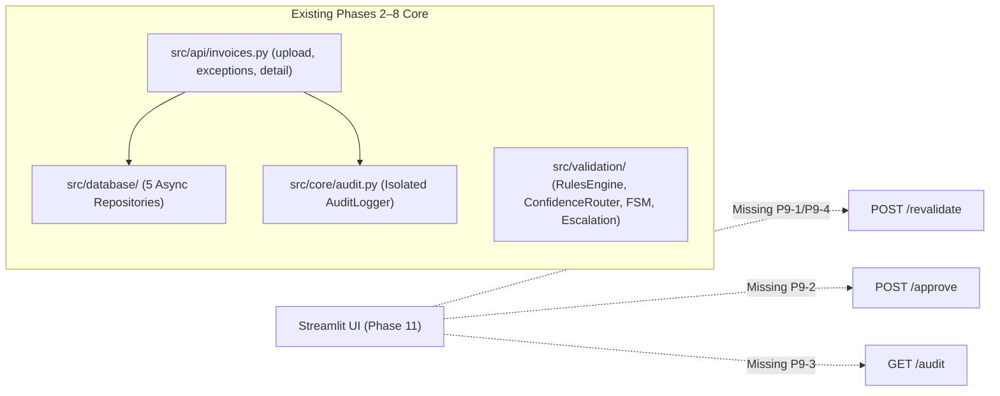
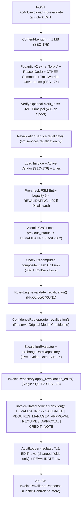
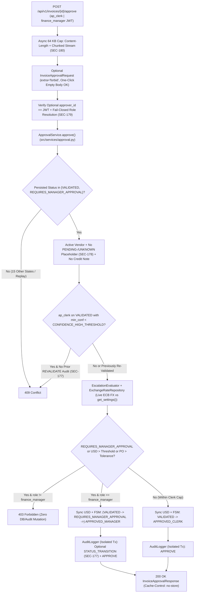
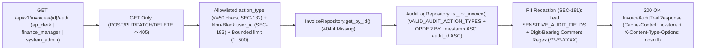
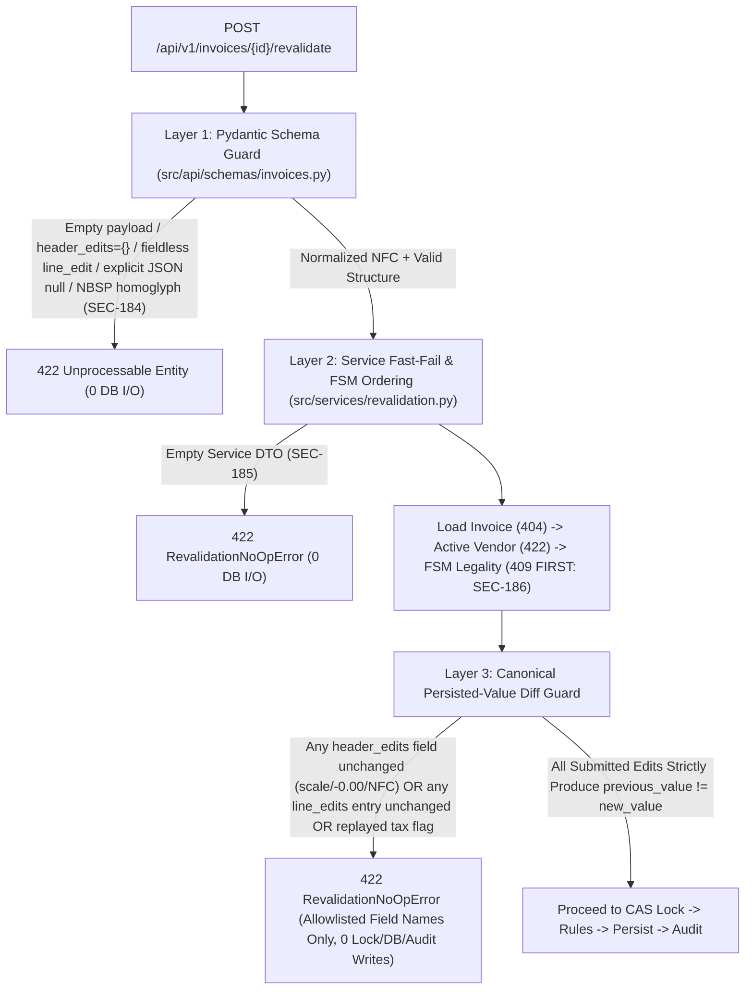
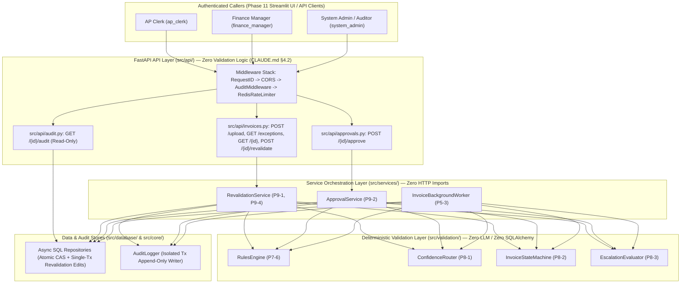

# Phase 9: Project System Design Evolution

> **Document Scope:** Architectural journey and system design evolution throughout **Phase 9 (Re-Validation and Approval API — P9-1 through P9-4)**.  
> **Target Audience:** Solution Architects, Backend Leads, Staff Engineers, Financial Systems Engineers, and System Design Interviewers.

---

## 1. Phase 9 Mission & Architectural Baseline

Entering Phase 9, Phases 1–8 and Phase 10 were complete (**43 / 68 tasks · 63%**, **538 passing offline tests**, **172 mitigated security findings**):
- **Phase 5 (`src/api/invoices.py`):** Exposed `POST /api/v1/invoices/upload`, `GET /api/v1/invoices/exceptions`, and `GET /api/v1/invoices/{id}`.
- **Phase 7 (`src/validation/`):** Built the 5 deterministic accounting validators chained inside `RulesEngine` (`validate_extraction` + `validate_revalidation`).
- **Phase 8 (`src/validation/`):** Built `ConfidenceRouter` (tri-tier routing + re-validation promotion), `InvoiceStateMachine` (17-status immutable FSM + SQL atomic CAS), and `EscalationEvaluator` (`>\$10k` USD via ECB FX + `>5%` PO variance).

What remained unbuilt at the end of Phase 8 was the **human-in-the-loop REST API & Service Orchestration Layer** connecting Phase 3 Entra ID RBAC, Phase 2 async SQL repositories, Phase 7/8 deterministic validation engines, and Phase 3 isolated-transaction audit logging—while strictly honoring `CLAUDE.md §4.2` layering rules (**zero validation logic inside `src/api/`, zero HTTP/FastAPI imports inside `src/services/`**).

---

## 2. Progressive Evolution: Subtask-by-Subtask System Design

### 2.1 Stage 0: End of Phase 8 Baseline (Engines Built, Human Action Endpoints Missing)

At the end of Phase 8, invoices could be uploaded, queued, extracted, validated, and read—but AP Clerks, Finance Managers, and Auditors had no HTTP routes to re-validate exceptions, execute role-gated approvals, or retrieve full audit trails.

---

### 2.2 Stage 1 — P9-1: Re-Validation Endpoint & Orchestration Service (`POST /api/v1/invoices/{id}/revalidate`)

We introduced a strict two-tier separation:
- **Thin API Controller (`src/api/invoices.py` + `src/api/schemas/invoices.py`):** Enforces `require_role(Role.AP_CLERK)`, 1 MB `Content-Length` fail-fast cap (`SEC-175`), `invoice_id` regex validation, anti-impersonation `clerk_id` JWT verification, and strict `extra="forbid"` Pydantic request schemas (`InvoiceRevalidateRequest`, `InvoiceHeaderEdits`, `InvoiceLineEdit`).
- **Orchestration Service (`src/services/revalidation.py`):** Owns the complete transactional workflow without importing FastAPI or HTTP libraries.
- **Atomic Persistence (`src/database/repositories.py::apply_revalidation_edits` — `SEC-173`):** Commits header + line edits in ONE SQL transaction verifying `expected_status == "REVALIDATING"`, field allowlists, and line ownership (`line.invoice_id == invoice_id`).

**Key Architectural Decisions in P9-1:**
- **Non-Wedging Lock Recovery:** Any failure while holding the transient `REVALIDATING` lock (such as a `composite_hash` collision or missing ECB FX rate) triggers `_restore_status_best_effort()` via atomic CAS (`expected_status="REVALIDATING" -> previous_status`), ensuring no invoice is ever left permanently stuck in `REVALIDATING`.
- **Immutable AI Confidence:** `confidence_macro_avg` and every line's `confidence_score` are snapshotted read-only and structurally excluded from `ALLOWED_REVALIDATION_HEADER_FIELDS` and `ALLOWED_REVALIDATION_LINE_FIELDS` (`CLAUDE.md §7.4`).

---

### 2.3 Stage 2 — P9-2: Dual-Key Approval Route & Service (`POST /api/v1/invoices/{id}/approve`)

We created dedicated approval modules matching `CLAUDE.md §3 (FR-13)` and `§4.3`: **`src/api/approvals.py`** (registered in `src/api/main.py`) and **`src/services/approval.py`** (`ApprovalService`).

**Key Architectural Decisions in P9-2:**
- **Live Authoritative FX Verification:** `ApprovalService` never trusts a potentially stale SQL `total_amount_usd` column; it recomputes exact USD totals via `EscalationEvaluator.evaluate_with_fx()` against `ExchangeRateRepository` on `invoice.invoice_date` and atomically syncs `total_amount_usd` if drifted.
- **BR-015 + PRD Journey 5 Reconciliation (`SEC-177`):** `ap_clerk` cannot one-click approve an unreviewed `< 90%` confidence invoice (`409`), yet *can* approve a `< 90%` invoice once a prior `REVALIDATE` audit event proves human review!
- **Isomorphic Two-Step Audit Trail (`SEC-177`):** When a `finance_manager` approves a high-value `VALIDATED` invoice directly, both `STATUS_TRANSITION` (`VALIDATED → REQUIRES_MANAGER_APPROVAL`) and `APPROVE` (`REQUIRES_MANAGER_APPROVAL → APPROVED_MANAGER`) are recorded in chronological order.

---

### 2.4 Stage 3 — P9-3: Immutable Audit Trail Route (`GET /api/v1/invoices/{id}/audit`)

We created **`src/api/audit.py`** (registered in `src/api/main.py`) and added **`AuditLogRepository.list_for_invoice()`** in `src/database/repositories.py`.

**Key Architectural Decisions in P9-3:**
- **Deterministic Ordering:** `ORDER BY AuditLog.timestamp ASC, AuditLog.audit_id ASC` guarantees stable chronological timelines even when multiple `EDIT` + `REVALIDATE` records share identical timestamps.
- **Precision PII Redaction (`SEC-181`):** Leaf-segment field matching (`header.vendor_tax_id` → `vendor_tax_id`) plus digit-bearing comment regex masks SSNs, US EINs, EU VAT IDs, and IBANs without ever corrupting uppercase status keywords (`VALIDATED`, `REVALIDATING`) or `[request_id=...]` correlation tags.

---

### 2.5 Stage 4 — P9-4: API & Service No-Op Edit Guard (`previous_value == new_value`)

We hardened the entire re-validation intake pipeline so no-op edits are blocked cleanly at **three defense-in-depth layers**—strictly preserving FSM-first error ordering (`409` before `422` to prevent approved-invoice value-guessing oracles: `SEC-186`):

---

## 3. End-of-Phase 9 Complete System Architecture

With all four Phase 9 subtasks merged (`47 / 68 tasks · 69%`), the complete FastAPI backend API surface (Phases 1–9) is now live and ready for Phase 11 Streamlit UI integration:

---

## 4. Evolution Metrics Summary (Phase 8 → Phase 9)

| Metric | End of Phase 8 | End of Phase 9 | Delta |
|---|---:|---:|---:|
| Completed Platform Tasks | 43 / 68 (63%) | **47 / 68 (69%)** | **+4 tasks (Phase 9 100% ✅)** |
| FastAPI Invoice Endpoints | 3 (`/upload`, `/exceptions`, `/{id}`) | **6** (`+/revalidate`, `+/approve`, `+/audit`) | **+3 production endpoints** |
| Service Orchestrators (`src/services/`) | 1 (`worker.py`) | **3** (`+revalidation.py`, `+approval.py`) | **+2 decoupled services** |
| Offline Passing Tests | 538 | **589** | **+51 Phase 9 tests** |
| Audited & Mitigated Security Findings | 172 (`SEC-001`–`SEC-172`) | **186 (`SEC-001`–`SEC-186`)** | **+14 findings closed** |
| Ruff Formatted Files | 96 (0 errors) | **104 (0 errors)** | **+8 files** |

